# LLD Notes: Part 3. UML & Class Diagrams (C++)

---

## Table of Contents

1. What is UML and why it matters in LLD interviews
2. Types of UML diagrams (overview)
3. Class diagram: anatomy of a class box
4. Visibility symbols and member notation
5. Relationships overview (the master table)
6. Dependency
7. Association (uni/bi-directional, multiplicity, roles)
8. Aggregation
9. Composition
10. Inheritance (Generalization)
11. Realization (Interface implementation)
12. Multiplicity (Cardinality) cheat sheet
13. Abstract classes, interfaces, enums, templates, static in UML
14. Class diagram to C++ code (mapping rules)
15. Full worked example: Library Management System
16. Sequence diagram
17. Use case diagram
18. Activity, State, and Component diagrams (brief)
19. How to draw UML in an LLD interview (step by step)
20. Common mistakes and how to avoid them
21. Interview Q&A
22. One-page cheat sheet

---

## 1. What is UML and why it matters

**UML (Unified Modeling Language)** = a standard **visual language** to describe the design of a software system. It is language-neutral; you draw once, then implement in C++/Java/Python.

**Why it shows up in LLD interviews**
- Fastest way to **communicate your design** before writing code.
- Shows the interviewer your **entities, relationships, and responsibilities** at a glance.
- Most LLD rounds expect at least a **rough class diagram**; some also ask for a **sequence diagram** of one key flow.

**What interviewers do NOT expect:** perfect notation. They expect **correct relationships** (is-a vs has-a vs uses), sensible **multiplicity**, and clean **responsibility split**.

> ⚡ **Quick Recall**
> UML = blueprint drawing. In LLD interviews: **class diagram (must)** + **sequence diagram (often)** + use case (sometimes, for requirements).

---

## 2. Types of UML diagrams (overview)

UML has **14 diagram types** in two families.

| Family | Diagram | What it shows | LLD relevance |
|---|---|---|---|
| **Structural** (static, "what exists") | **Class** | Classes, attributes, methods, relationships | ⭐⭐⭐ Always |
| | Object | Snapshot of instances at a moment | ⭐ Rare |
| | Component | Modules/libraries and dependencies | ⭐ HLD-ish |
| | Deployment | Hardware/servers layout | HLD |
| | Package | Grouping of classes | ⭐ Rare |
| | Composite structure | Internals of a class | Rare |
| **Behavioral** (dynamic, "what happens") | **Sequence** | Messages between objects over time | ⭐⭐ Often |
| | **Use case** | Actors and what they can do | ⭐⭐ Requirements |
| | **Activity** | Workflow / flowchart | ⭐ Sometimes |
| | **State machine** | Object states and transitions | ⭐⭐ (needed for State pattern, vending machine, ATM) |
| | Communication / Timing / Interaction overview | Variants | Rare |

---

## 3. Class Diagram: anatomy of a class box

A class is drawn as a **rectangle with 3 compartments**:

```
+---------------------------+
|        ClassName          |   <- 1) Name  (abstract = italic or <<abstract>>)
+---------------------------+
| - attribute1 : type       |   <- 2) Attributes (state)
| # attribute2 : type       |
+---------------------------+
| + method1(param:type):ret |   <- 3) Methods (behavior)
| - method2() : void        |
+---------------------------+
```

**Example**
```
+-----------------------------+
|         BankAccount         |
+-----------------------------+
| - accountNo : string        |
| - balance   : double        |
+-----------------------------+
| + deposit(amt: double): bool|
| + withdraw(amt: double):bool|
| + getBalance() : double     |
+-----------------------------+
```

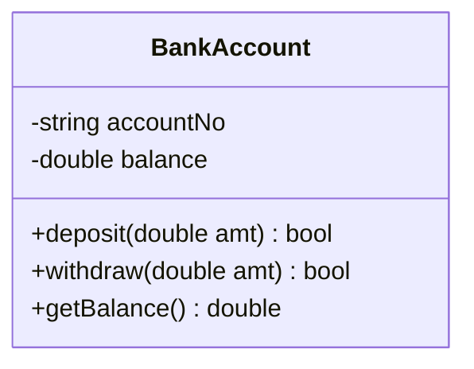

**C++ equivalent**
```cpp
class BankAccount {
    string accountNo;
    double balance;
public:
    bool deposit(double amt);
    bool withdraw(double amt);
    double getBalance() const;
};
```

**Notes**
- Attribute syntax: `visibility name : type [= default]` (e.g., `- balance : double = 0`)
- Method syntax: `visibility name(param : type, ...) : returnType`
- In interviews it is fine to **omit the attribute/method compartments** for classes that are not the focus (just show the name box).

---

## 4. Visibility Symbols and Member Notation

| Symbol | Meaning | C++ |
|---|---|---|
| `+` | public | `public:` |
| `-` | private | `private:` |
| `#` | protected | `protected:` |
| `~` | package (Java concept) | no direct equivalent |

| Notation | Meaning | C++ |
|---|---|---|
| <u>underlined</u> member (Mermaid: `$` suffix) | **static** | `static` |
| *italic* name or `{abstract}` | abstract class / pure virtual method | `= 0` |
| `/ derivedAttr` | derived/computed attribute | computed getter |
| `<<interface>>` | stereotype: interface | class with only pure virtuals |
| `<<enumeration>>` | stereotype: enum | `enum class` |
| `<<abstract>>` | stereotype: abstract class | class with a pure virtual |
| `{readOnly}` | constant attribute | `const` |

```
+-------------------------+
|     <<interface>>       |
|        IPayment         |
+-------------------------+
| + pay(amt: double):bool |     <- interface methods are abstract
+-------------------------+
```

---

## 5. Relationships Overview (the master table)

**This is the single most important table in Part 3.** Memorize the arrows.

| Relationship | Meaning | Strength | Line style | Arrowhead / marker | Reads as |
|---|---|---|---|---|---|
| **Dependency** | temporarily uses | weakest | **dashed** line | open arrow `- - - >` | "A **uses** B" |
| **Association** | knows / holds reference | weak | solid line | plain or open arrow `——>` | "A **knows** B" |
| **Aggregation** | has-a, part can live alone | medium | solid line | **hollow diamond** ◇ at the whole | "A **has** B (B independent)" |
| **Composition** | owns, part dies with whole | strong | solid line | **filled diamond** ◆ at the whole | "A **owns** B (B dies with A)" |
| **Inheritance (Generalization)** | is-a | strong | solid line | **hollow triangle** ▷ at parent | "B **is a** A" |
| **Realization** | implements interface | strong | **dashed** line | **hollow triangle** ▷ at interface | "B **implements** A" |

**Strength order (weak → strong):**
`Dependency < Association < Aggregation < Composition < Inheritance`

**ASCII cheat sheet**
```
Dependency    :  A - - - - - >  B
Association   :  A ----------->  B     (or  A ---------- B  for bidirectional)
Aggregation   :  Whole <>--------  Part          (<> = hollow diamond)
Composition   :  Whole <#>-------  Part          (<#> = filled diamond)
Inheritance   :  Child ---------|>  Parent       (|> = hollow triangle)
Realization   :  Impl - - - - -|>  <<interface>>
```

**Mermaid syntax cheat sheet**
```
A ..> B      dependency
A --> B      association (directed)
A -- B       association (plain)
A o-- B      aggregation   (diamond on A's side)
A *-- B      composition   (filled diamond on A's side)
A <|-- B     inheritance   (B extends A)
A <|.. B     realization   (B implements A)
```

> ⚡ **Quick Recall**
> **Diamond sits on the WHOLE side.** Hollow = weak ownership, filled = strong ownership. **Dashed** = weaker/looser (dependency, realization). **Triangle** = "is-a" family.

---

## 6. Dependency

**Meaning:** Class A **temporarily uses** class B. B is a method parameter, local variable, or return type. A does **not store** B as a member.

**Lifetime:** B is not owned or held. Relationship exists only during the method call.

**Notation:** dashed line with open arrow, from user to used.

```
Order  - - - - - >  EmailService
```

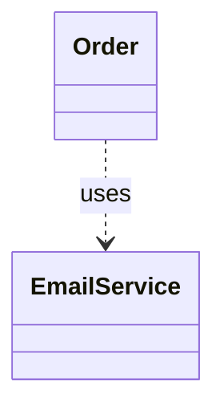

**C++ code**
```cpp
class EmailService {
public:
    void send(const string& to, const string& msg) { /* ... */ }
};

class Order {
public:
    void confirm(EmailService& mailer) {      // B as parameter → dependency
        mailer.send("user@x.com", "Order confirmed");
    }
    void printReceipt() {
        EmailService local;                   // B as local variable → dependency
        local.send("a@b.com", "receipt");
    }
};
```

**Interview points**
- Dependency = **"uses"**, no member variable.
- Changing B may break A (A depends on B's interface). Keep dependencies pointing to **abstractions** (DIP from Part 2).
- If A stores B as a field, it graduates to **association**.

---

## 7. Association

**Meaning:** A has a **long-lived reference** to B (as a member). Both have **independent lifetimes**. Neither owns the other.

**Notation:** solid line, optionally with an open arrow showing **navigability** (who knows whom).

### 7.1 Types

| Type | Notation | Meaning | C++ shape |
|---|---|---|---|
| **Unidirectional** | `A ------> B` | A knows B, B doesn't know A | `B* b;` in A |
| **Bidirectional** | `A -------- B` | Both know each other | `B* b;` in A and `A* a;` in B |
| **Self-association** | loop on A | Object relates to another of its own class (Employee → manager) | `Employee* manager;` |
| **Association class** | dashed line from the association to a class | The relationship itself has attributes (Student–Course → `Enrollment` with grade) | separate `Enrollment` class |

```
Teacher ------------------ Student          (bidirectional, both know each other)
Doctor  ------------------> Patient         (unidirectional, doctor knows patient)
```

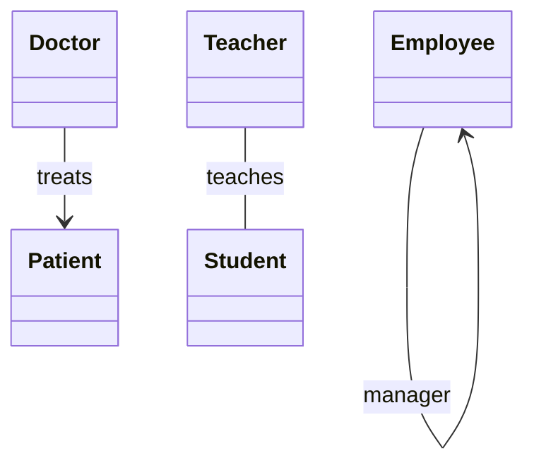

**C++ code**
```cpp
class Patient { string name; };

class Doctor {
    vector<Patient*> patients;     // holds references, does NOT own them
public:
    void addPatient(Patient* p) { patients.push_back(p); }
};
```

### 7.2 Association class (interview favorite)
When the *relationship* has its own data.
```
Student  1..* ------ 0..*  Course
                |
            Enrollment      <- association class: grade, enrolledOn
```
```cpp
class Enrollment {
    Student* student; Course* course;
    string grade; string enrolledOn;
};
```

### 7.3 Role names and labels
Write a verb or role on the line: `Doctor --treats--> Patient` or role `+manager`, `+reports`.

**Interview points**
- Association = **"knows / has reference to"** with **independent lifetime**.
- Always mark **multiplicity** on both ends (section 12).
- **Association vs Dependency:** association = stored as a **field** (long-lived); dependency = only in **method scope** (short-lived).

---

## 8. Aggregation

**Meaning:** "**has-a**" relationship where the **part can exist independently** of the whole. **Weak ownership.**

**Notation:** solid line with **hollow diamond ◇ on the whole (container) side**.

```
Department  <>---------------  Teacher
(whole)                        (part; survives if Department is deleted)
```

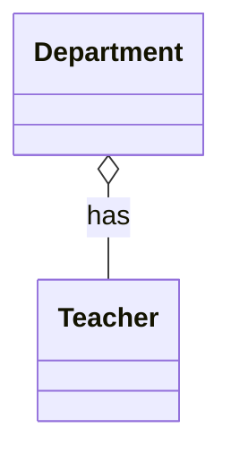

**Real-life examples**
- Department **has** Teachers (Teachers still exist if the department is dissolved).
- Team **has** Players. Library **has** Books. Playlist **has** Songs.

**C++ code**: the whole holds **non-owning** pointers/references or `shared_ptr`:
```cpp
class Teacher { string name; public: Teacher(string n) : name(n) {} };

class Department {
    vector<Teacher*> teachers;              // non-owning pointers (aggregation)
    // or: vector<shared_ptr<Teacher>> teachers;   // shared ownership
public:
    void addTeacher(Teacher* t) { teachers.push_back(t); }
    // ~Department does NOT delete teachers
};

int main() {
    Teacher t1("Rao");                      // created outside the department
    {
        Department cs;
        cs.addTeacher(&t1);
    }                                       // Department destroyed; t1 still alive ✅
}
```

**Interview points**
- Aggregation is **UML-optional**. Many designers just use association. It documents **intent** ("whole–part, but independent").
- Test: *"If I delete the whole, does the part still make sense?"* Yes → aggregation.

---

## 9. Composition

**Meaning:** "**owns-a / part-of**" relationship where the **part cannot exist without the whole**. **Strong ownership. Lifecycle is tied.** When the whole is destroyed, its parts are destroyed too.

**Notation:** solid line with **filled diamond ◆ on the whole side**.

```
House  <#>---------------  Room
(whole)                    (part; dies with the House)
```

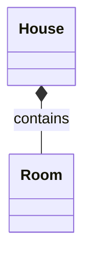

**Real-life examples**
- House **owns** Rooms. Human **owns** Heart. Order **owns** OrderLineItems. Chessboard **owns** Squares. Car **owns** Engine (in a strict model).

**C++ code**: the whole holds parts **by value** or via `unique_ptr`:
```cpp
class Room { public: string name; };

class House {
    vector<Room> rooms;                     // by value → composition
    // or: vector<unique_ptr<Room>> rooms;  // exclusive ownership
public:
    void addRoom(string n) { rooms.push_back({n}); }
};   // ~House automatically destroys rooms ✅
```

**Interview points**
- Test: *"If I delete the whole, must the part go too?"* Yes → composition.
- **C++ shapes:** by-value member or `unique_ptr` → composition; raw/`shared_ptr` to independent object → aggregation/association.
- A part in composition belongs to **exactly one** whole (multiplicity on the whole side is `1`).

### Aggregation vs Composition (asked very often)

| | Aggregation | Composition |
|---|---|---|
| Ownership | Weak / shared | Strong / exclusive |
| Part's lifetime | Independent | Dies with whole |
| Diamond | Hollow ◇ | Filled ◆ |
| Can a part be shared? | Yes | No (one owner) |
| Example | Team–Player | Human–Heart |
| C++ | pointer / `shared_ptr` | member by value / `unique_ptr` |

> ⚡ **Quick Recall**
> **Aggregation**: "Department has Teachers": delete dept, teachers live. **Composition**: "House has Rooms": delete house, rooms die.
> **Same test for all three:** *delete the container; does the contained thing still make sense?*

---

## 10. Inheritance (Generalization)

**Meaning:** **is-a** relationship. Child (specialization) inherits from Parent (generalization).

**Notation:** solid line with a **hollow triangle ▷ pointing at the parent**.

```
        +----------+
        |  Vehicle |
        +----------+
             ^
       ______|______
      |             |
  +-------+    +--------+
  |  Car  |    |  Bike  |
  +-------+    +--------+
```

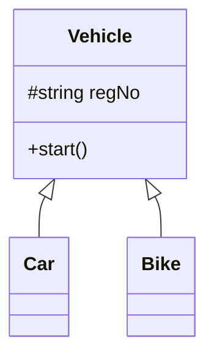

**C++ code**
```cpp
class Vehicle { protected: string regNo; public: virtual void start() = 0; virtual ~Vehicle() = default; };
class Car  : public Vehicle { public: void start() override { /* ... */ } };
class Bike : public Vehicle { public: void start() override { /* ... */ } };
```

**Interview points**
- Arrow direction: **from child to parent** (points to the general class).
- Use only when the child truly **honors the parent's contract** (LSP, Part 2).
- **Multiple inheritance**: two arrows from one child to two parents; prefer inheriting **interfaces** only.
- Abstract parent name is *italicized* or tagged `<<abstract>>`.

---

## 11. Realization (Interface Implementation)

**Meaning:** A class **implements** the contract defined by an interface.

**Notation:** **dashed** line with a **hollow triangle ▷ pointing at the interface**.

```
   <<interface>>
     IPayment
        ^
        ¦   (dashed)
   _____¦______
  |            |
 UPI       CreditCard
```

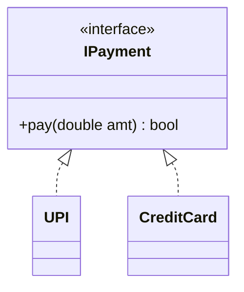

**C++ code**
```cpp
class IPayment { public: virtual bool pay(double amt) = 0; virtual ~IPayment() = default; };
class UPI        : public IPayment { public: bool pay(double a) override { return true; } };
class CreditCard : public IPayment { public: bool pay(double a) override { return true; } };
```

**Inheritance vs Realization:** inheritance (solid) = extends a **class** (may inherit implementation and state). Realization (dashed) = implements a pure **contract**.

---

## 12. Multiplicity (Cardinality) Cheat Sheet

Written at each end of an association-type line. It answers: **"How many objects of this class are linked to one object on the other end?"**

| Notation | Meaning | C++ shape |
|---|---|---|
| `1` | exactly one | `T t;` / `T& t;` |
| `0..1` | zero or one (optional) | `T* t;` / `optional<T>` |
| `*` or `0..*` | zero or more | `vector<T>` |
| `1..*` | one or more (at least one) | `vector<T>` + non-empty invariant |
| `n` | exactly n | `array<T,n>` |
| `m..n` | between m and n | `vector<T>` with bounds check |

**How to read it**
```
Customer  1 --------- 0..*  Order
```
"One Customer can have **zero or more** Orders; each Order belongs to **exactly one** Customer."

**Read the far end:** the number **near a class** says how many of **that class** relate to one instance of the other.

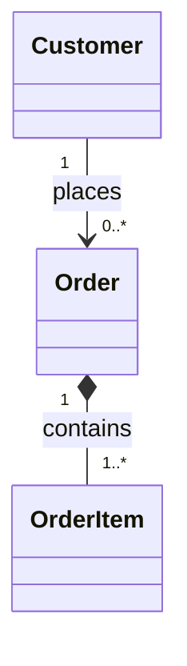

**Common LLD multiplicities**
| Relationship | Multiplicity |
|---|---|
| User – Account | 1 to 1..* |
| Order – OrderItem (composition) | 1 to 1..* |
| Student – Course | * to * (use association class `Enrollment`) |
| Parking Lot – Floors | 1 to 1..* |
| Movie – Show | 1 to 0..* |
| Employee – Manager | * to 0..1 |

**Many-to-many rule:** in code, a pure many-to-many is usually resolved by an **association class** in the middle (Student–Enrollment–Course).

---

## 13. Abstract Classes, Interfaces, Enums, Templates, Static in UML

### Abstract class
```
+---------------------+
|  <<abstract>>       |         (or name in italics)
|      Shape          |
+---------------------+
| + area() : double   |  {abstract}  or italic
+---------------------+
```
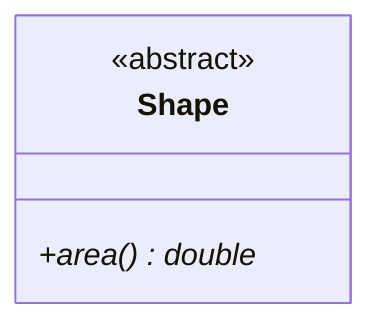
The `*` after a method in Mermaid marks it abstract, and `$` marks it static.

### Interface
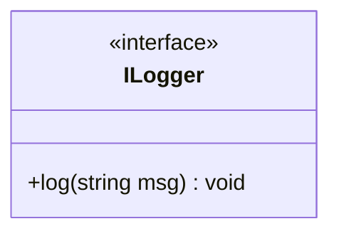

### Enumeration
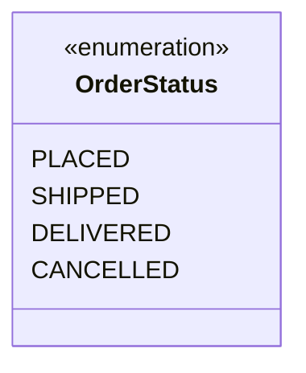
```cpp
enum class OrderStatus { PLACED, SHIPPED, DELIVERED, CANCELLED };
```

### Static members
`<u>counter : int</u>` (underlined). Mermaid: `+int counter$` for static attribute, `+getInstance()$ Singleton` for static method.

### Template (generic) class
```
+---------+
| T       |   <- dashed box at top-right corner holds the type parameter
+---------+---------+
|   Stack<T>        |
+-------------------+
```
```cpp
template <typename T> class Stack { vector<T> data; public: void push(T x); T pop(); };
```

### Notes / constraints
`{ }` braces hold constraints, e.g., `{balance >= 0}`, `{ordered}`. A **note** is a folded-corner box attached with a dotted line.

---

## 14. Class Diagram to C++ Code (Mapping Rules)

| UML | C++ translation |
|---|---|
| Class | `class Name { ... };` |
| `- attr : T` | private member `T attr;` |
| `+ op(p:T) : R` | public member function `R op(T p);` |
| `<<interface>>` | class with only pure virtuals + virtual dtor |
| `<<abstract>>` | class with ≥ 1 pure virtual |
| Inheritance ▷ | `class Child : public Parent` |
| Realization ┄▷ | `class Impl : public IFace` |
| Dependency ┄> | parameter / local variable / return type of that class |
| Association → | member `B* b;` or `B& b;` (non-owning) |
| Association with `0..*` | `vector<B*> bs;` |
| Aggregation ◇ | `vector<B*>` or `vector<shared_ptr<B>>` (part independent) |
| Composition ◆ | member `B b;` or `unique_ptr<B>` or `vector<B>` (part owned) |
| Multiplicity `0..1` | `B*` / `optional<B>` |
| Association class | separate class holding both pointers + extra attributes |
| Enum stereotype | `enum class` |
| Static (underlined) | `static` member |
| Template | `template<typename T>` |

**Ownership decision guide for C++**
```
Does A own B's lifetime?
├── Yes, exclusively   → member by value  /  unique_ptr<B>          (composition)
├── Yes, but shared    → shared_ptr<B>                              (shared aggregation)
└── No                 → B* / B&  (non-owning), or weak_ptr<B>      (association / aggregation)
```

---

## 15. Full Worked Example: Library Management System

### Requirements (typical interview prompt)
- A **Library** has many **Books** (multiple copies) and many **Members**.
- A **Member** can **borrow** several **BookItems** (physical copies); each borrow has a due date.
- **Librarian** manages the catalog. Fines apply on late returns.
- Notifications are sent via email or SMS.

### Step 1: Extract nouns → candidate classes
`Library, Book, BookItem, Member, Librarian, Loan, Fine, Notification, Account`

### Step 2: Decide relationships
| Pair | Relationship | Why |
|---|---|---|
| Library ◇→ BookItem | Aggregation | items can be transferred/exist independent of the library object |
| Book 1 —— 1..* BookItem | Composition | copies exist only for a given Book title in this model |
| Member 1 —— 0..* Loan | Association | member and loans have independent lifecycle records |
| Loan → BookItem | Association | loan references the physical copy |
| Member / Librarian ▷ Person | Inheritance | both are people with name/email |
| Loan ..> Fine | Dependency | fine computed on return, not stored permanently in this simplified model |
| EmailNotifier / SMSNotifier ┄▷ INotifier | Realization | pluggable strategy (DIP + OCP) |
| Member ..> INotifier | Dependency | receives notifier as a parameter |

### Step 3: Class diagram

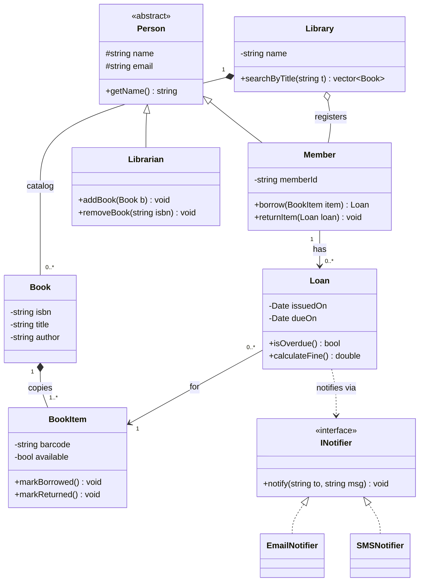

**ASCII version (for notes)**
```
                 +---------------+
                 |   <<abstract>>|
                 |     Person    |
                 +---------------+
                    ^         ^
                    |         |
             +--------+   +-----------+
             | Member |   | Librarian |
             +--------+   +-----------+
               | 1
               | has
               | 0..*
             +------+  0..*        1  +----------+
             | Loan |---------------->| BookItem |
             +------+                 +----------+
                :                          ^ 1..*
                : (dep)                    | (composition ◆ at Book)
                v                        +------+
           <<interface>>                 | Book |  <◆ Library (1 -> 0..*)
            INotifier                    +------+
              ^      ^
              :      :   (realization)
       EmailNotifier  SMSNotifier
```

### Step 4: Translate to C++ (skeleton)

```cpp
#include <bits/stdc++.h>
using namespace std;

// ---------- Interface + implementations (Realization) ----------
class INotifier {
public:
    virtual void notify(const string& to, const string& msg) = 0;
    virtual ~INotifier() = default;
};
class EmailNotifier : public INotifier {
public: void notify(const string& to, const string& msg) override { cout << "Email to " << to << ": " << msg << "\n"; }
};
class SMSNotifier : public INotifier {
public: void notify(const string& to, const string& msg) override { cout << "SMS to " << to << ": " << msg << "\n"; }
};

// ---------- Book & BookItem (Composition: Book owns its copies) ----------
class BookItem {
    string barcode; bool available = true;
public:
    explicit BookItem(string b) : barcode(std::move(b)) {}
    bool isAvailable() const { return available; }
    void markBorrowed()  { available = false; }
    void markReturned()  { available = true; }
    const string& getBarcode() const { return barcode; }
};

class Book {
    string isbn, title, author;
    vector<BookItem> copies;                      // composition: by value
public:
    Book(string i, string t, string a) : isbn(std::move(i)), title(std::move(t)), author(std::move(a)) {}
    void addCopy(const string& barcode) { copies.emplace_back(barcode); }
    BookItem* findAvailableCopy() {
        for (auto& c : copies) if (c.isAvailable()) return &c;
        return nullptr;
    }
    const string& getTitle() const { return title; }
    const string& getIsbn()  const { return isbn; }
};

// ---------- Loan (Association to BookItem, Dependency on INotifier) ----------
class Loan {
    BookItem* item;                               // association: non-owning pointer
    int issuedDay, dueDay;
public:
    Loan(BookItem* it, int issued, int loanDays) : item(it), issuedDay(issued), dueDay(issued + loanDays) {}
    bool isOverdue(int today) const { return today > dueDay; }
    double calculateFine(int today) const { return isOverdue(today) ? (today - dueDay) * 2.0 : 0.0; }
    BookItem* getItem() const { return item; }
};

// ---------- Person hierarchy (Inheritance) ----------
class Person {
protected:
    string name, email;
public:
    Person(string n, string e) : name(std::move(n)), email(std::move(e)) {}
    virtual ~Person() = default;
    const string& getEmail() const { return email; }
};

class Member : public Person {
    string memberId;
    vector<Loan> loans;                           // association 1 -> 0..*
public:
    Member(string id, string n, string e) : Person(n, e), memberId(std::move(id)) {}

    bool borrow(Book& book, int today) {
        BookItem* copy = book.findAvailableCopy();
        if (!copy) return false;
        copy->markBorrowed();
        loans.emplace_back(copy, today, 14);
        return true;
    }

    // Dependency: INotifier only used inside this call (parameter), not stored
    void returnItem(size_t loanIdx, int today, INotifier& notifier) {
        Loan& l = loans.at(loanIdx);
        double fine = l.calculateFine(today);
        l.getItem()->markReturned();
        if (fine > 0) notifier.notify(email, "Overdue fine: Rs " + to_string(fine));
        loans.erase(loans.begin() + loanIdx);
    }
};

class Librarian : public Person {
public:
    using Person::Person;
    void addBook(vector<Book>& catalog, Book b) { catalog.push_back(std::move(b)); }
};

int main() {
    vector<Book> catalog;
    Librarian lib("Sita", "sita@lib.com");
    Book b("ISBN-1", "Clean Code", "Robert Martin");
    b.addCopy("BC-001"); b.addCopy("BC-002");
    lib.addBook(catalog, std::move(b));

    Member m("M1", "Ravi", "ravi@x.com");
    m.borrow(catalog[0], /*today=*/1);

    EmailNotifier email;
    m.returnItem(0, /*today=*/20, email);        // 5 days late → fine notification
}
```

### Step 5: Talking points (say these aloud in the interview)
- "`Book` **composes** `BookItem` because a copy has no meaning outside its title."
- "`Loan` only **associates** with `BookItem`; the item exists independently of the loan."
- "`INotifier` is an **abstraction** so I can add WhatsApp without touching `Member` (OCP + DIP)."
- "`Member` **depends** on `INotifier` only during return, so it is a dependency, not a field."

---

## 16. Sequence Diagram

**Purpose:** show **how objects interact over time** for **one scenario** (a use case flow). Answers: *"In what order do objects call each other?"*

### 16.1 Elements

| Element | Notation | Meaning |
|---|---|---|
| **Participant / Lifeline** | box at top + vertical dashed line down | An object/actor taking part |
| **Actor** | stick figure | External user/system |
| **Activation bar** | thin rectangle on lifeline | Object is executing |
| **Synchronous message** | solid line, filled arrowhead `——▶` | Caller waits for the response |
| **Asynchronous message** | solid line, open arrowhead `——>` | Caller doesn't wait |
| **Return message** | dashed line, open arrowhead `<- - -` | Response/return value |
| **Self-call** | arrow looping back to same lifeline | Object calls its own method |
| **Object creation** | arrow to a box placed lower, `<<create>>` | `new` |
| **Object destruction** | large **X** at lifeline end | Deleted |
| **Alt (if/else)** | frame labeled `alt` with `[cond]` sections | Conditional |
| **Opt (if)** | frame labeled `opt` | Optional |
| **Loop** | frame labeled `loop` | Repetition |
| **Par** | frame labeled `par` | Parallel |
| **Ref** | frame labeled `ref` | Refers to another diagram |

### 16.2 Example: Borrow a book

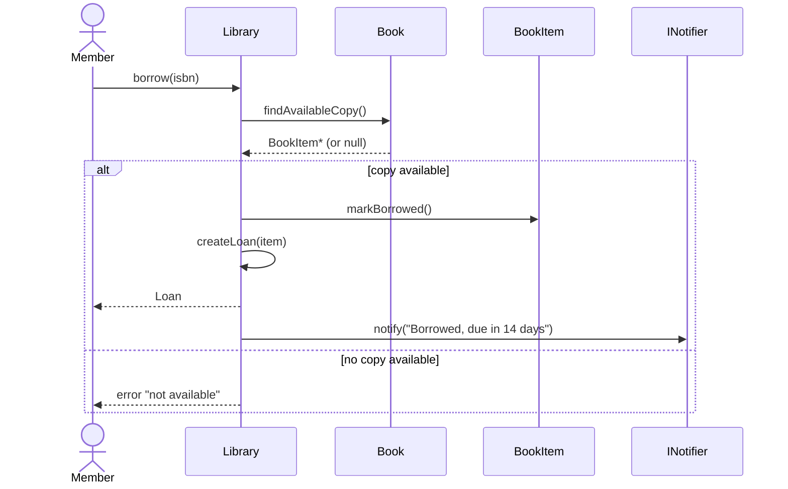

**ASCII version**
```
 Member          Library            Book           BookItem        INotifier
   |  borrow(isbn)  |                 |                |               |
   |--------------->|                 |                |               |
   |                | findAvailable() |                |               |
   |                |---------------->|                |               |
   |                |<- - - - - - - - |                |               |
   |          [alt: copy available]                                     |
   |                | markBorrowed()  |                |               |
   |                |------------------------------->  |               |
   |                | createLoan()    |                |               |
   |                |-------+         |                |               |
   |                |<------+         |                |               |
   |<- - - Loan - - |                 |                |               |
   |                | notify("...")   |                |               |
   |                |----------------------------------------------->  |
   |          [else: no copy]                                           |
   |<- - error - - -|                 |                |               |
```

### 16.3 Interview points
- **Class diagram = structure (static).** **Sequence diagram = behavior of one flow (dynamic).**
- Draw it **after** the class diagram to *validate* that your methods exist and responsibilities make sense. If a message has no corresponding method, your class diagram is incomplete.
- Keep to **one scenario** (e.g., "book a ticket", "withdraw cash", "park a vehicle").
- Time flows **top to bottom**.

---

## 17. Use Case Diagram

**Purpose:** capture **requirements**: *who* (actors) can do *what* (use cases) with the system. It is drawn **first** in the design process, from a user's point of view.

### 17.1 Elements

| Element | Notation |
|---|---|
| **Actor** | stick figure (a role: Customer, Admin, Payment Gateway) |
| **Use case** | oval with a verb phrase ("Borrow Book") |
| **System boundary** | rectangle enclosing the use cases |
| **Association** | line between actor and use case |
| **`<<include>>`** | dashed arrow: base use case **always** invokes the included one (mandatory reuse) |
| **`<<extend>>`** | dashed arrow: optional/conditional extra behavior |
| **Generalization** | actor or use case inheritance (`PremiumMember ▷ Member`) |

### 17.2 Example: Library

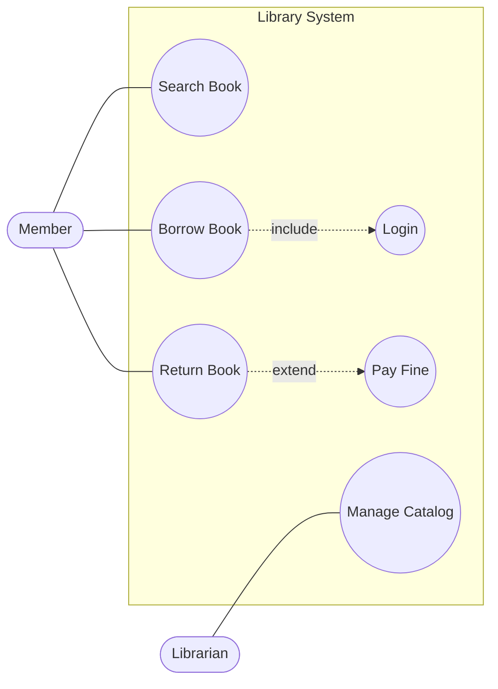
(Mermaid has no native use case syntax, so a flowchart is used to mimic it.)

### 17.3 include vs extend

| | `<<include>>` | `<<extend>>` |
|---|---|---|
| Nature | **Mandatory**: always executed | **Optional**: only under a condition |
| Arrow points | base → included | extension → base |
| Example | Borrow Book **includes** Login | Return Book **is extended by** Pay Fine (only if late) |
| Purpose | Factor out shared steps | Add conditional behavior |

> ⚡ **Quick Recall**
> **include = always** (base calls it). **extend = sometimes** (extension adds itself to base when a condition holds).

---

## 18. Activity, State, and Component Diagrams (brief)

### Activity diagram (workflow / flowchart)
- **Notation:** filled circle = start, rounded rectangles = actions, diamond = decision, thick bar = fork/join (parallel), circled dot = end.
- **Use for:** business workflows (order fulfillment, ATM withdrawal steps).

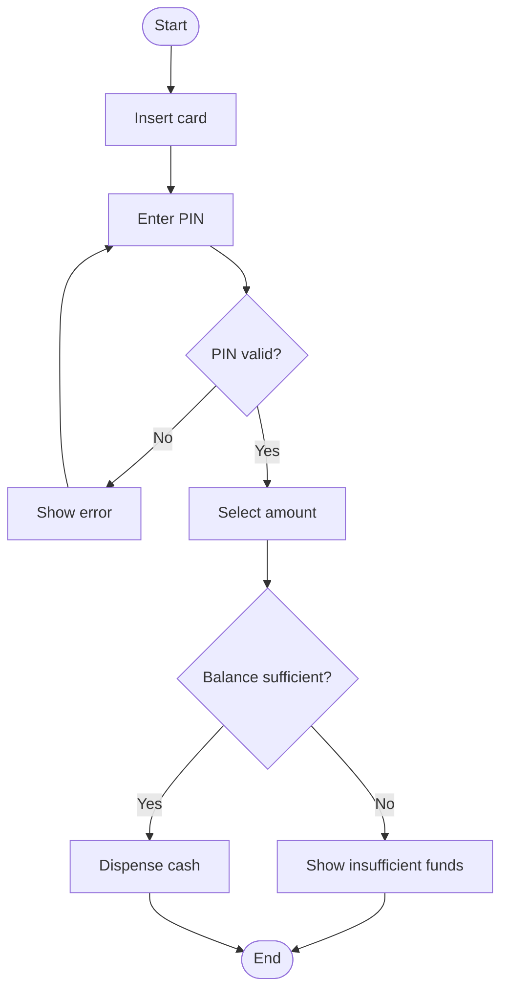

### State machine diagram (very relevant for LLD)
- **Notation:** rounded boxes = states, arrows = transitions labeled `event [guard] / action`, filled circle = initial, bullseye = final.
- **Use for:** objects whose behavior depends on state → **Vending machine, ATM, Order lifecycle, Traffic light, Elevator**. This maps directly to the **State design pattern**.

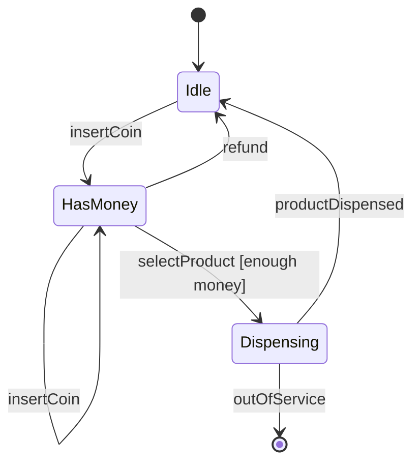

### Component diagram
Shows **modules/libraries** and the interfaces between them (provided `○` and required `◐` interfaces). Closer to HLD; rarely drawn in LLD rounds.

---

## 19. How to Draw UML in an LLD Interview (step by step)

1. **Clarify requirements.** Ask 3-5 questions: scale, actors, must-have vs nice-to-have. Write them as bullet points (or a quick **use case list**).
2. **Identify entities** (nouns) → candidate classes. Identify **actions** (verbs) → candidate methods.
3. **Assign responsibilities** (SRP). Each class one purpose.
4. **Decide relationships**, using the test:
   - Stored as field, independent lifetime → **association**
   - Whole–part, part independent → **aggregation**
   - Whole–part, part dies with whole → **composition**
   - Only a parameter/local → **dependency**
   - Is-a with contract kept → **inheritance**
   - Implements a contract → **realization**
5. **Find variation points** (payment types, pricing, vehicle types) → introduce **interfaces/abstract classes** (OCP, DIP) and name the **design pattern** (Strategy, Factory, Observer...).
6. **Add multiplicity** on every association-type line.
7. **Draw the class diagram** (core classes only; skip getters/setters, list key methods).
8. **Walk one flow** through a **sequence diagram** to validate.
9. **Write the code** (C++ skeleton), following the diagram.
10. **State trade-offs** and extension points ("to add a new vehicle type, add a subclass; nothing else changes").

**Time budget (45 min):** requirements 5, entities/relationships 10, diagram 8, code 17, extension discussion 5.

---

## 20. Common Mistakes and How to Avoid Them

| Mistake | Why it's wrong | Fix |
|---|---|---|
| **Diamond on the wrong end** | Diamond always sits on the **whole** | Put ◆/◇ next to the container |
| **Inheritance arrow reversed** | Arrow points **to the parent** | Child ──▷ Parent |
| **Using inheritance for "has-a"** | Car does not "is-a" Engine | Use composition |
| **Everything is an association** | Loses ownership/lifetime info | Decide aggregation vs composition deliberately |
| **Missing multiplicity** | Ambiguous (one or many?) | Mark both ends |
| **God class** (one class with 30 methods) | Violates SRP | Split by responsibility |
| **Dependency drawn as solid line** | Dependency is **dashed** | Dashed open arrow |
| **Drawing getters/setters** | Clutters the diagram | Show only meaningful behaviors |
| **Concrete-to-concrete dependencies** | Tight coupling | Depend on interfaces |
| **Mixing implementation detail with design** | Overloaded diagram | Keep it at the right abstraction level |
| **Bidirectional association everywhere** | Circular dependency, harder to maintain | Prefer unidirectional, navigate one way |
| **Forgetting enums for statuses** | Magic strings/ints | Use `<<enumeration>>` |

---

## 21. Interview Q&A

**Q1. Difference between association, aggregation, and composition?**
Association: A knows B, independent. Aggregation: whole–part, part independent (◇). Composition: whole–part, part dies with whole (◆). Show a one-line example for each.

**Q2. How do you show an interface in UML?**
A class box tagged `<<interface>>`; implementers connect with a **dashed line + hollow triangle** (realization).

**Q3. Difference between inheritance and realization?**
Inheritance: solid line, class extends class. Realization: dashed line, class implements an interface.

**Q4. Dependency vs association?**
Dependency: temporary use (parameter/local), dashed. Association: stored as a member, long-lived, solid.

**Q5. What does multiplicity `1..*` mean?**
At least one, no upper limit.

**Q6. How do you model many-to-many?**
Association with `*` on both ends, usually resolved by an **association class** (Student–Enrollment–Course).

**Q7. How does a class diagram map to C++?**
See section 14: composition = by-value/`unique_ptr`, aggregation = pointer/`shared_ptr`, realization = pure-virtual base, and so on.

**Q8. Class diagram vs sequence diagram?**
Class = static structure. Sequence = dynamic interaction order for one scenario.

**Q9. Which UML diagrams do you draw in an LLD interview?**
Class diagram always; sequence diagram for a key flow; state diagram for state-driven systems (vending machine, ATM, elevator); use cases for requirements.

**Q10. `<<include>>` vs `<<extend>>`?**
Include = mandatory shared behavior. Extend = optional conditional behavior.

**Q11. How do you represent an abstract class?**
`<<abstract>>` stereotype, or italic class name, with italic abstract methods.

**Q12. What is an association class?**
A class attached to an association that stores attributes of the relationship itself (e.g., `Enrollment.grade`).

**Q13. When would you choose aggregation over composition in C++?**
When the part is created/owned elsewhere or shared (`shared_ptr` / raw non-owning pointer); composition when the whole should exclusively own and destroy the part (member by value / `unique_ptr`).

**Q14. What does a filled arrowhead vs open arrowhead mean in a sequence diagram?**
Filled = synchronous call (caller waits). Open = asynchronous call. Dashed line = return.

**Q15. How do you decide the arrow direction of an association?**
Point to the class that **is known/navigated to**. If both need to navigate, bidirectional, but avoid it unless necessary.

---

## 22. One-Page Cheat Sheet

```
CLASS BOX      : [Name] / [- attrs : type] / [+ methods(params) : ret]
VISIBILITY     : + public   - private   # protected      <<interface>> <<abstract>> <<enumeration>>
STATIC         : underlined (Mermaid: $)          ABSTRACT: italic / {abstract} (Mermaid: *)

RELATIONSHIPS (weak -> strong)
  Dependency   : A - - - > B      uses temporarily (param/local)               dashed, open arrow
  Association  : A ------> B      holds reference (field), independent life    solid
  Aggregation  : W <>----- P      has-a, part survives                         hollow diamond on WHOLE
  Composition  : W <#>---- P      owns, part dies with whole                   filled diamond on WHOLE
  Inheritance  : C -----|> P      is-a                                         solid + hollow triangle -> parent
  Realization  : I - - -|> Iface  implements contract                          dashed + hollow triangle -> interface

MERMAID        : ..>  -->  o--  *--  <|--  <|..

MULTIPLICITY   : 1 | 0..1 | * (0..*) | 1..* | m..n      -> label BOTH ends

C++ MAPPING
  Composition  -> member by value / unique_ptr / vector<T>
  Aggregation  -> B* / shared_ptr<B> / vector<B*>
  Association  -> B* / B&
  Dependency   -> parameter / local variable
  Inheritance  -> class C : public P          Realization -> class Impl : public IFace

SEQUENCE       : lifelines top->bottom, solid arrow = call, dashed = return, frames: alt / opt / loop / par
USE CASE       : actors + ovals; include = always, extend = sometimes
STATE          : states + transitions (event [guard] / action)  -> State pattern (vending machine, ATM, elevator)

INTERVIEW FLOW : requirements -> nouns (classes) -> responsibilities (SRP) -> relationships ->
                 variation points (interface + pattern) -> multiplicity -> class diagram ->
                 sequence diagram -> C++ code -> extension discussion
TEST           : delete the container: does the part still make sense?
                 Yes = aggregation | No = composition | It only got passed in = dependency
```

---
