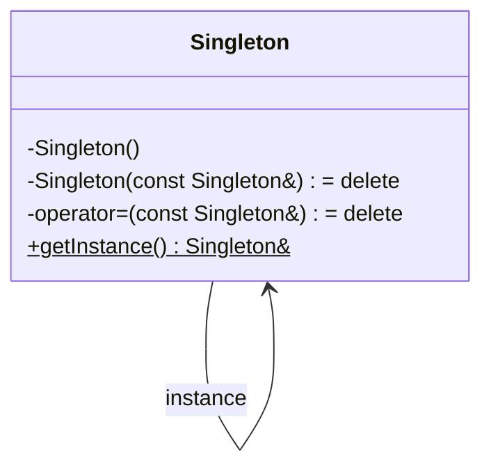
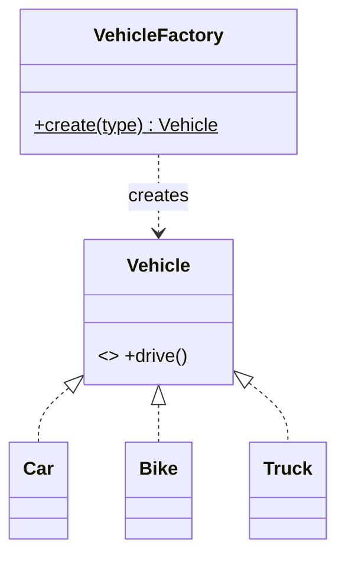
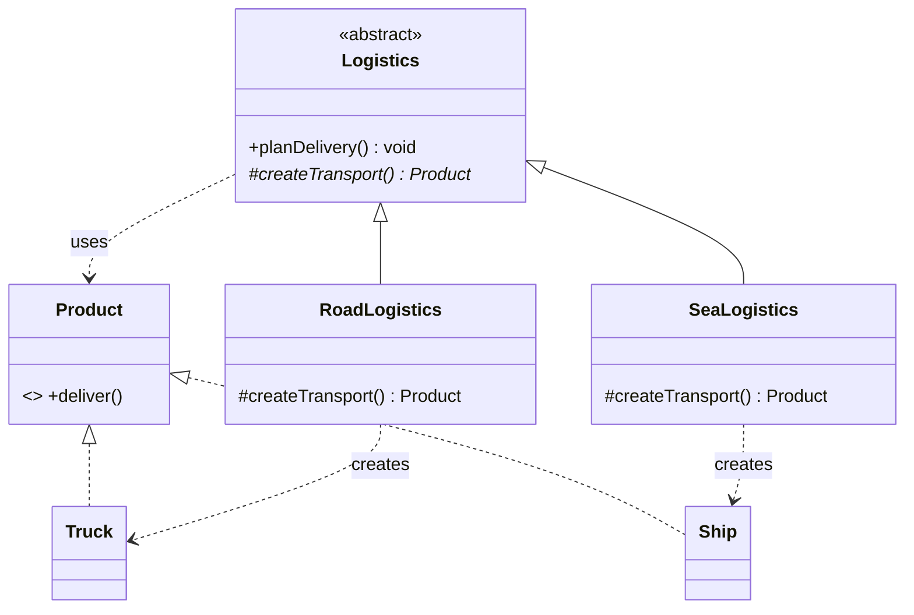
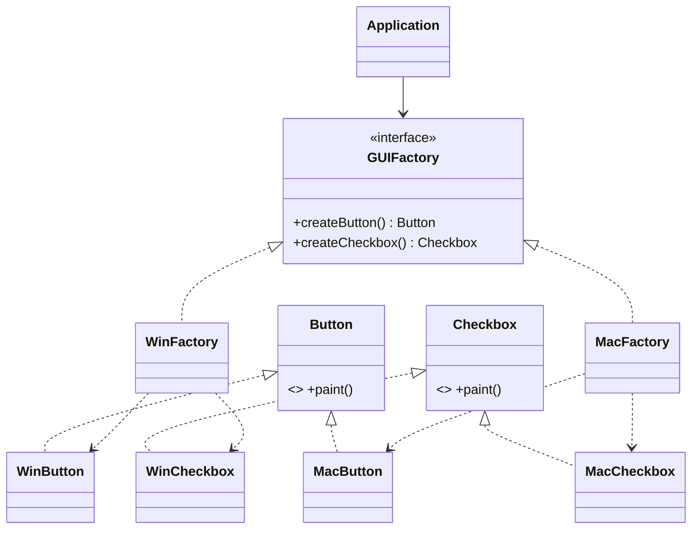
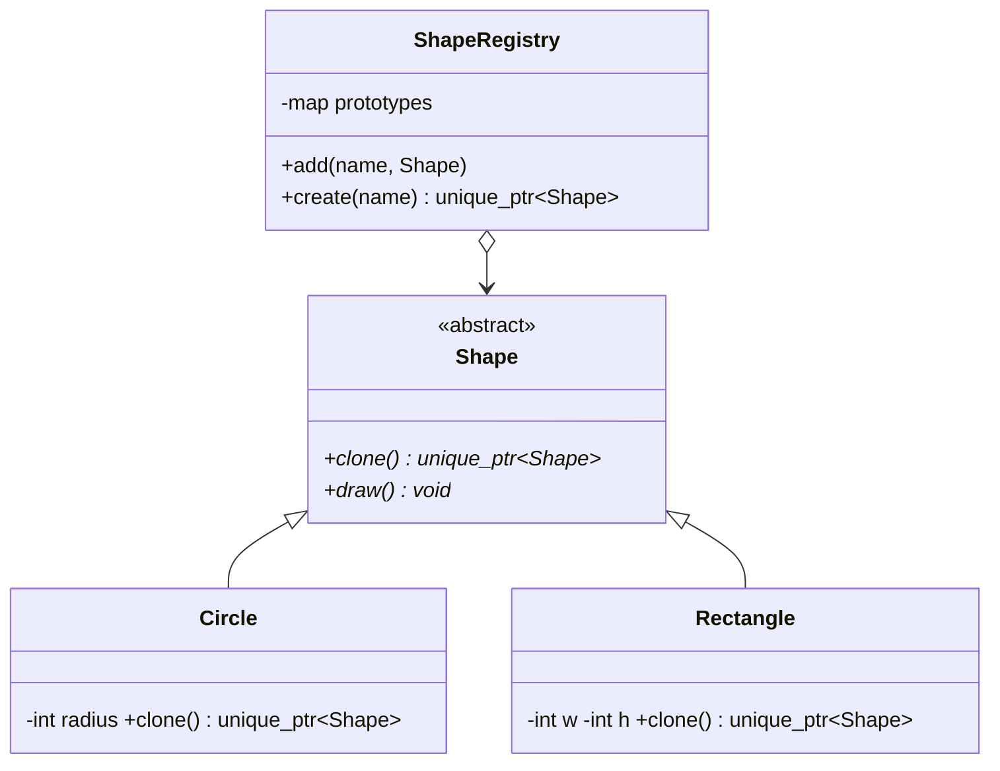

# LLD Notes: Part 4. Creational Design Patterns (C++)

---

## Table of Contents

0. Design patterns: the big picture
1. Creational patterns overview
2. Singleton (deep dive)
3. Simple Factory (not a GoF pattern, but asked constantly)
4. Factory Method
5. Abstract Factory
6. Builder
7. Prototype
8. Object Pool (bonus, common in LLD)
9. Comparison tables (which pattern when?)
10. Interview Q&A
11. One-page cheat sheet

---

## 0. Design Patterns: The Big Picture

**Design pattern** = a **reusable, proven solution template** to a commonly occurring design problem. It is **not code you copy**, but a **shape** you adapt.

**Origin:** the "Gang of Four" (GoF) book (1994) catalogued **23 patterns** in three families.

| Family | Concern | Patterns (GoF) |
|---|---|---|
| **Creational** | *How objects are created* | Singleton, Factory Method, Abstract Factory, Builder, Prototype |
| **Structural** | *How objects/classes are composed* | Adapter, Bridge, Composite, Decorator, Facade, Flyweight, Proxy |
| **Behavioral** | *How objects communicate & share responsibility* | Strategy, Observer, Command, State, Template Method, Chain of Responsibility, Iterator, Mediator, Memento, Visitor, Interpreter |

**Why patterns matter in interviews**
- Shared vocabulary ("use Strategy here") → communicates a whole design in one word.
- They are **applications of SOLID** (esp. OCP, DIP).
- But **never force a pattern**. Name it only when the problem matches (YAGNI, Part 2).

**How to describe any pattern in an interview (4-part template)**
1. **Problem:** what pain exists without it?
2. **Solution idea:** one sentence.
3. **Participants:** which classes/roles.
4. **Trade-off:** what it costs.

---

## 1. Creational Patterns Overview

**Concern:** abstract the **object-creation process** so the system is independent of *how* its objects are created, composed, and represented.

**Core problem:** `new ConcreteClass()` scattered everywhere → **tight coupling** to concrete types → violates DIP/OCP (Part 2).

| Pattern | One-line intent | Typical trigger |
|---|---|---|
| **Singleton** | Exactly **one** instance, globally accessible | Logger, Config, DB pool, Cache |
| **Simple Factory** | One function/class picks the concrete type | `if/else` creating objects by type string |
| **Factory Method** | Subclass decides **which** class to instantiate | Framework defers creation to user code |
| **Abstract Factory** | Create **families** of related objects | UI themes, cross-platform widgets |
| **Builder** | Construct **complex** objects **step by step** | Many optional parameters, telescoping constructors |
| **Prototype** | Create new objects by **cloning** an existing one | Expensive creation, runtime-determined types |

> ⚡ **Quick Recall**
> Singleton = **one**. Factory Method = **subclass chooses**. Abstract Factory = **family of products**. Builder = **step-by-step complex**. Prototype = **clone**.

---

## 2. Singleton 🔥 DEEP DIVE

### 2.1 Intent
> *Ensure a class has **only one instance** and provide a **global point of access** to it.*

**Real-world analogy:** the President of a country / the CPU's operating system kernel / a printer spooler. There is exactly one, and everyone reaches the same one.

### 2.2 Problem it solves
- Some resources **must** be single: logger file handle, configuration, connection pool, hardware access, in-memory cache.
- Multiple instances would cause **inconsistent state** or **resource conflicts**.

### 2.3 Structure

```
+-------------------------------+
|          Singleton            |
+-------------------------------+
| - static instance : Singleton*|
| - Singleton()          (private ctor)
+-------------------------------+
| + static getInstance()        |----> returns the one instance
+-------------------------------+
```



### 2.4 The 4 ingredients (memorize)
1. **Private constructor**: nobody can `new` it.
2. **Deleted copy constructor and copy assignment**: nobody can clone it.
3. **Static member** holding the sole instance.
4. **Public static accessor** `getInstance()`.

### 2.5 Implementations: evolution from naive to best

#### Version 1: Eager initialization (thread-safe by design)
```cpp
class Logger {
    static Logger instance;                 // created at program start (static init)
    Logger() { cout << "Logger created\n"; }
public:
    Logger(const Logger&) = delete;
    Logger& operator=(const Logger&) = delete;
    static Logger& getInstance() { return instance; }
    void log(const string& m) { cout << "[LOG] " << m << "\n"; }
};
Logger Logger::instance;                    // definition
```
| Pros | Cons |
|---|---|
| Thread-safe (created before `main`) | Created even if never used (wasteful) |
| Simple | **Static Initialization Order Fiasco**: if another global uses `Logger` during its own static init, `instance` may not be ready |

#### Version 2: Lazy, NOT thread-safe ❌ (the classic bug)
```cpp
class Singleton {
    static Singleton* instance;
    Singleton() {}
public:
    static Singleton* getInstance() {
        if (instance == nullptr)            // Thread A and B both see nullptr...
            instance = new Singleton();     // ...both create → TWO instances / leak
        return instance;
    }
};
Singleton* Singleton::instance = nullptr;
```
**Race condition:** two threads pass the `nullptr` check simultaneously → two objects. Also **never deleted** (leak, though OS reclaims at exit).

#### Version 3: Lazy + mutex on every call (correct but slow)
```cpp
class Singleton {
    static Singleton* instance;
    static mutex mtx;
    Singleton() {}
public:
    static Singleton* getInstance() {
        lock_guard<mutex> lock(mtx);        // lock EVERY call, even after creation
        if (!instance) instance = new Singleton();
        return instance;
    }
};
Singleton* Singleton::instance = nullptr;
mutex Singleton::mtx;
```
Correct, but every access pays the lock cost, even though the lock is only needed once.

#### Version 4: Double-Checked Locking (DCLP)
```cpp
class Singleton {
    static atomic<Singleton*> instance;     // atomic is REQUIRED
    static mutex mtx;
    Singleton() {}
public:
    static Singleton* getInstance() {
        Singleton* tmp = instance.load(memory_order_acquire);
        if (tmp == nullptr) {                                   // 1st check (no lock, fast path)
            lock_guard<mutex> lock(mtx);
            tmp = instance.load(memory_order_relaxed);
            if (tmp == nullptr) {                               // 2nd check (under lock)
                tmp = new Singleton();
                instance.store(tmp, memory_order_release);
            }
        }
        return tmp;
    }
};
atomic<Singleton*> Singleton::instance{nullptr};
mutex Singleton::mtx;
```
**Why double check?** The first (unlocked) check keeps the fast path lock-free; the second (locked) check guarantees only one thread creates the object.

**Why `atomic` is required (interview favorite):** `instance = new Singleton()` is really 3 steps: *allocate memory → construct object → assign pointer*. The compiler/CPU may **reorder** to *allocate → assign pointer → construct*. Another thread could then see a **non-null but half-constructed** pointer. `atomic` with acquire/release ordering forbids that reordering. A plain-pointer DCLP is **broken** (undefined behavior) in C++.

#### Version 5: Meyers' Singleton ⭐ (BEST in modern C++)
```cpp
class Singleton {
    Singleton() { cout << "Created\n"; }
    ~Singleton() { cout << "Destroyed\n"; }
public:
    Singleton(const Singleton&) = delete;
    Singleton& operator=(const Singleton&) = delete;
    Singleton(Singleton&&) = delete;
    Singleton& operator=(Singleton&&) = delete;

    static Singleton& getInstance() {
        static Singleton instance;          // "magic static"
        return instance;
    }
    void doWork() { cout << "working\n"; }
};

int main() {
    Singleton::getInstance().doWork();
}
```
**Why it's best**
- **Thread-safe since C++11**: the standard guarantees a function-local `static` is initialized **exactly once**, even with concurrent callers (other threads block until initialization completes).
- **Lazy**: created on first call.
- **Automatically destroyed** at program exit (no leak, RAII).
- **No manual locking, no atomics**, and the shortest code.

**Caveats**
- Only thread-safe for **initialization**, not for the **methods** you call afterward. Protect mutable state inside with a mutex.
- **Destruction order:** destroyed in reverse order of construction. If singleton A's destructor uses singleton B that was destroyed first → UB. (Fix: ensure A calls `B::getInstance()` in A's constructor, so B is constructed first and destroyed last.)
- Pre-C++11 compilers don't guarantee thread safety for this.

#### Version 6: `std::call_once`
```cpp
class Singleton {
    static unique_ptr<Singleton> instance;
    static once_flag flag;
    Singleton() {}
public:
    static Singleton& getInstance() {
        call_once(flag, []() { instance.reset(new Singleton()); });
        return *instance;
    }
};
unique_ptr<Singleton> Singleton::instance;
once_flag Singleton::flag;
```
Guaranteed to run the lambda exactly once across threads. (`make_unique` can't be used because the constructor is private.)

### 2.6 Comparison of implementations

| Version | Lazy? | Thread-safe? | Speed | Complexity | Verdict |
|---|---|---|---|---|---|
| Eager (static member) | ❌ | ✅ | Fast | Low | OK; watch init-order |
| Lazy naive | ✅ | ❌ | Fast | Low | **Never use** |
| Lazy + mutex each call | ✅ | ✅ | Slow | Low | Works; wasteful |
| Double-checked (atomic) | ✅ | ✅ | Fast | High | Error-prone; know it for interviews |
| **Meyers (function static)** | ✅ | ✅ (C++11) | Fast | **Lowest** | ⭐ **Default choice** |
| `call_once` | ✅ | ✅ | Fast | Medium | Good alternative |

### 2.7 Making a Singleton "practical": Logger example

```cpp
class Logger {
    ofstream file;
    mutex mtx;                                       // protects the shared file
    Logger() { file.open("app.log", ios::app); }
public:
    Logger(const Logger&) = delete;
    Logger& operator=(const Logger&) = delete;

    static Logger& getInstance() {
        static Logger instance;
        return instance;
    }
    void log(const string& level, const string& msg) {
        lock_guard<mutex> lock(mtx);                 // thread-safe usage, separate from thread-safe creation
        file << "[" << level << "] " << msg << "\n";
    }
};

// usage from anywhere / any thread:
Logger::getInstance().log("INFO", "Server started");
```

### 2.8 Singleton with `shared_ptr` / returning pointer vs reference
- **Return by reference** (`Singleton&`): prevents callers from `delete`-ing it or setting it to null. **Preferred.**
- Returning a raw pointer invites misuse.

### 2.9 How to BREAK a Singleton (interviewers ask this)
| Attack | Defense |
|---|---|
| Copy constructor / assignment | `= delete` both |
| Move constructor / assignment | `= delete` both |
| `new Singleton()` from outside | private constructor |
| Multiple threads racing | Meyers static / `call_once` |
| Inheritance to create a second instance | Mark the class `final`, private constructor |
| Reflection/serialization (Java concerns) | Not an issue in C++ |
| Dynamic libraries: each `.so`/`.dll` may get its own static copy | Careful symbol visibility/export (advanced) |

### 2.10 Pros and Cons

| Pros | Cons / Criticisms |
|---|---|
| Controlled access to a single instance | It's a **global variable in disguise**: hidden dependencies |
| Lazy init saves resources | **Hard to unit test**: can't easily inject a mock |
| Global, easy access | Violates **SRP** (manages own lifetime + does its job) |
| Consistent shared state | Tight coupling: callers depend on the concrete class (**DIP violation**) |
| | Concurrency hazards on shared mutable state |

### 2.11 Making it testable (the mature answer)
```cpp
class ILogger { public: virtual void log(const string&) = 0; virtual ~ILogger() = default; };

class FileLogger : public ILogger {
    /* Singleton internals */
public:
    static FileLogger& getInstance() { static FileLogger i; return i; }
    void log(const string& m) override { /* write */ }
private:
    FileLogger() = default;
};

class OrderService {
    ILogger& logger;                                  // injected: could be Singleton OR a fake
public:
    explicit OrderService(ILogger& l) : logger(l) {}
    void place() { logger.log("order placed"); }
};

// prod:  OrderService svc(FileLogger::getInstance());
// test:  FakeLogger fake; OrderService svc(fake);
```
**Say in interview:** *"I keep the single instance, but I inject it through an interface, so business classes don't depend on the Singleton directly."*

### 2.12 When to use / avoid
- ✅ **Use:** logger, configuration, hardware/device manager, connection/thread pool manager, in-process cache, ID generator.
- ❌ **Avoid:** as a lazy substitute for passing dependencies; when state is mutable and shared without need; when tests need isolation.

### 2.13 Interview traps
- **"Why private constructor?"** Prevents external instantiation.
- **"Why is the naive lazy version broken?"** Race on the `nullptr` check → two instances.
- **"Why `atomic` in DCLP?"** Instruction reordering → half-constructed object visible.
- **"Is Meyers' Singleton thread-safe?"** Yes for *initialization* (C++11+), no for *usage*.
- **"Singleton vs static class?"** A Singleton is a real **object** (can implement interfaces, be passed around, lazily created, mocked); a class of static members cannot.
- **"How to destroy a Singleton?"** Meyers: automatic at exit. With `new`: manual `destroy()` method or `unique_ptr`.

> ⚡ **Quick Recall**
> Private ctor + deleted copy/move + static instance + static accessor. **Use Meyers (`static T instance;` inside `getInstance()`)**. Thread-safe *creation* ≠ thread-safe *usage*. Inject via interface for tests.

---

## 3. Simple Factory (a.k.a. Static Factory)

> **Note:** *Not* one of the 23 GoF patterns, but it is the **entry point** to Factory Method and appears in nearly every LLD problem. Interviewers often say "Factory" meaning this.

### 3.1 Intent
Centralize object creation in **one place** so client code doesn't `new` concrete classes.

### 3.2 Problem
```cpp
// ❌ Client knows every concrete class → tight coupling, scattered `if`s
Vehicle* v;
if (type == "car")        v = new Car();
else if (type == "bike")  v = new Bike();
else if (type == "truck") v = new Truck();
```
Each place that needs a vehicle repeats this ladder. Adding a type means editing all of them.

### 3.3 Solution: move creation into a factory

```cpp
class Vehicle {
public:
    virtual void drive() = 0;
    virtual ~Vehicle() = default;
};
class Car  : public Vehicle { public: void drive() override { cout << "Car\n"; } };
class Bike : public Vehicle { public: void drive() override { cout << "Bike\n"; } };
class Truck: public Vehicle { public: void drive() override { cout << "Truck\n"; } };

class VehicleFactory {
public:
    static unique_ptr<Vehicle> create(const string& type) {
        if (type == "car")   return make_unique<Car>();
        if (type == "bike")  return make_unique<Bike>();
        if (type == "truck") return make_unique<Truck>();
        throw invalid_argument("Unknown vehicle: " + type);
    }
};

int main() {
    auto v = VehicleFactory::create("car");
    v->drive();
}
```



### 3.4 Pros / Cons
| Pros | Cons |
|---|---|
| Single place to change creation logic | **Violates OCP**: new type means edit the factory's `if/else` |
| Client depends on the abstraction only | Factory itself depends on all concrete classes |
| Easy, readable | Not truly extensible without editing |

### 3.5 Making it OCP-friendly: registry-based factory
```cpp
class VehicleFactory {
    using Creator = function<unique_ptr<Vehicle>()>;
    static unordered_map<string, Creator>& registry() {
        static unordered_map<string, Creator> r;
        return r;
    }
public:
    static void registerType(const string& key, Creator c) { registry()[key] = std::move(c); }
    static unique_ptr<Vehicle> create(const string& key) {
        auto it = registry().find(key);
        if (it == registry().end()) throw invalid_argument("Unknown: " + key);
        return it->second();
    }
};

// Registration lives OUTSIDE the factory. Adding a type never edits the factory:
VehicleFactory::registerType("car",  []{ return make_unique<Car>(); });
VehicleFactory::registerType("bike", []{ return make_unique<Bike>(); });
```

### 3.6 Modern C++ tips
- Return `unique_ptr<Base>` (clear ownership transfer).
- Use `enum class VehicleType` instead of magic strings where possible.
- Base class needs a **virtual destructor** (Part 1).

---

## 4. Factory Method

### 4.1 Intent
> *Define an **interface for creating an object**, but let **subclasses decide** which class to instantiate. Factory Method lets a class defer instantiation to subclasses.*

### 4.2 Problem
A framework/base class contains logic that needs an object, but **doesn't know (and shouldn't know) the concrete class**. Different subclasses need different products.

**Example:** A `LogisticsApp` plans deliveries. `RoadLogistics` ships by `Truck`; `SeaLogistics` ships by `Ship`. The planning workflow is identical; only the **vehicle created** differs.

### 4.3 Structure

```
  Creator (abstract)                       Product (interface)
  + someOperation()   ---uses--->          + operate()
  + createProduct() = 0   <-- factory method       ^
         ^                                         |
         |                                  ConcreteProductA/B
   ConcreteCreatorA / B
   + createProduct()  -> new ConcreteProductA/B
```



### 4.4 C++ code

```cpp
// ----- Product -----
class Transport {
public:
    virtual void deliver() = 0;
    virtual ~Transport() = default;
};
class Truck : public Transport { public: void deliver() override { cout << "Delivering by land in a truck\n"; } };
class Ship  : public Transport { public: void deliver() override { cout << "Delivering by sea in a ship\n"; } };

// ----- Creator -----
class Logistics {
public:
    virtual ~Logistics() = default;

    void planDelivery() {                              // core business logic, uses the product abstractly
        unique_ptr<Transport> t = createTransport();   // <-- FACTORY METHOD
        cout << "Loading cargo...\n";
        t->deliver();
    }
protected:
    virtual unique_ptr<Transport> createTransport() const = 0;   // subclasses decide
};

class RoadLogistics : public Logistics {
protected:
    unique_ptr<Transport> createTransport() const override { return make_unique<Truck>(); }
};
class SeaLogistics : public Logistics {
protected:
    unique_ptr<Transport> createTransport() const override { return make_unique<Ship>(); }
};

int main() {
    unique_ptr<Logistics> app = make_unique<SeaLogistics>();   // choose creator once (config/startup)
    app->planDelivery();
}
```

### 4.5 Key ideas
- The **Creator** has business logic (`planDelivery`) that depends only on the **abstract Product**.
- The **factory method** (`createTransport`) is the **hook** that subclasses override.
- To add `AirLogistics` + `Plane`: **add two classes**, touch nothing else. ✅ **OCP.**
- Inheritance-based: *"subclass decides."*

### 4.6 Simple Factory vs Factory Method

| | Simple Factory | Factory Method |
|---|---|---|
| Is a GoF pattern? | ❌ No | ✅ Yes |
| Mechanism | One class with `if/switch` or map | **Inheritance**: subclasses override a creation method |
| Adding a product | Edit factory (violates OCP) | Add new creator subclass (OCP ✅) |
| Creation logic lives in | A separate factory class | The creator hierarchy (creator has other logic too) |
| Complexity | Low | Higher |
| Use when | Few types, rarely change | Framework hooks; need to defer creation to subclass |

### 4.7 Pros / Cons
| Pros | Cons |
|---|---|
| Removes tight coupling between creator and concrete products | Many subclasses (one creator per product) → class explosion |
| **SRP**: creation code in one place | Slightly more complex than a plain `new` or Simple Factory |
| **OCP**: new products without changing creator logic | Requires the inheritance hierarchy |

### 4.8 Use cases
- Document editors (`Application::createDocument()`: PDF, Word).
- UI frameworks (`Dialog::createButton()` → WindowsButton / WebButton).
- Notification systems (create Email/SMS/Push objects).
- Parsers (`createParser()` returns JSON/XML parser).
- Logistics, payments, game unit spawning.

### 4.9 Interview traps
- *"Is your `if/else` factory a Factory Method?"* → No, that's **Simple Factory**. Factory Method uses **subclass override**.
- *"Where does the client choose the creator?"* → One place at startup/config; after that, everything is polymorphic.
- *"Does Factory Method violate OCP?"* → No: extending means new subclasses, not editing existing ones.

> ⚡ **Quick Recall**
> Factory Method = a **virtual creation function** in a base class; **subclasses override it** to return different products. Base class logic never names a concrete product.

---

## 5. Abstract Factory

### 5.1 Intent
> *Provide an interface for creating **families of related or dependent objects** without specifying their concrete classes.*

### 5.2 Problem
You need **sets of objects that must be used together** (a consistent family), and you want to swap the whole family at once.

**Example:** A cross-platform GUI. On **Windows**: `WinButton + WinCheckbox`. On **Mac**: `MacButton + MacCheckbox`. Mixing `WinButton` with `MacCheckbox` would look broken. Ensure **consistency of family**.

### 5.3 Structure

```
             <<interface>> GUIFactory
             + createButton()   : Button
             + createCheckbox() : Checkbox
                     ^
          ___________|___________
         |                       |
   WinFactory                MacFactory
   + createButton  -> WinButton      + createButton -> MacButton
   + createCheckbox-> WinCheckbox    + createCheckbox-> MacCheckbox

   Button (interface)   <- WinButton, MacButton
   Checkbox (interface) <- WinCheckbox, MacCheckbox

   Client depends ONLY on GUIFactory, Button, Checkbox (abstractions).
```



### 5.4 C++ code

```cpp
// ---------- Abstract products ----------
class Button   { public: virtual void paint() const = 0; virtual ~Button() = default; };
class Checkbox { public: virtual void paint() const = 0; virtual ~Checkbox() = default; };

// ---------- Windows family ----------
class WinButton   : public Button   { public: void paint() const override { cout << "[Windows Button]\n"; } };
class WinCheckbox : public Checkbox { public: void paint() const override { cout << "[Windows Checkbox]\n"; } };

// ---------- Mac family ----------
class MacButton   : public Button   { public: void paint() const override { cout << "(Mac Button)\n"; } };
class MacCheckbox : public Checkbox { public: void paint() const override { cout << "(Mac Checkbox)\n"; } };

// ---------- Abstract factory ----------
class GUIFactory {
public:
    virtual unique_ptr<Button>   createButton()   const = 0;
    virtual unique_ptr<Checkbox> createCheckbox() const = 0;
    virtual ~GUIFactory() = default;
};
class WinFactory : public GUIFactory {
public:
    unique_ptr<Button>   createButton()   const override { return make_unique<WinButton>(); }
    unique_ptr<Checkbox> createCheckbox() const override { return make_unique<WinCheckbox>(); }
};
class MacFactory : public GUIFactory {
public:
    unique_ptr<Button>   createButton()   const override { return make_unique<MacButton>(); }
    unique_ptr<Checkbox> createCheckbox() const override { return make_unique<MacCheckbox>(); }
};

// ---------- Client: knows ONLY abstractions ----------
class Application {
    unique_ptr<Button>   button;
    unique_ptr<Checkbox> checkbox;
public:
    explicit Application(const GUIFactory& f) : button(f.createButton()), checkbox(f.createCheckbox()) {}
    void render() const { button->paint(); checkbox->paint(); }
};

int main() {
    string os = "mac";                                     // from config / detection
    unique_ptr<GUIFactory> factory;
    if (os == "win") factory = make_unique<WinFactory>();
    else             factory = make_unique<MacFactory>();

    Application app(*factory);                             // whole family swapped by choosing ONE factory
    app.render();                                          // (Mac Button) (Mac Checkbox)
}
```

### 5.5 Key ideas
- **Factory of factories?** Not exactly: an Abstract Factory is a **factory that produces several related products**. Often each product creation is itself a **Factory Method**.
- **Adding a new family** (Linux): add `LinuxFactory` + `LinuxButton` + `LinuxCheckbox`. Nothing else changes. ✅ OCP.
- **Adding a new product type** (Slider): must change **every factory** and the interface ❌. This is the pattern's weakness.

### 5.6 Factory Method vs Abstract Factory

| | Factory Method | Abstract Factory |
|---|---|---|
| Creates | **One** product | A **family** of related products |
| Structure | One creation method, overridden in subclasses | Interface with **multiple** creation methods |
| Mechanism | Inheritance | Composition (client holds a factory object) |
| Adding a new product **variant** | Add subclass | Add a new concrete factory + variants |
| Adding a new product **type** | N/A | Modify interface and **all** factories ❌ |
| Purpose | Defer instantiation | Ensure **consistent families** |

### 5.7 Pros / Cons
| Pros | Cons |
|---|---|
| Guarantees products from a family **fit together** | Lots of classes/interfaces (complexity) |
| Client decoupled from concrete products | Adding a **new product type** touches every factory |
| Swap families with one line (**OCP** for families) | Over-engineering for simple cases |
| **SRP**: creation code in one place | |

### 5.8 Use cases
- Cross-platform UI toolkits (Win/Mac/Linux widgets), themes (Light/Dark).
- Database access layers (`MySQLFactory` → Connection + Command + Reader; `PostgresFactory` → ...).
- Game worlds (`ForestFactory` → Trees + Enemies; `DesertFactory` → Cacti + Scorpions).
- Furniture / vehicle families (`VictorianFactory`: Chair + Sofa; `ModernFactory`: ...).
- Payment gateways bundling Processor + Refund + Report classes per provider.

### 5.9 Interview traps
- *"Difference from Factory Method?"* → **Family** of products vs **single** product; composition vs inheritance.
- *"Downside?"* → Adding a new product **type** forces edits in every factory.
- *"Where do you decide which factory to use?"* → Once, at startup (config/OS detection). Everything else uses the abstraction.

> ⚡ **Quick Recall**
> Abstract Factory = **interface with several `createX()` methods** → one concrete factory per **family**. Client holds `GUIFactory&`, never `WinButton`.

---

## 6. Builder

### 6.1 Intent
> *Separate the **construction** of a complex object from its **representation**, so the same construction process can create different representations.* In practice: **build a complex object step by step**, with readable code.

### 6.2 Problem: the Telescoping Constructor anti-pattern

```cpp
class Pizza {
public:
    Pizza(int size);
    Pizza(int size, bool cheese);
    Pizza(int size, bool cheese, bool pepperoni);
    Pizza(int size, bool cheese, bool pepperoni, bool mushrooms, bool olives, bool extraSauce);   // ...
};

Pizza p(12, true, false, true, false, true);      // ❌ What do those booleans mean? Easy to swap by mistake.
```
Problems: unreadable call sites, many overloads, **invalid/partial objects** possible, tons of parameters, optional fields awkward.

(Also avoiding a "JavaBean" style of default-construct + many setters: the object is **mutable and half-built** in between.)

### 6.3 Solution idea
Move construction into a **Builder** with **named steps**; `build()` returns the finished, valid object.

### 6.4 Structure (fluent builder: the most common interview form)

```
  Client ---> PizzaBuilder                         Pizza (product)
              + size(int)      : PizzaBuilder&      - size, cheese, pepperoni, ...
              + cheese(bool)   : PizzaBuilder&      - Pizza(const PizzaBuilder&)  (private)
              + pepperoni(bool): PizzaBuilder&
              + build()        : Pizza  ------------->
```

```mermaid
classDiagram
    class Pizza {
        -int size
        -bool cheese
        -bool pepperoni
        -bool mushrooms
        -Pizza(Builder b)
        +describe() void
    }
    class Builder {
        +Builder(int size)
        +cheese(bool) Builder&
        +pepperoni(bool) Builder&
        +mushrooms(bool) Builder&
        +build() Pizza
    }
    Pizza +-- Builder : nested
    Builder ..> Pizza : creates
```

### 6.5 C++ code: Fluent Builder with a nested class

```cpp
class Pizza {
    int  size;                 // required
    bool cheese, pepperoni, mushrooms, olives;   // optional
    Pizza() = default;         // only Builder can construct

public:
    class Builder {
        Pizza p;
    public:
        explicit Builder(int size) { p.size = size; p.cheese = p.pepperoni = p.mushrooms = p.olives = false; }
        Builder& cheese(bool v = true)    { p.cheese = v;    return *this; }
        Builder& pepperoni(bool v = true) { p.pepperoni = v; return *this; }
        Builder& mushrooms(bool v = true) { p.mushrooms = v; return *this; }
        Builder& olives(bool v = true)    { p.olives = v;    return *this; }
        Pizza build() {
            if (p.size <= 0) throw invalid_argument("size must be > 0");     // validation in ONE place
            return std::move(p);
        }
    };

    void describe() const {
        cout << size << "\" pizza:"
             << (cheese ? " cheese" : "") << (pepperoni ? " pepperoni" : "")
             << (mushrooms ? " mushrooms" : "") << (olives ? " olives" : "") << "\n";
    }
};

int main() {
    Pizza p = Pizza::Builder(12)
                  .cheese()
                  .pepperoni()
                  .olives()
                  .build();
    p.describe();          // 12" pizza: cheese pepperoni olives
}
```
**Notes**
- `Builder` is a **nested class**, so it can access `Pizza`'s private constructor/members (nested classes are members and have access rights).
- Every setter returns `*this` by reference → **method chaining** (`this` pointer, Part 1).
- `build()` is the **single place for validation** and invariants.
- Result can be made **immutable** (no setters on `Pizza`).

### 6.6 Classic GoF Builder: with Director and multiple representations

```cpp
// Product
class Computer {
public:
    string cpu, ram, storage, gpu;
    void show() const { cout << cpu << " | " << ram << " | " << storage << " | " << (gpu.empty() ? "no GPU" : gpu) << "\n"; }
};

// Abstract Builder
class ComputerBuilder {
protected:
    unique_ptr<Computer> c = make_unique<Computer>();
public:
    virtual ~ComputerBuilder() = default;
    virtual void buildCPU() = 0;
    virtual void buildRAM() = 0;
    virtual void buildStorage() = 0;
    virtual void buildGPU() {}                       // optional step (default: skip)
    unique_ptr<Computer> getResult() { return std::move(c); }
};

// Concrete Builders (different representations)
class GamingPCBuilder : public ComputerBuilder {
public:
    void buildCPU()     override { c->cpu = "i9"; }
    void buildRAM()     override { c->ram = "32GB"; }
    void buildStorage() override { c->storage = "2TB NVMe"; }
    void buildGPU()     override { c->gpu = "RTX 4080"; }
};
class OfficePCBuilder : public ComputerBuilder {
public:
    void buildCPU()     override { c->cpu = "i3"; }
    void buildRAM()     override { c->ram = "8GB"; }
    void buildStorage() override { c->storage = "256GB SSD"; }
};

// Director: knows the ORDER of steps (the recipe)
class Director {
public:
    unique_ptr<Computer> construct(ComputerBuilder& b) {
        b.buildCPU();
        b.buildRAM();
        b.buildStorage();
        b.buildGPU();
        return b.getResult();
    }
};

int main() {
    Director d;
    GamingPCBuilder gaming;
    OfficePCBuilder office;
    d.construct(gaming)->show();     // i9 | 32GB | 2TB NVMe | RTX 4080
    d.construct(office)->show();     // i3 | 8GB | 256GB SSD | no GPU
}
```
**Roles**
- **Builder** interface: the step methods.
- **ConcreteBuilder**: implements steps, assembles a specific representation.
- **Director** (optional): fixed construction **sequence**; reuses one recipe with different builders.
- **Product**: the complex object.

### 6.7 Fluent (Effective-Java style) vs Classic GoF (Director)

| | Fluent Builder | Classic GoF Builder |
|---|---|---|
| Goal | Readable construction of **one** product with many optional params | Same process → **different representations** |
| Director? | No (client chains calls) | Yes (optional) |
| Abstract Builder? | Usually no | Yes |
| Most common in LLD interviews | ✅ | Sometimes |

### 6.8 Pros / Cons
| Pros | Cons |
|---|---|
| **Readable** call sites, self-documenting | More code: a Builder class per product |
| Avoids telescoping constructors | Builder must be **kept in sync** when Product gains fields |
| Immutable product possible; validation in `build()` | Overkill for simple objects with 2-3 fields |
| Step-by-step, deferred, and reusable construction | Slightly more objects created |
| **SRP**: separates construction from business logic | |

### 6.8b Modern C++ alternatives (mention for bonus points)
- **Named parameters via a config struct** with C++20 designated initializers:
  ```cpp
  struct PizzaConfig { int size; bool cheese = false; bool pepperoni = false; };
  Pizza p({ .size = 12, .cheese = true });     // C++20
  ```
- **Default arguments / aggregate initialization** for simple cases.
- **`std::optional`** for optional fields.
Use Builder when construction has **validation, many optional fields, or multiple steps**.

### 6.9 Use cases
- Objects with **many optional fields**: HTTP request (`url, method, headers, body, timeout`), SQL query builder, Pizza/Meal/Computer configurator, Email (`to, cc, bcc, subject, body, attachments`).
- **Immutable** domain objects (User profile).
- Document/report generators (build HTML vs PDF vs Markdown via same steps).
- `std::ostringstream`/`StringBuilder`-like accumulation (similar spirit).

### 6.10 Interview traps
- *"Builder vs Factory?"* → **Factory**: creates an object **in one call**, focus on *which class*. **Builder**: creates a **complex** object over *many steps*, focus on *how it's assembled*.
- *"Why not just setters?"* → The object is half-built/mutable in between and can never be immutable; no central validation.
- *"Why make Pizza's constructor private?"* → Force construction through the Builder so invalid objects can't exist.
- *"Where does validation go?"* → In `build()`.

> ⚡ **Quick Recall**
> Builder = **fluent chain of named steps + `build()`**. Solves telescoping constructors. Put validation in `build()`. Optional Director = reusable recipe.

---

## 7. Prototype

### 7.1 Intent
> *Specify the kinds of objects to create using a **prototypical instance**, and create new objects by **copying (cloning)** this prototype.*

### 7.2 Problem
- Creating an object from scratch is **expensive** (DB load, heavy computation, network), and you need many **similar** objects.
- You have only an **interface pointer** (`Shape*`) and can't know the **concrete type** to call its constructor.
- Can't copy from outside because the **fields are private**.

### 7.3 Solution: `clone()` method
Each class implements a **`clone()`** that returns a copy of itself. The client asks the object to clone itself, without knowing its concrete class.

### 7.4 Structure

```
  <<interface>> Prototype
  + clone() : Prototype*
        ^
   _____|__________
  |                |
 ConcretePrototypeA / B
 + clone() -> return copy of self

  Client:  Prototype* copy = original->clone();
```



### 7.5 C++ code

```cpp
class Shape {
public:
    virtual unique_ptr<Shape> clone() const = 0;      // "virtual copy constructor"
    virtual void draw() const = 0;
    virtual ~Shape() = default;
};

class Circle : public Shape {
    int radius; string color;
public:
    Circle(int r, string c) : radius(r), color(std::move(c)) {}
    unique_ptr<Shape> clone() const override { return make_unique<Circle>(*this); }   // uses COPY CTOR
    void draw() const override { cout << color << " circle r=" << radius << "\n"; }
    void setColor(const string& c) { color = c; }
};

class Rectangle : public Shape {
    int w, h; string color;
public:
    Rectangle(int w, int h, string c) : w(w), h(h), color(std::move(c)) {}
    unique_ptr<Shape> clone() const override { return make_unique<Rectangle>(*this); }
    void draw() const override { cout << color << " rect " << w << "x" << h << "\n"; }
};

int main() {
    unique_ptr<Shape> original = make_unique<Circle>(10, "red");
    unique_ptr<Shape> copy = original->clone();        // client never names "Circle"
    copy->draw();
}
```

### 7.6 Prototype Registry (a.k.a. Prototype Manager)

```cpp
class ShapeRegistry {
    unordered_map<string, unique_ptr<Shape>> prototypes;
public:
    void add(const string& key, unique_ptr<Shape> proto) { prototypes[key] = std::move(proto); }
    unique_ptr<Shape> create(const string& key) const {
        auto it = prototypes.find(key);
        if (it == prototypes.end()) throw invalid_argument("no prototype: " + key);
        return it->second->clone();
    }
};

int main() {
    ShapeRegistry reg;
    reg.add("bigRedCircle", make_unique<Circle>(100, "red"));
    reg.add("smallSquare",  make_unique<Rectangle>(5, 5, "blue"));

    auto s1 = reg.create("bigRedCircle");     // cheap clone instead of expensive construction
    auto s2 = reg.create("bigRedCircle");
}
```

### 7.7 Shallow vs Deep copy (THE Prototype trap)

```cpp
class Document : public Shape /* ... */ {
    vector<string> lines;          // fine: vector copy is deep
    Image* logo;                   // raw pointer → default copy is SHALLOW ❌
public:
    // ✅ Deep copy constructor
    Document(const Document& o) : lines(o.lines), logo(o.logo ? new Image(*o.logo) : nullptr) {}
    unique_ptr<Shape> clone() const override { return make_unique<Document>(*this); }
    ~Document() { delete logo; }
};
```
- **Shallow clone**: copies pointers, so the clone and the original **share** sub-objects. Mutating one affects the other, and double-delete is possible.
- **Deep clone**: recursively copies owned sub-objects. Use it whenever the object owns resources.
- Best practice: hold members as **value types / `unique_ptr` with clone()**, so the compiler-generated copy works (Rule of 0, Part 1).

### 7.8 Covariant `clone()` trick (avoid downcasts)
```cpp
class Circle : public Shape {
public:
    unique_ptr<Shape> clone() const override { ... }     // standard
};
// With raw pointers you can use covariant returns:  Circle* clone() const override { return new Circle(*this); }
// (unique_ptr<Circle> is NOT covariant with unique_ptr<Shape>, so a common workaround is a private
//  virtual doClone() + public non-virtual typed clone()  → advanced)
```

### 7.9 Pros / Cons
| Pros | Cons |
|---|---|
| Creating from an existing instance is **cheaper** than fresh construction | **Deep copy of complex/cyclic structures** is tricky |
| Clone without coupling to concrete class (works via base pointer) | Every class needs a `clone()` (boilerplate) |
| Avoids subclass explosion of creators (vs Factory Method) | Objects with **non-copyable resources** (mutex, file handle) need special handling |
| Get pre-configured objects at runtime (registry) | |
| Add/remove products at **runtime** | |

### 7.10 Use cases
- **Game development:** spawn 1000 enemies/bullets/trees from a template.
- **Document/graphics editors:** "duplicate shape", copy-paste.
- **Configuration objects:** start from a default config and tweak per use.
- **Caching heavy objects:** load once from DB, clone for each request.
- **Undo/Memento-like snapshots** (relation to Memento pattern).
- **Test data:** clone a base fixture and modify a field.

### 7.11 Interview traps
- *"Prototype vs copy constructor?"* → The copy constructor needs the **static type**; `clone()` is **virtual**, so it works through a **base pointer** (a "virtual copy constructor").
- *"Shallow vs deep?"* → Explain with an example; state deep is needed when the object owns pointers.
- *"Why not just `new Circle(*ptr)`?"* → You'd need to know it's a `Circle`; polymorphic copy requires `clone()`.
- *"Prototype vs Factory?"* → Factory builds fresh from a class; Prototype copies an existing configured instance.

> ⚡ **Quick Recall**
> Prototype = **virtual `clone()`** + optional **registry** of ready-made templates. The danger is **shallow copy**, so deep-copy owned resources.

---

## 8. Object Pool (bonus, frequently paired with Singleton)

> *Not a GoF pattern*, but heavily used in LLD (connection pool, thread pool, parking-slot pool).

### 8.1 Intent
**Reuse** a set of expensive-to-create objects instead of creating/destroying them repeatedly.

### 8.2 Idea
`acquire()` hands out an available object; `release()` returns it to the pool.

### 8.3 C++ code (thread-safe, simple)

```cpp
class Connection {
public:
    Connection() { cout << "Expensive connection created\n"; }
    void query(const string& q) { cout << "Running: " << q << "\n"; }
};

class ConnectionPool {
    queue<unique_ptr<Connection>> pool;
    mutex mtx;
    condition_variable cv;
    ConnectionPool(int n) { for (int i = 0; i < n; i++) pool.push(make_unique<Connection>()); }

public:
    ConnectionPool(const ConnectionPool&) = delete;
    ConnectionPool& operator=(const ConnectionPool&) = delete;

    static ConnectionPool& getInstance() {              // Singleton + Object Pool
        static ConnectionPool instance(3);
        return instance;
    }

    unique_ptr<Connection> acquire() {
        unique_lock<mutex> lock(mtx);
        cv.wait(lock, [&]{ return !pool.empty(); });    // block until one is free
        auto c = std::move(pool.front());
        pool.pop();
        return c;
    }
    void release(unique_ptr<Connection> c) {
        { lock_guard<mutex> lock(mtx); pool.push(std::move(c)); }
        cv.notify_one();
    }
};
```
**Interview points:** always **reset state** on release; handle **exhaustion** (block, timeout, or grow); guard against **leaks** (use an RAII wrapper that auto-releases); usually combined with Singleton.

---

## 9. Comparison Tables (Which Pattern When?)

### 9.1 The five compared

| Pattern | Creates | Mechanism | Key benefit | Key cost |
|---|---|---|---|---|
| Singleton | The **one** instance | Private ctor + static accessor | Controlled single access | Global state, hard to test |
| Simple Factory | One product by key | `if/switch` or registry in a factory | Centralized creation | Violates OCP (if/else version) |
| Factory Method | One product | **Subclass overrides** creation method | OCP, defer to subclasses | Class explosion |
| Abstract Factory | **Family** of products | Interface w/ many `createX()` | Family consistency | New product type touches all factories |
| Builder | One **complex** product | Step-by-step + `build()` | Readable, valid, immutable objects | Extra builder class |
| Prototype | Copy of existing | `clone()` | Cheap/polymorphic copy | Deep-copy pitfalls |

### 9.2 Decision flow
```
Need exactly ONE shared instance?                       → Singleton
Creating objects by type/name, few types?               → Simple Factory (registry if extensible)
Framework/base class defers WHICH class to create?      → Factory Method
Must create matching SETS of objects together?          → Abstract Factory
Object has many optional fields / many steps?           → Builder
Creation is expensive / need copy of configured object? → Prototype
Expensive to create and reused often?                   → Object Pool
```

### 9.3 Factory Method vs Abstract Factory vs Builder (frequent triple)

| | Factory Method | Abstract Factory | Builder |
|---|---|---|---|
| Question answered | *Which class?* | *Which family?* | *How to assemble?* |
| Products | 1 | Several related | 1 complex |
| Creation | 1 call | Several calls | Many calls + `build()` |
| Typical structure | Inheritance | Composition of factories | Fluent chain / Director |
| Example | `createTransport()` | Win/Mac widget sets | Pizza / HTTP request |

### 9.4 Patterns that combine well
- **Abstract Factory** built from **Factory Methods** (each `createX()` is one).
- **Abstract Factory / Builder / Prototype** implemented as **Singletons** (a factory rarely needs multiple instances).
- **Factory + Strategy**: factory picks the strategy object (e.g., `DiscountFactory::get("festive")` → `FestiveOffer`).
- **Prototype + Registry** as an alternative to Factory when types are runtime-defined.
- **Object Pool + Singleton** for connection/thread pools.

---

## 10. Interview Q&A

**Q1. What are creational patterns?**
Patterns that abstract object creation to decouple code from concrete classes: Singleton, Factory Method, Abstract Factory, Builder, Prototype.

**Q2. Why is Singleton controversial?**
It's global state in disguise: hidden dependencies, hard to test, violates SRP/DIP. Mitigate by injecting it via an interface.

**Q3. Best way to implement Singleton in C++?**
Meyers' Singleton: `static T instance;` inside `getInstance()`. Thread-safe initialization from C++11, lazy, auto-destroyed.

**Q4. Is Meyers' Singleton fully thread-safe?**
Only *initialization*. Concurrent access to mutable state inside still needs a mutex.

**Q5. Why does double-checked locking need `atomic`?**
To prevent reordering that exposes a non-null but not-yet-constructed object to another thread.

**Q6. How to prevent copying a Singleton?**
Delete the copy/move constructors and assignment operators; keep the constructor private.

**Q7. Simple Factory vs Factory Method?**
Simple = one class with a conditional/registry (not GoF). Factory Method = subclasses override a creation hook (GoF), OCP-friendly.

**Q8. Factory Method vs Abstract Factory?**
Factory Method: one product via inheritance. Abstract Factory: family of related products via an interface of factories.

**Q9. When is Abstract Factory a poor fit?**
When new product **types** are added often. It forces changes in every concrete factory.

**Q10. What problem does Builder solve?**
Telescoping constructors and half-built objects. Gives readable, validated, optionally immutable construction.

**Q11. Builder vs Factory?**
Factory: one call, focuses on *which class*. Builder: many steps, focuses on *how a complex object is assembled*.

**Q12. What's the role of the Director?**
Encapsulates a fixed **sequence of build steps**, reusable across different builders. Optional.

**Q13. Prototype vs copy constructor?**
Copy constructor needs the static type; `clone()` is virtual and works via base pointer.

**Q14. Shallow vs deep clone: why does it matter?**
Shallow shares sub-objects (aliasing bugs, double delete); deep copies owned resources.

**Q15. Give one example each of where you'd use each creational pattern.**
Singleton → Logger. Simple Factory → Notification by channel. Factory Method → Logistics/Transport. Abstract Factory → Cross-platform UI. Builder → HTTP request. Prototype → Cloning game enemies.

**Q16. How do these patterns support SOLID?**
OCP (add types without editing), DIP (depend on abstractions, not `new Concrete`), SRP (creation logic separated).

**Q17. Can a Factory be a Singleton?**
Yes, commonly. A factory is stateless/shared so one instance is enough. (But a static method factory needs no instance at all.)

**Q18. What is the Static Initialization Order Fiasco?**
Globals/statics in different translation units are initialized in an **unspecified order**. Eager Singleton members can be used before construction. The Meyers function-local static avoids it.

---

## 11. One-Page Cheat Sheet

```
SINGLETON       : private ctor + deleted copy/move + static accessor.
                  BEST (C++11): static T inst; inside getInstance()  ("Meyers")
                  naive lazy = race | DCLP needs atomic (reordering) | call_once = alternative
                  thread-safe CREATION != thread-safe USAGE.  Inject via interface for testing.
                  Use: Logger, Config, ConnectionPool, Cache.

SIMPLE FACTORY  : one class/func with if-switch/registry -> returns base ptr.  (not GoF, violates OCP unless registry)

FACTORY METHOD  : base class has virtual createProduct(); subclasses override -> "subclass decides".
                  Add product = add subclass (OCP).  Use: frameworks, transport/doc/parser creation.

ABSTRACT FACTORY: interface w/ createA(), createB() ... ; one concrete factory per FAMILY (Win/Mac).
                  Ensures family consistency. Weakness: new product TYPE touches all factories.

BUILDER         : fluent chain of named steps + build() (validate here). Kills telescoping ctors.
                  Nested Builder w/ private product ctor. Optional Director = reusable recipe.
                  Use: HTTP request, Pizza, Email, SQL builder, immutable objects.

PROTOTYPE       : virtual clone() ("virtual copy ctor") + optional registry of templates.
                  Beware SHALLOW copy -> deep-copy owned resources. Use: game entities, shape duplication.

OBJECT POOL     : acquire()/release() of reusable expensive objects; reset state; handle exhaustion. Often + Singleton.

KEY DISTINCTIONS
  Factory Method = 1 product, inheritance   | Abstract Factory = product FAMILY, composition
  Factory = which class (1 call)            | Builder = how to assemble (many steps)
  Prototype = copy existing                 | Factory = construct fresh
Creation patterns all serve: DIP (depend on abstractions) + OCP (extend w/o edit) + SRP (creation in one place)
```

---
