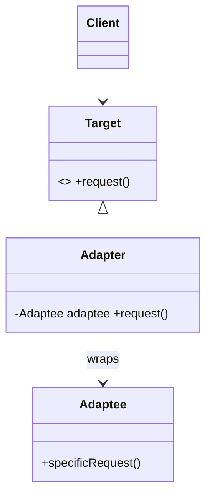
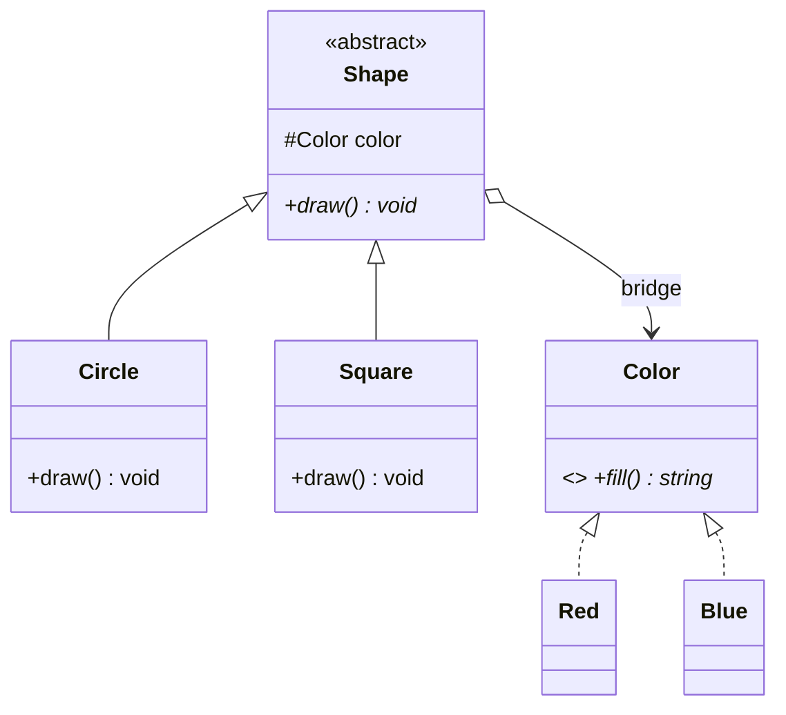
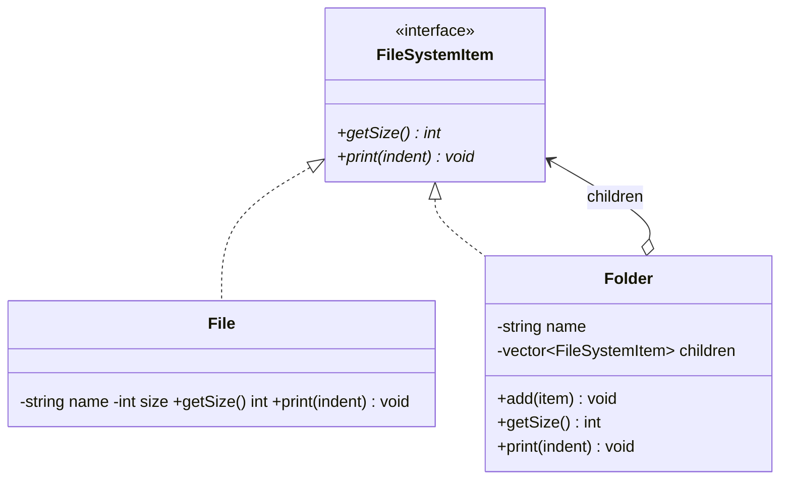
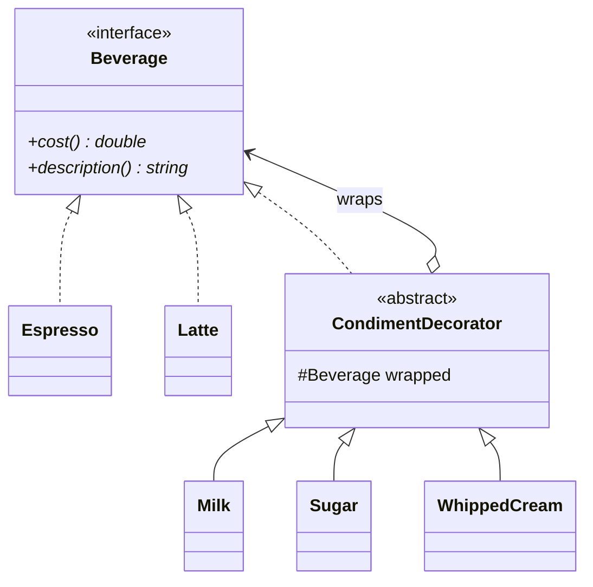
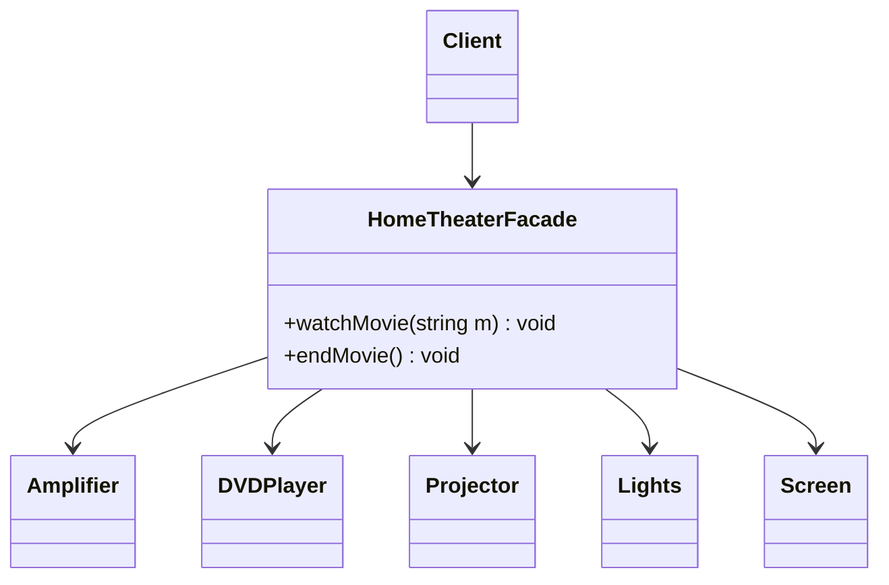
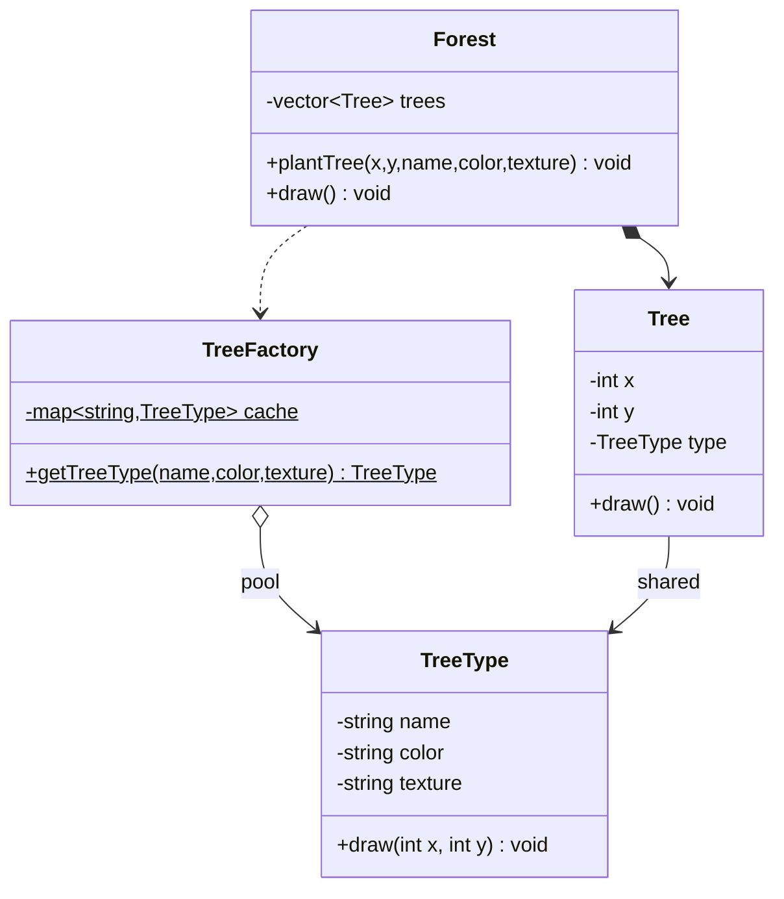
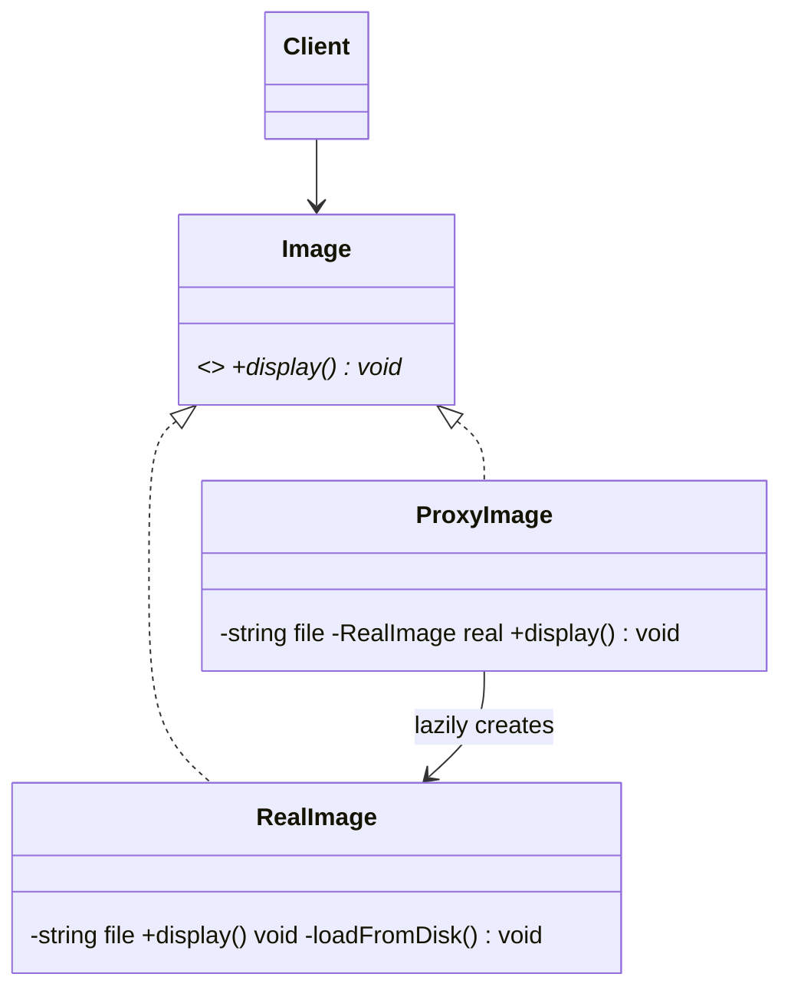

# LLD Notes: Part 5. Structural Design Patterns (C++)

---

## Table of Contents

0. Structural patterns: the big picture
1. Adapter
2. Bridge
3. Composite
4. Decorator
5. Facade
6. Flyweight
7. Proxy
8. Comparison tables (the confusing pairs)
9. Which pattern when? (decision flow)
10. Interview Q&A
11. One-page cheat sheet

---

## 0. Structural Patterns: The Big Picture

**Concern:** how to **compose classes and objects into larger structures** while keeping those structures **flexible and efficient**.

**Core problem:** classes with incompatible interfaces, deep inheritance trees, tangled subsystems, or objects that are too heavy/too many. Structural patterns fix these using mostly **composition (has-a)** rather than inheritance (Part 1, Part 2).

| Pattern | One-line intent | Typical trigger |
|---|---|---|
| **Adapter** | Convert one interface into another the client expects | Integrating a legacy/3rd-party class with the wrong interface |
| **Bridge** | Split **abstraction** from **implementation** so both vary independently | Class explosion from 2 dimensions of variation |
| **Composite** | Treat **single objects and groups uniformly** (tree) | File system, UI tree, org chart, menu |
| **Decorator** | Add responsibilities **dynamically** by wrapping | Optional add-ons (coffee toppings, stream wrappers) |
| **Facade** | One **simple interface** to a complex subsystem | Hide messy subsystem calls behind one method |
| **Flyweight** | **Share** common state to save memory across many objects | Thousands of similar objects (text characters, trees, particles) |
| **Proxy** | A **stand-in** that controls access to another object | Lazy loading, access control, caching, remote access |

> ⚡ **Quick Recall**
> **A**dapter = *make it fit*. **B**ridge = *separate two hierarchies*. **C**omposite = *tree, uniform*. **D**ecorator = *wrap to add*. **F**acade = *simplify*. **F**lyweight = *share to save memory*. **P**roxy = *control access*.
> (Mnemonic: **A B C D F F P**)

**Structural patterns and SOLID**
- **OCP:** Decorator, Bridge, Composite let you extend without editing.
- **DIP:** Adapter, Bridge depend on abstractions.
- **SRP:** Facade, Proxy separate concerns (access control, simplification) from the core logic.
- **Composition over inheritance:** the theme of almost all of them.

---

## 1. Adapter

### 1.1 Intent
> *Convert the interface of a class into another interface clients expect. Adapter lets classes work together that couldn't otherwise because of incompatible interfaces.*

**Real-world analogy:** A **travel plug adapter**. Your laptop has a 3-pin plug; the foreign wall socket has 2 round holes. The adapter sits between and converts. Neither the laptop nor the socket changes.

### 1.2 Problem
You have a **Target interface** your code expects, and an existing class (**Adaptee**, often third-party or legacy) that does the right job but with a **different interface**. You **can't (or shouldn't) modify the Adaptee**.

```cpp
// Client expects this:
class MediaPlayer { public: virtual void play(const string& file) = 0; virtual ~MediaPlayer() = default; };

// 3rd-party library gives this (can't change it):
class VLCLibrary { public: void playVLC(const string& f) { cout << "VLC playing " << f << "\n"; } };
```
Client calls `play(...)`; library only has `playVLC(...)`. Incompatible.

### 1.3 Structure

```
 Client ----> <<interface>> Target                 Adaptee
              + request()                          + specificRequest()
                    ^                                    ^
                    |                                    | (holds / inherits)
                 Adapter -----------------------------------
                 + request() { adaptee.specificRequest(); }
```



### 1.4 C++ code: Object Adapter (composition, preferred)

```cpp
// ---------- Target (what client expects) ----------
class MediaPlayer {
public:
    virtual void play(const string& file) = 0;
    virtual ~MediaPlayer() = default;
};

// ---------- Adaptee (incompatible, can't modify) ----------
class VLCLibrary {
public:
    void playVLC(const string& f) { cout << "VLC playing " << f << "\n"; }
};

// ---------- Adapter ----------
class VLCAdapter : public MediaPlayer {
    VLCLibrary vlc;                                   // composition
public:
    void play(const string& file) override {
        vlc.playVLC(file);                            // translate the call
    }
};

// ---------- Client ----------
void listen(MediaPlayer& p, const string& f) { p.play(f); }

int main() {
    VLCAdapter adapter;
    listen(adapter, "song.vlc");                      // client knows nothing about VLCLibrary
}
```

### 1.5 Two kinds of Adapter

| | **Object Adapter** | **Class Adapter** |
|---|---|---|
| Mechanism | **Composition**: holds an Adaptee | **Multiple inheritance**: inherits Target (public) + Adaptee (private) |
| Flexibility | Can adapt Adaptee **and its subclasses** | Bound to one concrete Adaptee |
| Overriding Adaptee behavior | Harder | Easy |
| C++ support | ✅ Preferred | ✅ Possible (C++ has multiple inheritance) |
| Verdict | **Default choice** (composition over inheritance) | Use rarely |

```cpp
// Class adapter (C++ multiple inheritance)
class VLCClassAdapter : public MediaPlayer, private VLCLibrary {
public:
    void play(const string& f) override { playVLC(f); }
};
```

### 1.6 Realistic example: payment gateway adapter (very common in LLD)

```cpp
class PaymentProcessor {                              // Target used across our app
public:
    virtual bool pay(double amountInRupees) = 0;
    virtual ~PaymentProcessor() = default;
};

class StripeSDK {                                     // 3rd-party, works in CENTS with different method name
public:
    bool charge(long amountCents, const string& currency) {
        cout << "Stripe charged " << amountCents << " " << currency << "\n"; return true;
    }
};
class PayPalSDK {                                     // 3rd-party, different signature again
public:
    int makePayment(const string& currency, double amount) {
        cout << "PayPal paid " << amount << " " << currency << "\n"; return 1;
    }
};

class StripeAdapter : public PaymentProcessor {
    StripeSDK sdk;
public:
    bool pay(double amt) override { return sdk.charge(static_cast<long>(amt * 100), "INR"); }
};
class PayPalAdapter : public PaymentProcessor {
    PayPalSDK sdk;
public:
    bool pay(double amt) override { return sdk.makePayment("INR", amt) == 1; }
};

// Checkout depends only on PaymentProcessor (DIP), and adding Razorpay = one new adapter (OCP).
```

### 1.7 Pros / Cons
| Pros | Cons |
|---|---|
| **SRP**: interface conversion separated from business logic | Adds an extra class/indirection |
| **OCP**: new adapters without touching client or adaptee | Many adapters if many incompatible libraries |
| Reuse legacy/3rd-party code without modifying it | Sometimes simpler to change the adaptee (if you own it) |

### 1.8 Use cases
- Legacy system integration; wrapping third-party SDKs (payment, SMS, maps, logging).
- Data format conversion (XML ↔ JSON).
- Making `std::` containers/APIs match your own interface.
- Unit-test seams around external services.

### 1.9 Interview traps
- *"Adapter vs Facade?"* → Adapter makes **one** incompatible interface fit **another expected** interface. Facade **simplifies** a whole subsystem behind a **new** interface (section 8).
- *"Adapter vs Decorator?"* → Adapter **changes** the interface; Decorator keeps the **same** interface and adds behavior.
- *"When to use class vs object adapter?"* → Object adapter by default (composition).
- Adapter is usually applied **after the fact** (to fix a mismatch); Bridge is applied **up front** (by design).

> ⚡ **Quick Recall**
> Adapter = **wrapper that translates** Target's method calls into Adaptee's. Client stays unchanged. Default to **object adapter (composition)**.

---

## 2. Bridge

### 2.1 Intent
> *Decouple an **abstraction** from its **implementation** so the two can **vary independently**.*

**Real-world analogy:** A **universal remote** (abstraction) and **devices** (TV, radio; implementation). Different remotes (basic, advanced) can control any device. You don't need `BasicTVRemote`, `AdvancedTVRemote`, `BasicRadioRemote`, `AdvancedRadioRemote`...

### 2.2 Problem: class explosion from two dimensions

You have **two independent dimensions**: shapes (Circle, Square) × colors (Red, Blue).
With plain inheritance:
```
Shape
├── RedCircle, BlueCircle
└── RedSquare, BlueSquare       // 2 × 2 = 4 classes
```
Add `Triangle` → +2 classes. Add `Green` → +3 classes. Growth is **M × N** and multiplicative. This is the **cartesian product explosion**.

### 2.3 Solution
Split into **two hierarchies** and connect them by **composition** (the "bridge"):
- **Abstraction hierarchy**: `Shape` (Circle, Square) holds a reference to...
- **Implementation hierarchy**: `Color` (Red, Blue).

Now it's **M + N** classes instead of **M × N**.

### 2.4 Structure

```
   Abstraction  <>-------------->  <<interface>> Implementor
   + operation()  (bridge)         + operationImpl()
        ^                                   ^
        |                                   |
  RefinedAbstraction              ConcreteImplementorA / B
```



### 2.5 C++ code

```cpp
// ---------- Implementation hierarchy ----------
class Color {
public:
    virtual string fill() const = 0;
    virtual ~Color() = default;
};
class Red  : public Color { public: string fill() const override { return "red"; } };
class Blue : public Color { public: string fill() const override { return "blue"; } };

// ---------- Abstraction hierarchy ----------
class Shape {
protected:
    shared_ptr<Color> color;                          // THE BRIDGE (composition)
public:
    explicit Shape(shared_ptr<Color> c) : color(std::move(c)) {}
    virtual void draw() const = 0;
    virtual ~Shape() = default;
};
class Circle : public Shape {
public:
    using Shape::Shape;
    void draw() const override { cout << "Circle filled with " << color->fill() << "\n"; }
};
class Square : public Shape {
public:
    using Shape::Shape;
    void draw() const override { cout << "Square filled with " << color->fill() << "\n"; }
};

int main() {
    Circle c(make_shared<Red>());
    Square s(make_shared<Blue>());
    c.draw();   // Circle filled with red
    s.draw();   // Square filled with blue
}
// New shape (Triangle) = +1 class.  New color (Green) = +1 class.  No combos.
```

### 2.6 Realistic example: Notification × Channel

```cpp
class MessageSender {                                 // implementation: HOW it's sent
public:
    virtual void send(const string& text) = 0;
    virtual ~MessageSender() = default;
};
class EmailSender : public MessageSender { public: void send(const string& t) override { cout << "Email: " << t << "\n"; } };
class SMSSender   : public MessageSender { public: void send(const string& t) override { cout << "SMS: "   << t << "\n"; } };

class Notification {                                  // abstraction: WHAT kind of notification
protected:
    unique_ptr<MessageSender> sender;
public:
    explicit Notification(unique_ptr<MessageSender> s) : sender(std::move(s)) {}
    virtual void notify(const string& msg) = 0;
    virtual ~Notification() = default;
};
class UrgentNotification : public Notification {
public:
    using Notification::Notification;
    void notify(const string& m) override { sender->send("[URGENT] " + m); }
};
class NormalNotification : public Notification {
public:
    using Notification::Notification;
    void notify(const string& m) override { sender->send(m); }
};

// UrgentNotification(make_unique<SMSSender>()) → any combination, no class explosion.
```

### 2.7 Pros / Cons
| Pros | Cons |
|---|---|
| Avoids **M × N** class explosion (→ M + N) | Adds complexity for a simple, single-dimension problem |
| **OCP**: extend either hierarchy independently | Requires identifying the two dimensions **up front** |
| **SRP**: high-level logic vs low-level details | One more level of indirection |
| Runtime swapping of implementation | |
| Hides implementation from client (also reduces C++ recompilation via the *pimpl* idiom) | |

### 2.8 Use cases
- Cross-platform GUI (Window abstraction × OS-specific rendering).
- **Device × Remote**; **Shape × Renderer** (OpenGL/DirectX); **Notification × Channel**; **Payment type × Gateway**; **Database driver** abstraction (JDBC-style).
- **Pimpl (pointer to implementation) idiom** in C++ is a Bridge variant used to hide private members and cut compile times.

### 2.9 Interview traps
- *"Bridge vs Adapter?"* → **Bridge is designed up front** to let two hierarchies evolve independently. **Adapter is a retrofit** to make existing incompatible classes work together.
- *"Bridge vs Strategy?"* → Structurally almost identical (both use composition + interface). **Intent differs**: Strategy swaps an **algorithm** (behavioral); Bridge separates a whole **abstraction hierarchy** from an **implementation hierarchy** (structural).
- *"How do you spot a Bridge opportunity?"* → Class names combine two concepts (`RedCircle`, `EmailUrgentNotification`), a sign of two dimensions.

> ⚡ **Quick Recall**
> Bridge = **two hierarchies joined by composition**. Kills M×N class explosion (→ M+N). Spot: class names glue two concepts together.

---

## 3. Composite

### 3.1 Intent
> *Compose objects into **tree structures** to represent **part-whole hierarchies**. Composite lets clients treat **individual objects and compositions uniformly**.*

**Real-world analogy:** **File system**: a **Folder** contains Files and other Folders. You can ask either "what's your size?" and get an answer. A folder sums its children.

### 3.2 Problem
You have a tree of objects; client code must constantly distinguish **leaf** vs **group**:
```cpp
if (isFile(node)) size += node.size();
else for (child : node.children) ... recursion + type checks   // ❌ messy
```

### 3.3 Solution
Define a **common interface** for both leaves and containers. Containers **delegate** to children **recursively**. The client treats everything as a `Component`.

### 3.4 Structure

```
            <<interface>> Component
            + operation()
                 ^
        _________|_________
       |                   |
     Leaf              Composite
     + operation()     - children : list<Component>
                       + add(Component) / remove(Component)
                       + operation() { for c in children: c.operation() }
```



### 3.5 C++ code

```cpp
// ---------- Component ----------
class FileSystemItem {
public:
    virtual int getSize() const = 0;
    virtual void print(int indent = 0) const = 0;
    virtual ~FileSystemItem() = default;
};

// ---------- Leaf ----------
class File : public FileSystemItem {
    string name; int size;
public:
    File(string n, int s) : name(std::move(n)), size(s) {}
    int getSize() const override { return size; }
    void print(int indent) const override { cout << string(indent, ' ') << "- " << name << " (" << size << "KB)\n"; }
};

// ---------- Composite ----------
class Folder : public FileSystemItem {
    string name;
    vector<shared_ptr<FileSystemItem>> children;
public:
    explicit Folder(string n) : name(std::move(n)) {}
    void add(shared_ptr<FileSystemItem> item) { children.push_back(std::move(item)); }
    int getSize() const override {
        int total = 0;
        for (const auto& c : children) total += c->getSize();     // recursion via polymorphism
        return total;
    }
    void print(int indent) const override {
        cout << string(indent, ' ') << "+ " << name << "/\n";
        for (const auto& c : children) c->print(indent + 2);
    }
};

int main() {
    auto root = make_shared<Folder>("root");
    auto docs = make_shared<Folder>("docs");
    docs->add(make_shared<File>("cv.pdf", 200));
    docs->add(make_shared<File>("notes.txt", 15));
    root->add(docs);
    root->add(make_shared<File>("photo.jpg", 500));

    root->print();
    cout << "Total: " << root->getSize() << "KB\n";           // 715KB
}
/* Output:
+ root/
  + docs/
    - cv.pdf (200KB)
    - notes.txt (15KB)
  - photo.jpg (500KB)
Total: 715KB
*/
```

### 3.6 Design decision: where to put `add()` / `remove()`?

| Approach | Description | Trade-off |
|---|---|---|
| **Transparency** | `add/remove` declared in `Component` (leaf gets a no-op/throws) | Uniform interface ✅ but leaf has meaningless methods (LSP/ISP smell ❌) |
| **Safety** | `add/remove` only in `Composite` | Type-safe ✅ but client must know it holds a Composite to add (needs `dynamic_cast` or a typed handle) |

**Common interview answer:** GoF favor transparency; modern design usually prefers **safety** (keep `add` on `Folder`, build tree via typed handles) to respect ISP/LSP (Part 2).

### 3.7 Other examples
- **UI:** `Panel` contains `Button`, `Label`, and other `Panel`s → `render()` recurses.
- **Organization chart:** `Manager` has `Employees` (and other Managers) → `getSalaryCost()`.
- **Menu:** `Menu` contains `MenuItem`s and sub-`Menu`s.
- **Expression tree:** `Add(Num, Mul(Num, Num))` → `evaluate()`.
- **Game scene graph**, **graphics groups** (group of shapes).

### 3.8 Pros / Cons
| Pros | Cons |
|---|---|
| Client code is **simple and uniform** (no leaf/composite checks) | Interface may be **too general** (hard to restrict what can be child of what) |
| **OCP**: new component types without changing client | Leaf inherits methods that are meaningless (transparency approach) |
| Natural recursion for tree operations | Hard to enforce type constraints (e.g., "a Folder can't contain X") |
| Simple to add new node kinds | Overhead for shallow trees |

### 3.9 Interview traps
- *"Composite vs Decorator?"* → Both are recursive composition with the same interface. **Composite** aggregates **many** children to get a **sum/whole** (tree). **Decorator** wraps **one** object to **add behavior** (chain). (Section 8.)
- *"Where does the recursion happen?"* → In the Composite's implementation, which calls the same method on each child.
- *"Cycle danger?"* → Adding a folder into its own descendant creates an infinite loop; guard against it.
- *"Ownership?"* → Composite owns children (composition); use `shared_ptr` or `unique_ptr` (Part 1).

> ⚡ **Quick Recall**
> Composite = **Leaf and Group share one interface**; groups loop over children calling the same method. Use for **trees** (folders, menus, org charts).

---

## 4. Decorator

### 4.1 Intent
> *Attach **additional responsibilities** to an object **dynamically**. Decorators provide a flexible alternative to subclassing for extending functionality.*

**Real-world analogy:** **Ordering coffee.** Base = espresso. You **wrap** it with milk, then sugar, then whipped cream. Each addition wraps the previous and adds cost and description. No `EspressoWithMilkAndSugarAndWhip` class needed.

### 4.2 Problem: subclass explosion for feature combinations

```
Coffee
├── CoffeeWithMilk
├── CoffeeWithSugar
├── CoffeeWithMilkAndSugar
├── CoffeeWithMilkAndSugarAndWhip ...       // 2^n combinations
```
n optional add-ons → 2ⁿ subclasses. Inheritance is **static** (compile-time) and can't add/remove features at runtime.

### 4.3 Solution
Create **wrapper classes** that:
1. Implement the **same interface** as the object they wrap, and
2. **Hold a reference** to the wrapped object,
3. **Delegate** the call to it, then **add their own behavior** before/after.

Wrappers can be **stacked** in any order/combination.

### 4.4 Structure

```
     <<interface>> Component
     + operation()
          ^
    ______|__________________
   |                         |
ConcreteComponent        Decorator (abstract)
+ operation()            - wrapped : Component
                         + operation() { wrapped.operation(); }
                              ^
                        _____|______
                       |            |
                 DecoratorA     DecoratorB
                 + operation() { Decorator::operation(); addedBehavior(); }
```



### 4.5 C++ code: Coffee shop (the canonical example)

```cpp
// ---------- Component ----------
class Beverage {
public:
    virtual string description() const = 0;
    virtual double cost() const = 0;
    virtual ~Beverage() = default;
};

// ---------- Concrete components ----------
class Espresso : public Beverage {
public:
    string description() const override { return "Espresso"; }
    double cost() const override { return 60.0; }
};
class Latte : public Beverage {
public:
    string description() const override { return "Latte"; }
    double cost() const override { return 90.0; }
};

// ---------- Base Decorator ----------
class CondimentDecorator : public Beverage {
protected:
    unique_ptr<Beverage> wrapped;                     // holds the thing being decorated
public:
    explicit CondimentDecorator(unique_ptr<Beverage> b) : wrapped(std::move(b)) {}
};

// ---------- Concrete decorators ----------
class Milk : public CondimentDecorator {
public:
    using CondimentDecorator::CondimentDecorator;
    string description() const override { return wrapped->description() + ", Milk"; }
    double cost() const override { return wrapped->cost() + 15.0; }
};
class Sugar : public CondimentDecorator {
public:
    using CondimentDecorator::CondimentDecorator;
    string description() const override { return wrapped->description() + ", Sugar"; }
    double cost() const override { return wrapped->cost() + 5.0; }
};
class WhippedCream : public CondimentDecorator {
public:
    using CondimentDecorator::CondimentDecorator;
    string description() const override { return wrapped->description() + ", Whipped Cream"; }
    double cost() const override { return wrapped->cost() + 25.0; }
};

int main() {
    unique_ptr<Beverage> order = make_unique<Espresso>();
    order = make_unique<Milk>(std::move(order));              // wrap
    order = make_unique<Sugar>(std::move(order));             // wrap again
    order = make_unique<WhippedCream>(std::move(order));      // and again

    cout << order->description() << " = Rs " << order->cost() << "\n";
    // Espresso, Milk, Sugar, Whipped Cream = Rs 105
}
```
**Reading the call:** `WhippedCream.cost()` → asks `Sugar.cost()` → asks `Milk.cost()` → asks `Espresso.cost()`. Each layer adds its bit on the way back.

### 4.6 Second example: I/O streams (shows real-world usage)

```cpp
class DataSource { public: virtual void write(const string&) = 0; virtual string read() = 0; virtual ~DataSource() = default; };
class FileDataSource : public DataSource { /* plain file read/write */ };

class DataSourceDecorator : public DataSource {
protected: unique_ptr<DataSource> wrapped;
public: explicit DataSourceDecorator(unique_ptr<DataSource> w) : wrapped(std::move(w)) {}
};
class EncryptionDecorator  : public DataSourceDecorator { /* encrypt before write, decrypt after read */ };
class CompressionDecorator : public DataSourceDecorator { /* compress before write, decompress after read */ };

// Compression → Encryption → File:
// auto src = make_unique<CompressionDecorator>(make_unique<EncryptionDecorator>(make_unique<FileDataSource>("a.dat")));
```
The same idea appears in Java's `BufferedReader(new InputStreamReader(...))` and in middleware/logging/auth chains.

### 4.7 Key ideas
- **Same interface as the wrapped object** (IS-A) **and** holds one (HAS-A). This "is-a and has-a" pair is the signature of Decorator.
- **Order matters:** compress-then-encrypt ≠ encrypt-then-compress.
- Decorators are **stackable** and can be added/removed at **runtime**.
- **Open/Closed:** add a new topping = one new class.

### 4.8 Pros / Cons
| Pros | Cons |
|---|---|
| Extend behavior **without subclass explosion** | **Many small classes** |
| **Runtime** composition (add/remove wrappers) | Hard to remove a **specific** wrapper from the middle of the stack |
| **SRP**: each decorator has one concern | Behavior depends on **wrapping order** (subtle bugs) |
| **OCP**: new decorators without editing existing ones | Object identity: decorated object ≠ original (`==`, `dynamic_cast` surprises) |
| Alternative to inheritance (composition over inheritance) | Initial configuration code can look bulky (mitigate with a builder/factory) |

### 4.9 Use cases
- Beverages/pizza toppings/meals with add-ons.
- **I/O streams** (buffering, encryption, compression).
- **Logging / auth / caching / rate-limit middleware** around a service.
- **UI**: adding scrollbars/borders to widgets.
- Adding **validation/formatting** layers around text processors.

### 4.10 Interview traps
- *"Decorator vs Inheritance?"* → Inheritance adds behavior **at compile time to all instances of a class**; Decorator adds behavior **at runtime to a specific object**.
- *"Decorator vs Proxy?"* → Same structure; **intent** differs. Decorator **adds** behavior (client decides the wrapping). Proxy **controls access** (proxy usually manages the lifecycle of the real object). (Section 8.)
- *"Decorator vs Composite?"* → Decorator wraps **one**, adds behavior. Composite holds **many**, aggregates results.
- *"Why does the Decorator inherit from Component AND hold a Component?"* → To be **substitutable** anywhere a Component is expected (LSP) while **delegating** to the inner one.

> ⚡ **Quick Recall**
> Decorator = **wrapper with the same interface** that delegates then adds behavior. **Stack them** for combinations. Beats `2ⁿ` subclasses. Order of wrapping matters.

---

## 5. Facade

### 5.1 Intent
> *Provide a **unified, simplified interface** to a set of interfaces in a **subsystem**. Facade defines a higher-level interface that makes the subsystem easier to use.*

**Real-world analogy:** A **hotel receptionist** or **restaurant waiter**. You say "I want a room for two nights"; the receptionist coordinates housekeeping, billing, and key-card systems. You don't call each department yourself.

### 5.2 Problem
Using a subsystem requires **many calls in the right order across many classes**. Clients get coupled to internals.

```cpp
// ❌ Client must know all subsystem parts and the correct order
Amplifier amp; DVDPlayer dvd; Projector proj; Lights lights; Screen screen;
lights.dim(10); screen.down(); proj.on(); proj.setInput("dvd");
amp.on(); amp.setVolume(5); dvd.on(); dvd.play("Movie");
```

### 5.3 Solution
Create a **Facade** with a few high-level methods that orchestrate the subsystem. Clients call the facade only.

### 5.4 Structure

```
 Client ---> Facade  ---> SubsystemA
             + doTask()   SubsystemB
                          SubsystemC   (still accessible directly if needed)
```



### 5.5 C++ code

```cpp
// ---------- Complex subsystem ----------
class Amplifier { public: void on(){cout<<"Amp on\n";} void setVolume(int v){cout<<"Volume "<<v<<"\n";} void off(){cout<<"Amp off\n";} };
class DVDPlayer { public: void on(){cout<<"DVD on\n";} void play(const string& m){cout<<"Playing "<<m<<"\n";} void off(){cout<<"DVD off\n";} };
class Projector { public: void on(){cout<<"Projector on\n";} void setInput(const string& s){cout<<"Input: "<<s<<"\n";} void off(){cout<<"Projector off\n";} };
class Lights    { public: void dim(int p){cout<<"Lights at "<<p<<"%\n";} void on(){cout<<"Lights on\n";} };
class Screen    { public: void down(){cout<<"Screen down\n";} void up(){cout<<"Screen up\n";} };

// ---------- Facade ----------
class HomeTheaterFacade {
    Amplifier& amp; DVDPlayer& dvd; Projector& proj; Lights& lights; Screen& screen;
public:
    HomeTheaterFacade(Amplifier& a, DVDPlayer& d, Projector& p, Lights& l, Screen& s)
        : amp(a), dvd(d), proj(p), lights(l), screen(s) {}

    void watchMovie(const string& movie) {
        cout << "--- Get ready to watch " << movie << " ---\n";
        lights.dim(10);
        screen.down();
        proj.on(); proj.setInput("dvd");
        amp.on();  amp.setVolume(5);
        dvd.on();  dvd.play(movie);
    }
    void endMovie() {
        cout << "--- Shutting down ---\n";
        dvd.off(); amp.off(); proj.off(); screen.up(); lights.on();
    }
};

int main() {
    Amplifier a; DVDPlayer d; Projector p; Lights l; Screen s;
    HomeTheaterFacade theater(a, d, p, l, s);
    theater.watchMovie("Inception");                  // ONE call instead of 8
    theater.endMovie();
}
```

### 5.6 Realistic LLD example: Order placement facade

```cpp
class OrderFacade {                                   // used by the API/controller layer
    InventoryService& inventory; PaymentService& payment; ShippingService& shipping; NotificationService& notifier;
public:
    OrderFacade(InventoryService& i, PaymentService& p, ShippingService& s, NotificationService& n)
        : inventory(i), payment(p), shipping(s), notifier(n) {}

    bool placeOrder(const Order& o) {
        if (!inventory.reserve(o))        return false;
        if (!payment.charge(o))           { inventory.release(o); return false; }   // compensate
        shipping.schedule(o);
        notifier.send(o.customerEmail(), "Order confirmed");
        return true;
    }
};
```

### 5.7 Key ideas
- Facade **doesn't hide** the subsystem, it offers a **convenient entry point**. Advanced clients can still use subsystem classes directly.
- Facade contains **no business logic of its own**, only **coordination**. (Otherwise it becomes a **God class**.)
- You can have **multiple facades** for different client needs (e.g., `AdminFacade`, `CustomerFacade`).
- Layering: facades are how you define **boundaries between layers/modules**.

### 5.8 Pros / Cons
| Pros | Cons |
|---|---|
| **Simplifies** usage; reduces client-subsystem coupling | Can grow into a **God object** coupled to everything |
| Promotes **layered architecture**, **Law of Demeter** (Part 2) | Adds an extra layer/indirection |
| Subsystem can change internally without breaking clients | May hide useful capabilities if overly restrictive |
| Easier testing (mock the facade) | |

### 5.9 Use cases
- Library/SDK wrappers (simple `send()` hiding SMTP handshake steps).
- Video converter (`convert(file, "mp4")` hides codecs, bitrate, muxers).
- Booking systems (search + pay + confirm + email).
- Compiler (`compile()` hides lexer, parser, optimizer, codegen).
- Microservice **API gateway**-style aggregation (conceptually).

### 5.10 Interview traps
- *"Facade vs Adapter?"* → Facade **simplifies** many classes behind a **new** interface. Adapter **converts** one class's interface to **an existing expected** one. (Section 8.)
- *"Does Facade violate OCP/SRP?"* → Not if it only orchestrates. It risks SRP violation if business logic creeps in.
- *"Facade vs Mediator?"* → Facade is **one-way**: clients → subsystem (subsystem unaware of the facade). Mediator is **two-way**: colleagues talk **through** the mediator.
- *"Can a Facade be a Singleton?"* → Often yes (one is enough).

> ⚡ **Quick Recall**
> Facade = **one simple method that orchestrates many subsystem calls**. Coordination only, no business logic. Subsystem stays accessible.

---

## 6. Flyweight

### 6.1 Intent
> *Use **sharing** to support a **large number of fine-grained objects** efficiently.*

**Real-world analogy:** A **text editor**. A document with 1,000,000 characters doesn't store 1,000,000 full "character objects" with font/size/style each. It shares **one object per glyph (e.g., 'a' in Arial 12)** and just records **position** separately.

### 6.2 Problem
You need **huge numbers of similar objects** (game trees/bullets/particles, text characters, map markers); memory runs out because each carries duplicate heavy data (mesh, texture, color, font).

### 6.3 Key concept: split object state into two kinds

| State | Meaning | Where it lives | Example (Tree in a forest) |
|---|---|---|---|
| **Intrinsic** | **Shared, context-independent, immutable**, same across many objects | **Inside** the flyweight (shared) | type name, color, texture, mesh |
| **Extrinsic** | **Unique per use, context-dependent**, varies | **Outside** (passed in by client, or stored in a context object) | x, y position, age, scale |

Rule: **Flyweights store only intrinsic state.** Extrinsic state is supplied **by the caller** when needed (as method parameters).

### 6.4 Structure

```
 Client ---> FlyweightFactory ---> Flyweight (intrinsic state, shared, immutable)
             + getFlyweight(key)     + operation(extrinsicState)
             - pool : map<key, Flyweight>
 Context (extrinsic state: x, y, ...) --- holds ---> Flyweight reference
```



### 6.5 C++ code: Forest of trees

```cpp
// ---------- Flyweight: intrinsic (shared, immutable) state ----------
class TreeType {
    string name, color, texture;                      // heavy, shared
public:
    TreeType(string n, string c, string t) : name(std::move(n)), color(std::move(c)), texture(std::move(t)) {}
    void draw(int x, int y) const {                   // extrinsic state passed IN
        cout << "Drawing " << name << " (" << color << ") at (" << x << "," << y << ")\n";
    }
};

// ---------- Flyweight Factory: guarantees sharing ----------
class TreeFactory {
    static unordered_map<string, shared_ptr<TreeType>>& cache() {
        static unordered_map<string, shared_ptr<TreeType>> c;
        return c;
    }
public:
    static shared_ptr<TreeType> getTreeType(const string& name, const string& color, const string& tex) {
        string key = name + "|" + color + "|" + tex;
        auto& c = cache();
        auto it = c.find(key);
        if (it == c.end()) {
            it = c.emplace(key, make_shared<TreeType>(name, color, tex)).first;   // create ONCE
        }
        return it->second;                                                        // reuse
    }
    static size_t typesCreated() { return cache().size(); }
};

// ---------- Context: extrinsic state + reference to flyweight ----------
class Tree {
    int x, y;                                         // unique per tree (small)
    shared_ptr<TreeType> type;                        // shared (big data lives there)
public:
    Tree(int x, int y, shared_ptr<TreeType> t) : x(x), y(y), type(std::move(t)) {}
    void draw() const { type->draw(x, y); }
};

class Forest {
    vector<Tree> trees;
public:
    void plantTree(int x, int y, const string& name, const string& color, const string& tex) {
        trees.emplace_back(x, y, TreeFactory::getTreeType(name, color, tex));
    }
    void draw() const { for (auto& t : trees) t.draw(); }
};

int main() {
    Forest f;
    for (int i = 0; i < 100000; i++) {
        f.plantTree(rand() % 1000, rand() % 1000, "Oak",  "green", "oak.png");
        f.plantTree(rand() % 1000, rand() % 1000, "Pine", "dark-green", "pine.png");
    }
    cout << "200,000 trees, but only " << TreeFactory::typesCreated() << " TreeType objects\n";   // 2
}
```
**Memory math:** without Flyweight: 200,000 × (heavy texture ~ MBs). With Flyweight: 2 heavy objects + 200,000 × (two ints + one pointer).

### 6.6 Key rules
1. Flyweight must be **immutable** (intrinsic state never changes after creation), because it's shared. Mutating it would affect every user.
2. Objects must be obtained **only via the factory** (so sharing is guaranteed). Make constructors private/protected where possible.
3. **Extrinsic state** is passed to methods or stored in a lightweight context object.
4. **Thread safety:** the factory's cache needs a mutex if accessed from multiple threads; flyweights, being immutable, are inherently thread-safe.

### 6.7 Pros / Cons
| Pros | Cons |
|---|---|
| **Huge memory savings** with many similar objects | Adds **complexity** (splitting state, factory, context) |
| Fewer allocations → faster, cache-friendlier | **CPU trade-off**: extrinsic state must be recomputed/passed each call |
| Centralized control of shared instances | Code is harder to read/understand |
| | Only worthwhile if there are **many** objects and much of their state is **shareable** |

### 6.8 Use cases
- **Text editors:** glyph/character objects per font/style.
- **Games:** trees, bullets, particles, tiles, enemies of the same type; sprites.
- **Maps:** icons/markers.
- **String interning** (same literal shared). C++ compilers may merge identical string literals (a kind of flyweight).
- **Connection/Thread objects?** No, that's Object Pool (different).
- **Chess pieces/board cells** (only type shared, position extrinsic).

### 6.9 Interview traps
- *"Flyweight vs Singleton?"* → Singleton = **one** instance of a class. Flyweight = **many shared instances**, one **per distinct intrinsic state** (a pool keyed by state).
- *"Flyweight vs Object Pool?"* → Flyweight shares **immutable** objects **concurrently** among many clients. Pool **lends out mutable** objects **exclusively**, one client at a time, then reclaims them.
- *"Flyweight vs Prototype?"* → Prototype **copies**; Flyweight **shares** (no copy).
- *"Why must flyweights be immutable?"* → They're shared; any change would leak to every referrer.
- *"How to decide what's intrinsic?"* → State that's **identical across many objects** and **doesn't depend on context**.

> ⚡ **Quick Recall**
> Flyweight = **intrinsic (shared, immutable) + extrinsic (passed in)** + a **factory cache**. Only worth it with **massive counts** of similar objects.

---

## 7. Proxy

### 7.1 Intent
> *Provide a **surrogate or placeholder** for another object to **control access** to it.*

**Real-world analogy:** A **credit card** is a proxy for your bank account. It has the same "pay" interface as cash but adds control (limit checks, authorization, logging). Or a **receptionist** who screens access to the manager.

### 7.2 Problem
You want to add **control** around an object (delay its creation, restrict access, cache results, log calls, talk over a network) **without changing the object or its clients**.

### 7.3 Structure

```
 Client ---> <<interface>> Subject
             + request()
                  ^
          ________|________
         |                 |
    RealSubject          Proxy
    + request()          - real : RealSubject*
                         + request() { /*control*/ real->request(); /*control*/ }
```



### 7.4 Types of Proxy (interview essential)

| Type | Purpose | Example |
|---|---|---|
| **Virtual Proxy** | **Lazy-initialize** an expensive object on first use | Load a huge image only when displayed |
| **Protection Proxy** | **Access control** by role/permission | Only admins may delete a document |
| **Remote Proxy** | Local **stand-in for a remote** object (hides network) | RPC/gRPC stub, REST client wrapper |
| **Caching Proxy** | **Cache results** of expensive calls | Cache DB/API responses |
| **Logging/Monitoring Proxy** | Record calls/timing | Audit trail, metrics |
| **Smart Reference / Smart Pointer** | Add bookkeeping on access (ref-counting, locking) | `shared_ptr` is a smart-reference proxy! |
| **Firewall / Rate-limit Proxy** | Throttle or filter access | API rate limiter |

### 7.5 C++ code: Virtual Proxy (lazy loading)

```cpp
class Image {
public:
    virtual void display() = 0;
    virtual ~Image() = default;
};

class RealImage : public Image {
    string file;
    void loadFromDisk() { cout << "Loading " << file << " from disk (SLOW)...\n"; }
public:
    explicit RealImage(string f) : file(std::move(f)) { loadFromDisk(); }   // expensive constructor
    void display() override { cout << "Displaying " << file << "\n"; }
};

class ProxyImage : public Image {
    string file;
    unique_ptr<RealImage> real;                       // not created yet
public:
    explicit ProxyImage(string f) : file(std::move(f)) {}       // cheap
    void display() override {
        if (!real) real = make_unique<RealImage>(file);          // lazy creation on first use
        real->display();
    }
};

int main() {
    ProxyImage img("huge_photo.png");    // instant, nothing loaded
    cout << "Proxy created\n";
    img.display();                        // loads now
    img.display();                        // already loaded, fast
}
```

### 7.6 C++ code: Protection Proxy

```cpp
class Document {
public:
    virtual void view() = 0;
    virtual void edit(const string& text) = 0;
    virtual ~Document() = default;
};
class RealDocument : public Document {
    string content = "secret plan";
public:
    void view() override { cout << "Content: " << content << "\n"; }
    void edit(const string& t) override { content = t; cout << "Edited\n"; }
};

enum class Role { GUEST, EDITOR, ADMIN };

class DocumentProxy : public Document {
    RealDocument real;
    Role role;
public:
    explicit DocumentProxy(Role r) : role(r) {}
    void view() override { real.view(); }             // everyone may view
    void edit(const string& t) override {
        if (role == Role::GUEST) { cout << "Access denied\n"; return; }   // protection
        real.edit(t);
    }
};
```

### 7.7 C++ code: Caching Proxy

```cpp
class WeatherService {
public:
    virtual string getForecast(const string& city) = 0;
    virtual ~WeatherService() = default;
};
class RealWeatherService : public WeatherService {
public:
    string getForecast(const string& city) override {
        cout << "Calling remote API for " << city << "...\n";      // slow and costly
        return "Sunny in " + city;
    }
};
class CachingWeatherProxy : public WeatherService {
    unique_ptr<WeatherService> real;
    unordered_map<string, string> cache;
public:
    explicit CachingWeatherProxy(unique_ptr<WeatherService> r) : real(std::move(r)) {}
    string getForecast(const string& city) override {
        auto it = cache.find(city);
        if (it != cache.end()) return it->second;                  // cache hit
        return cache[city] = real->getForecast(city);              // cache miss → delegate
    }
};
```

### 7.8 Key ideas
- Proxy and RealSubject share the **same interface** → client can't tell them apart (**LSP**).
- The proxy often **manages the lifecycle** of the real object (creates it lazily, holds ownership).
- Stackable with Decorator-like chains (caching proxy wrapping a logging proxy wrapping the real service).
- C++ built-ins that are proxies: `std::shared_ptr`/`unique_ptr` (smart reference), `std::vector<bool>::reference` (proxy object returned by `operator[]`), iterators.

### 7.9 Pros / Cons
| Pros | Cons |
|---|---|
| Control access **without changing** real object or client (**OCP**) | Extra layer → **latency**/complexity |
| Lazy init, caching, security, logging in **one** place (**SRP**) | Response may be **delayed** (e.g., first-call lazy load) |
| Manages the real object's lifecycle | More classes; one proxy per interface |
| Works even when the real object is unavailable (remote/not created yet) | Caching proxies risk **stale data** |

### 7.10 Use cases
- **ORM lazy loading** (load related entities on demand).
- **RPC/gRPC client stubs**, REST client wrappers.
- **API gateways / rate limiters / auth checks**.
- **Caching layers** in front of DB/HTTP services.
- **Smart pointers**, reference counting.
- **Access control** for documents, admin functions.

### 7.11 Interview traps
- *"Proxy vs Decorator?"* → Same shape (both wrap + same interface). **Decorator adds new behavior** the client composes; **Proxy controls access** to the object and typically **owns/creates it**. (Section 8.)
- *"Proxy vs Adapter?"* → Proxy keeps the **same interface**; Adapter **changes** the interface.
- *"Proxy vs Facade?"* → Proxy wraps **one** object with the **same** interface; Facade simplifies **many** objects with a **new** interface.
- *"Name the proxy types."* → Virtual, Protection, Remote, Caching, Smart reference, Logging.

> ⚡ **Quick Recall**
> Proxy = **same interface, controls access** (lazy, protect, remote, cache, log). Client can't tell it from the real thing.

---

## 8. Comparison Tables (The Confusing Pairs)

### 8.1 Adapter vs Bridge vs Facade

| | Adapter | Bridge | Facade |
|---|---|---|---|
| Intent | **Make incompatible interfaces work** | **Separate** abstraction from implementation | **Simplify** a complex subsystem |
| When applied | **After** (retrofit) | **Before** (up-front design) | Any time |
| Number of classes wrapped | One (adaptee) | Two hierarchies | Many (subsystem) |
| Interface | Converts to an **existing** Target | Abstraction's own interface | **New**, simpler interface |
| Changes existing code? | No | Designed in | No |

### 8.2 Decorator vs Proxy (same structure, different intent)

| | Decorator | Proxy |
|---|---|---|
| Intent | **Add behavior/responsibilities** | **Control access** to the object |
| Who builds the chain? | **Client** composes/stacks decorators | Proxy usually **creates/manages** the real object itself |
| Object lifecycle | Wrapped object passed in | Proxy may **lazily create** it |
| Stackable? | Yes, typically stacked | Usually a single layer |
| Client awareness | Client knows it's decorating | Client often unaware of proxy |
| Example | Milk + Sugar on coffee | Lazy image loader, permission check |

### 8.3 Composite vs Decorator

| | Composite | Decorator |
|---|---|---|
| Holds | **Many** children | **One** wrapped object |
| Purpose | Represent **part-whole tree**; aggregate results | **Add behavior** to one object |
| Recursion | Sum/aggregate over children | Chain of delegation |
| Structure | Tree | Linear chain |

### 8.4 Adapter vs Decorator vs Proxy (all wrap one object)

| | Adapter | Decorator | Proxy |
|---|---|---|---|
| Interface to client | **Different** from wrapped | **Same** | **Same** |
| What it adds | Translation | New responsibilities | Access control/laziness/caching |

### 8.5 Flyweight vs Singleton vs Object Pool vs Prototype

| | Flyweight | Singleton | Object Pool | Prototype |
|---|---|---|---|---|
| Instances | Many, shared per **state** | Exactly one | Fixed set, **lent out** | New copies |
| Mutability | **Immutable** | Usually mutable | Mutable (reset on return) | Mutable copies |
| Sharing | Concurrent | Global | Exclusive at a time | None (copy) |
| Goal | **Save memory** | Single point of access | Save **creation cost** | Create by cloning |

---

## 9. Which Pattern When? (Decision Flow)

```
Existing class has the WRONG interface for what I need?             → Adapter
Two independent dimensions causing M×N subclasses?                  → Bridge
Tree / part-whole; treat leaf and group the same?                   → Composite
Add optional features/responsibilities at runtime, stackable?       → Decorator
Complex subsystem; want one easy entry point?                       → Facade
Millions of similar objects blowing up memory?                      → Flyweight
Need to control access (lazy / protect / cache / remote / log)?     → Proxy
```

**Trigger phrases in interview problems**
| Phrase in requirements | Pattern |
|---|---|
| "integrate with third-party / legacy API" | Adapter |
| "supports multiple platforms/devices/renderers × multiple types" | Bridge |
| "folders and files", "menus and submenus", "org hierarchy" | Composite |
| "add-ons", "toppings", "optional features", "wrap with logging/encryption" | Decorator |
| "simplify", "single entry point", "hide complex workflow" | Facade |
| "thousands/millions of similar objects", "memory" | Flyweight |
| "lazy load", "access control", "cache", "remote" | Proxy |

**LLD problems and their structural patterns**
| Problem | Patterns typically used |
|---|---|
| File system / Unix `ls` | **Composite** |
| Coffee / Pizza / Burger billing | **Decorator** (+ Factory/Builder) |
| Payment integration | **Adapter** (+ Strategy/Factory) |
| Text editor / word processor | **Flyweight** (glyphs), **Composite** (document tree), **Decorator** (formatting) |
| Online shopping / booking | **Facade** (order placement) |
| Image gallery / lazy loading | **Proxy** |
| Logger with multiple outputs | Bridge (Logger × Sink), Decorator |
| Game with many units | **Flyweight** (+ Prototype) |

---

## 10. Interview Q&A

**Q1. What are structural patterns?**
Patterns about composing classes/objects into larger, flexible structures: Adapter, Bridge, Composite, Decorator, Facade, Flyweight, Proxy.

**Q2. Adapter vs Facade?**
Adapter converts one interface to another expected one (one class). Facade offers a new simplified interface over many classes.

**Q3. Adapter vs Bridge?**
Adapter is a retrofit to make existing incompatible things work. Bridge is planned up front to let abstraction and implementation vary independently.

**Q4. What problem does Bridge solve?**
M×N class explosion from two dimensions of variation, reduced to M+N via composition.

**Q5. Bridge vs Strategy?**
Same structure. Strategy = swap one algorithm (behavioral, single dimension). Bridge = separate two whole hierarchies (structural).

**Q6. Composite: explain with an example.**
File system. `File` (leaf) and `Folder` (composite) share `FileSystemItem`. `Folder::getSize()` sums children recursively; the client never checks the type.

**Q7. Transparency vs safety in Composite?**
Transparency: `add/remove` in the base (uniform but leaves get meaningless methods). Safety: only in Composite (type-safe but clients need to know the type).

**Q8. Decorator vs inheritance?**
Inheritance is static and applies to a class. Decorator is dynamic and applies to a single object, and it avoids 2ⁿ subclasses.

**Q9. Decorator vs Proxy?**
Same structure; Decorator adds behavior (client stacks wrappers), Proxy controls access (and usually manages the real object's lifecycle).

**Q10. Why does Decorator both inherit from and hold a Component?**
Inherit so it's substitutable (LSP); hold so it can delegate to the inner object.

**Q11. Does decorator order matter?**
Yes. `Compress(Encrypt(x))` ≠ `Encrypt(Compress(x))`.

**Q12. What is a Facade and what is its risk?**
A simple interface over a subsystem. Risk: becoming a God class if business logic creeps in.

**Q13. Explain intrinsic vs extrinsic state in Flyweight.**
Intrinsic = shared, immutable, context-independent (stored in flyweight). Extrinsic = unique, context-dependent (passed in by the client).

**Q14. Why must Flyweights be immutable?**
They are shared; a mutation would leak to every user.

**Q15. Flyweight vs Object Pool?**
Flyweight shares immutable objects concurrently; Pool lends mutable objects exclusively and reclaims them.

**Q16. Name the types of proxy.**
Virtual (lazy), Protection (access), Remote, Caching, Logging, Smart reference (e.g., `shared_ptr`).

**Q17. Proxy vs Adapter?**
Proxy keeps the same interface and controls access; Adapter changes the interface.

**Q18. Which C++ standard-library types are patterns in disguise?**
`shared_ptr`/`unique_ptr` (smart-reference Proxy), `std::vector<bool>::reference` (Proxy), iterators (Iterator pattern), `std::stack/queue/priority_queue` (Adapters over containers), streams with wrappers (Decorator-like).

**Q19. Which structural patterns rely on composition over inheritance?**
All of them, especially Bridge, Decorator, Proxy, Adapter (object form), Composite.

**Q20. Which pattern would you use for: (a) a lazily-loaded heavy report, (b) toppings on a pizza, (c) Windows/Mac UI × Button/Slider, (d) integrating Razorpay's SDK, (e) a file explorer?**
(a) Virtual Proxy, (b) Decorator, (c) Bridge (or Abstract Factory for the family), (d) Adapter, (e) Composite.

---

## 11. One-Page Cheat Sheet

```
ADAPTER    : wrap Adaptee, expose Target interface. Retrofit for incompatible/legacy/3rd-party.
             Object adapter (composition, preferred) vs Class adapter (multiple inheritance).
BRIDGE     : Abstraction --has-a--> Implementor. Two hierarchies, vary independently. Kills M×N → M+N.
             Designed UP FRONT. C++ pimpl idiom is a Bridge variant.
COMPOSITE  : Component interface; Leaf + Composite(children list). Composite delegates to children.
             Trees: file system, menus, org chart, UI. Transparency vs Safety for add()/remove().
DECORATOR  : same interface as wrapped + HAS-A wrapped; delegate then add. Stackable, runtime, order matters.
             Beats 2^n subclasses. Coffee toppings, streams, middleware.
FACADE     : one simple API orchestrating a subsystem. Coordination only (avoid God class). Subsystem still accessible.
FLYWEIGHT  : intrinsic (shared, immutable) in flyweight + extrinsic (passed in) + factory cache.
             Only for MASSIVE counts of similar objects. Text glyphs, game trees/bullets.
PROXY      : same interface, controls access: Virtual(lazy) Protection Remote Caching Logging Smart-ref.
             Proxy usually owns/creates the real object.

CONFUSING PAIRS
  Adapter  = change interface            | Facade    = simplify many classes, new interface
  Bridge   = planned split of 2 dims     | Adapter   = after-the-fact fix
  Decorator= ADD behavior (client stacks)| Proxy     = CONTROL access (proxy manages object)
  Composite= MANY children, tree         | Decorator = ONE wrapped, chain
  Flyweight= share IMMUTABLE objects     | Pool      = lend MUTABLE objects exclusively | Singleton = exactly one
Mnemonic: A B C D F F P  =  Adapter, Bridge, Composite, Decorator, Facade, Flyweight, Proxy
All rely on COMPOSITION over inheritance and support OCP/DIP/SRP.
```

---
