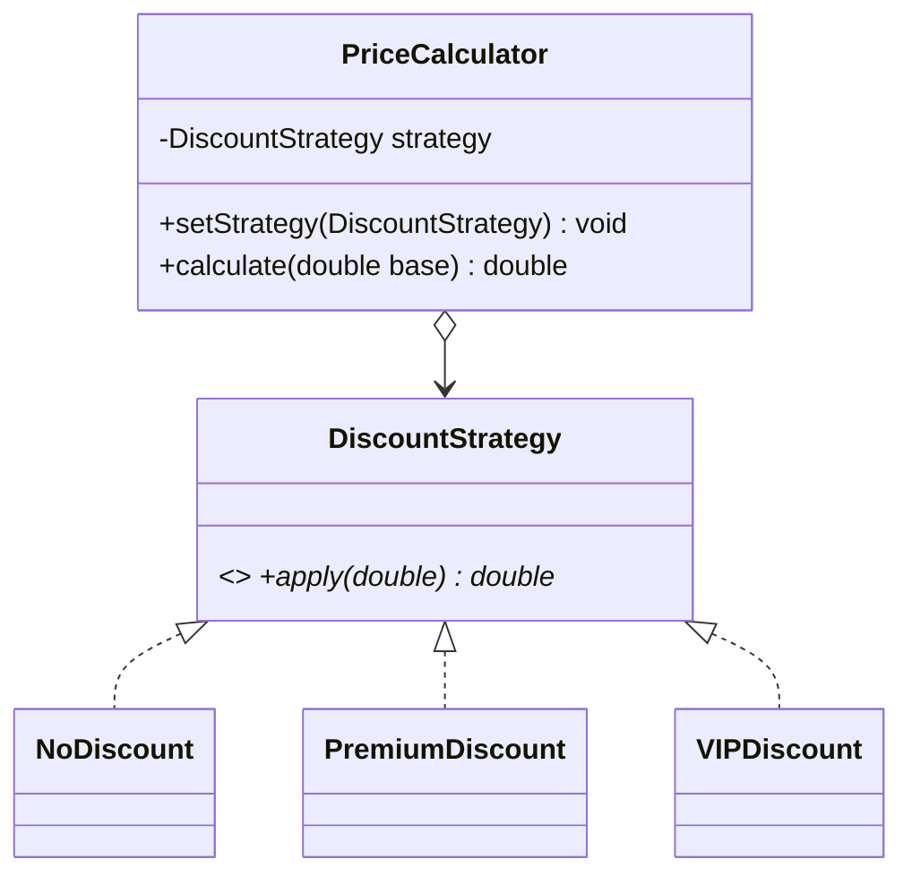
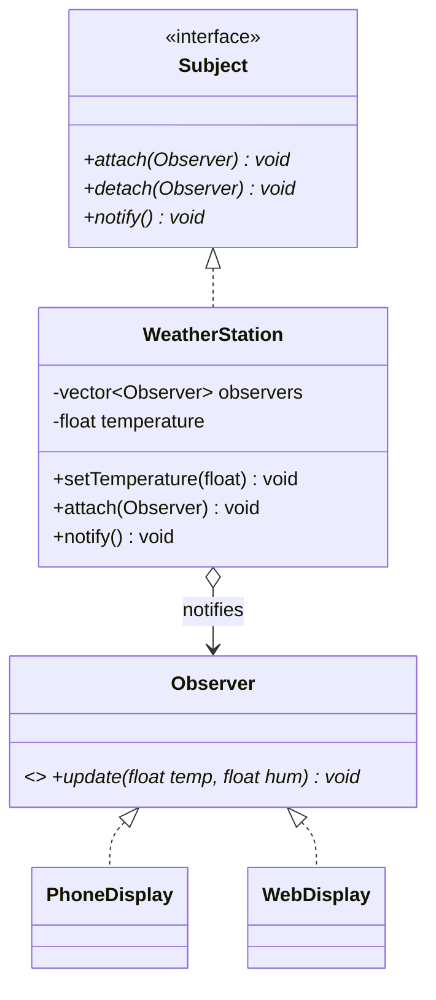
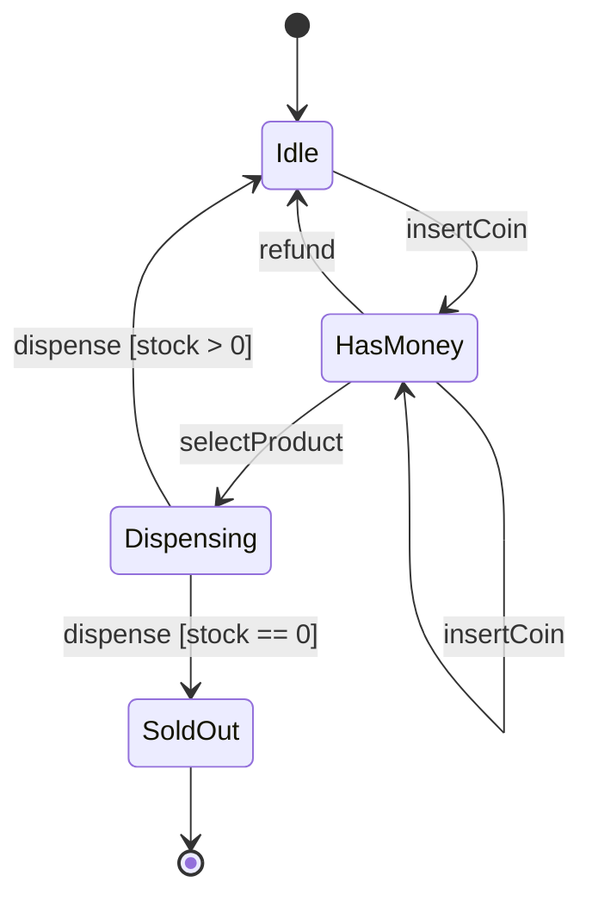
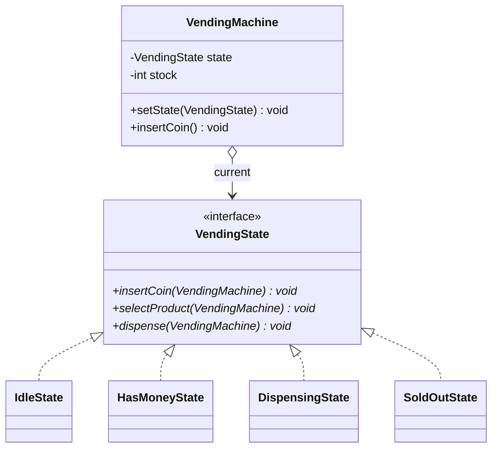
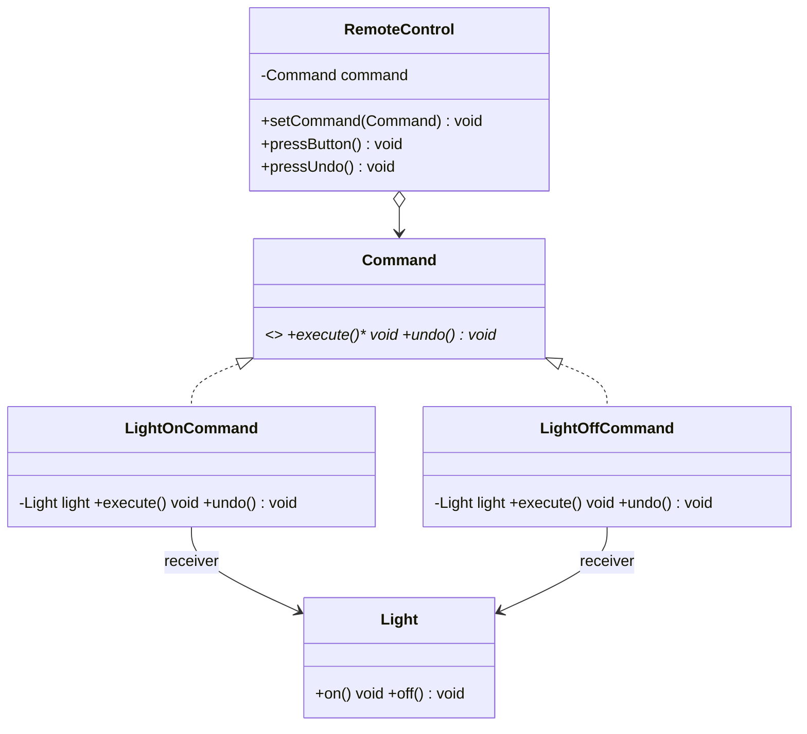

# LLD Notes: Part 6A. Behavioral Design Patterns I (C++)

---

## Table of Contents

0. Behavioral patterns: the big picture
1. Strategy
2. Observer
3. State
4. Command
5. Strategy vs State vs Bridge (comparison)
6. Observer vs Mediator vs Pub-Sub (preview)
7. Interview Q&A
8. One-page cheat sheet

---

## 0. Behavioral Patterns: The Big Picture

**Concern:** how objects **communicate**, **share responsibility**, and **change behavior** at runtime, without being tightly coupled.

| Pattern | One-line intent | Typical trigger |
|---|---|---|
| **Strategy** | Swap an **algorithm** at runtime | Multiple ways to do one task (sort, pay, price) |
| **Observer** | **Notify** dependents automatically on state change | Event systems, pub-sub, UI updates |
| **State** | Change behavior when **internal state** changes | Object behaves differently per "mode" |
| **Command** | Turn a **request into an object** | Undo/redo, queues, macros, logging requests |
| Template Method | Fixed **skeleton**, subclasses fill in steps | Same algorithm shape, different details |
| Chain of Responsibility | Pass a request along a **chain** of handlers | Middleware, approval workflows, logging levels |
| Iterator | **Traverse** a collection without exposing internals | Custom collection types |
| Mediator | Centralize **object-to-object communication** | Many objects talking to many objects |
| Memento | **Save/restore** an object's state | Undo, checkpoints, snapshots |
| Visitor | Add operations to a class hierarchy **without modifying it** | Operations that vary more often than the types |

> ⚡ **Quick Recall**
> **S**trategy = *swap algorithm*. **O**bserver = *notify on change*. **S**tate = *behavior follows internal state*. **C**ommand = *request as object*.

---

## 1. Strategy

### 1.1 Intent
> *Define a **family of algorithms**, encapsulate each one, and make them **interchangeable**. Strategy lets the algorithm vary independently from clients that use it.*

**Real-world analogy:** **Getting to the airport.** You can go by car, bus, or taxi — the goal (reach airport) is the same, the strategy (mode of transport) is swappable, decided at the moment of travel.

### 1.2 Problem

```cpp
// ❌ One class with a conditional for every variant — violates OCP (Part 2)
class PriceCalculator {
public:
    double calculate(double base, const string& customerType) {
        if (customerType == "regular") return base;
        else if (customerType == "premium") return base * 0.9;
        else if (customerType == "vip")     return base * 0.8;
        // New customer type? Edit this function again.
        return base;
    }
};
```

### 1.3 Solution
Extract each algorithm into its **own class** implementing a common interface. The context **holds a reference** to a strategy and delegates to it.

### 1.4 Structure

```
 Context                         <<interface>> Strategy
 - strategy : Strategy*          + execute(...)
 + setStrategy(Strategy*)              ^
 + doWork() { strategy->execute(); }   |
                                ________|________
                               |        |        |
                         StrategyA  StrategyB  StrategyC
```



### 1.5 C++ code

```cpp
// ---------- Strategy interface ----------
class DiscountStrategy {
public:
    virtual double apply(double base) const = 0;
    virtual ~DiscountStrategy() = default;
};
class NoDiscount      : public DiscountStrategy { public: double apply(double b) const override { return b; } };
class PremiumDiscount : public DiscountStrategy { public: double apply(double b) const override { return b * 0.9; } };
class VIPDiscount     : public DiscountStrategy { public: double apply(double b) const override { return b * 0.8; } };

// ---------- Context ----------
class PriceCalculator {
    unique_ptr<DiscountStrategy> strategy;
public:
    explicit PriceCalculator(unique_ptr<DiscountStrategy> s) : strategy(std::move(s)) {}
    void setStrategy(unique_ptr<DiscountStrategy> s) { strategy = std::move(s); }   // swap at RUNTIME
    double calculate(double base) const { return strategy->apply(base); }
};

int main() {
    PriceCalculator calc(make_unique<NoDiscount>());
    cout << calc.calculate(1000) << "\n";              // 1000

    calc.setStrategy(make_unique<VIPDiscount>());       // swap strategy at runtime
    cout << calc.calculate(1000) << "\n";               // 800
}
// New customer type (e.g., "Student")? Add ONE class. PriceCalculator untouched. (OCP)
```

### 1.6 Another classic example: sorting strategies

```cpp
class SortStrategy { public: virtual void sort(vector<int>& v) = 0; virtual ~SortStrategy() = default; };
class BubbleSort : public SortStrategy { public: void sort(vector<int>& v) override { /* O(n^2) */ } };
class QuickSort  : public SortStrategy { public: void sort(vector<int>& v) override { /* O(n log n) avg */ } };

class Sorter {
    unique_ptr<SortStrategy> strategy;
public:
    explicit Sorter(unique_ptr<SortStrategy> s) : strategy(std::move(s)) {}
    void sortData(vector<int>& v) { strategy->sort(v); }
};
```

### 1.7 Modern C++ lightweight alternative: `std::function`

For simple strategies with no state, a full class hierarchy can be overkill:
```cpp
class PriceCalculator {
    function<double(double)> strategy;
public:
    explicit PriceCalculator(function<double(double)> s) : strategy(std::move(s)) {}
    double calculate(double base) const { return strategy(base); }
};

PriceCalculator calc([](double b) { return b * 0.8; });    // lambda as strategy
cout << calc.calculate(1000);                               // 800
```
**Trade-off:** `std::function` is lighter and avoids boilerplate classes, but loses the ability to hold extra state/methods cleanly and loses polymorphic extensibility via inheritance (harder to add related helper methods). Use the class-based form when the strategy needs state or multiple related methods; use `std::function`/lambdas for simple, stateless, single-method strategies.

### 1.8 Pros / Cons
| Pros | Cons |
|---|---|
| **OCP**: add new strategies without touching context | Client must **know the differences** between strategies to choose |
| Eliminates conditional/switch logic | More classes (one per algorithm) |
| Algorithms become independently testable | Context ↔ Strategy communication overhead (passing needed data) |
| Swap behavior **at runtime** | If strategies rarely change, might be over-engineering (YAGNI) |

### 1.9 Use cases
- Payment methods, discount/pricing rules, sorting/compression algorithms, route-finding, validation rules, tax calculation, matchmaking in games.

### 1.10 Interview traps
- *"Strategy vs State?"* → Both have the same structure (context holds an interface pointer). **Strategy**: client/context **explicitly chooses** the algorithm; strategies **don't know about each other**. **State**: states often **trigger transitions to other states themselves**; the object's **behavior changes automatically** as state changes. (Full comparison in section 5.)
- *"Strategy vs Template Method?"* → Strategy uses **composition** (swap whole algorithm). Template Method uses **inheritance** (override steps of one fixed algorithm). (Part 6B.)
- *"How does Strategy satisfy OCP?"* → New algorithm = new class implementing the interface; context code never changes.

> ⚡ **Quick Recall**
> Strategy = **context holds an interchangeable algorithm object**. Client picks it (constructor/setter). Kills `if/switch` ladders on "how to do X".

---

## 2. Observer

### 2.1 Intent
> *Define a **one-to-many** dependency between objects so that when **one object changes state**, all its dependents are **notified and updated automatically**.*

**Real-world analogy:** **YouTube subscriptions.** A channel (Subject) uploads a video; all subscribers (Observers) get notified. The channel doesn't know what each subscriber does with the notification.

### 2.2 Problem
Multiple objects need to **react** when another object's state changes, without that object being **tightly coupled** to all of them (and without polling).

### 2.3 Structure

```
 <<interface>> Subject                    <<interface>> Observer
 + attach(Observer*)                      + update(data)
 + detach(Observer*)                           ^
 + notify()                          __________|___________
      ^                             |          |            |
 ConcreteSubject               ObserverA   ObserverB    ObserverC
 - observers : list<Observer*>
 - state
```



### 2.4 C++ code

```cpp
// ---------- Observer interface ----------
class Observer {
public:
    virtual void update(float temperature, float humidity) = 0;
    virtual ~Observer() = default;
};

// ---------- Subject interface ----------
class Subject {
public:
    virtual void attach(Observer* o) = 0;
    virtual void detach(Observer* o) = 0;
    virtual void notifyObservers() = 0;
    virtual ~Subject() = default;
};

// ---------- Concrete Subject ----------
class WeatherStation : public Subject {
    vector<Observer*> observers;                      // non-owning (association, Part 3)
    float temperature = 0, humidity = 0;
public:
    void attach(Observer* o) override { observers.push_back(o); }
    void detach(Observer* o) override {
        observers.erase(remove(observers.begin(), observers.end(), o), observers.end());
    }
    void notifyObservers() override {
        for (auto* o : observers) o->update(temperature, humidity);
    }
    void setMeasurements(float t, float h) {
        temperature = t; humidity = h;
        notifyObservers();                             // state change → auto notify
    }
};

// ---------- Concrete Observers ----------
class PhoneDisplay : public Observer {
public:
    void update(float t, float h) override { cout << "[Phone] Temp: " << t << "C, Humidity: " << h << "%\n"; }
};
class WebDisplay : public Observer {
public:
    void update(float t, float h) override { cout << "[Web] Temp: " << t << "C, Humidity: " << h << "%\n"; }
};

int main() {
    WeatherStation station;
    PhoneDisplay phone;
    WebDisplay web;

    station.attach(&phone);
    station.attach(&web);

    station.setMeasurements(30.5f, 65.0f);              // both displays auto-update
    station.detach(&web);
    station.setMeasurements(28.0f, 70.0f);               // only phone updates now
}
```

### 2.5 Push vs Pull model

| | **Push** | **Pull** |
|---|---|---|
| Data sent in `update()` | Full state (`update(temp, humidity)`) | Nothing, or just a reference to the subject (`update(Subject* s)`) |
| Observer gets data by | Receiving it directly | **Calling back** `subject->getTemperature()` |
| Pros | Simple, fast | Observer only fetches what it needs |
| Cons | Subject must know what every observer needs; brittle if signature grows | Extra call(s); observer needs subject reference |

```cpp
// Pull model variant
class Observer { public: virtual void update(WeatherStation* subject) = 0; virtual ~Observer() = default; };
class PhoneDisplay : public Observer {
public:
    void update(WeatherStation* s) override {
        cout << "Temp: " << s->getTemperature() << "\n";    // observer PULLS what it needs
    }
};
```

### 2.6 Pros / Cons
| Pros | Cons |
|---|---|
| **Loose coupling**: subject doesn't know concrete observer types | **Notification order** is not guaranteed unless designed for it |
| **OCP**: add new observer types without touching subject | Risk of **memory leaks** if observers aren't detached (dangling pointers) |
| Supports broadcast communication | **Update storms**: one change can cascade many notifications |
| Dynamic subscribe/unsubscribe at runtime | Debugging is harder (indirect call chains) |

### 2.7 C++-specific gotchas
- **Dangling observer pointers**: if an observer is destroyed without calling `detach()`, the subject holds a dangling pointer. Fix: observer destructor calls `detach(this)`, or use `weak_ptr<Observer>` and check `lock()` before calling.
- **Modifying the observer list during notification** (an observer detaches itself inside `update()`) can invalidate iterators. Iterate over a **copy** of the list, or use indices carefully.
- **Thread safety**: if `notifyObservers()` can run concurrently with `attach/detach`, guard the list with a mutex.

```cpp
void notifyObservers() override {
    auto snapshot = observers;              // copy to avoid iterator invalidation if a handler detaches
    for (auto* o : snapshot) o->update(temperature, humidity);
}
```

### 2.8 Use cases
- **Event systems / GUI** (button click listeners), **pub-sub message brokers** (Kafka-style, conceptually), **MVC** (Model notifies Views), **stock price tickers**, **social media feeds/notifications**, **reactive programming** (RxJS/Reactive Streams are large-scale Observer).

### 2.9 Interview traps
- *"Observer vs Pub-Sub?"* → Classic Observer: subject and observers **know each other directly** (tight-ish coupling via interface). Pub-Sub: a **broker/event bus** sits in between; publishers and subscribers **don't know each other at all** (looser coupling, often async). (Section 6.)
- *"How to avoid memory leaks?"* → Always `detach()` in the observer's destructor, or use `weak_ptr`.
- *"Push vs pull — which is better?"* → Depends: push is simpler for small, fixed data; pull scales better when observers need different/variable data.
- *"Is Observer synchronous?"* → Classic GoF Observer is synchronous (`notify()` calls `update()` directly in the same thread). Async variants (queues, event loops) are common extensions.

> ⚡ **Quick Recall**
> Observer = **Subject keeps a list of Observers**; state change → loop and call `update()` on each. Watch for **dangling pointers**, use `detach()` or `weak_ptr`.

---

## 3. State

### 3.1 Intent
> *Allow an object to **alter its behavior when its internal state changes**. The object will appear to **change its class**.*

**Real-world analogy:** A **traffic light**. Same object, but what `next()` does depends entirely on whether it's currently Red, Yellow, or Green. The light "becomes" different behavior per state.

### 3.2 Problem: state explosion via conditionals

```cpp
// ❌ Every method checks the state; adding a state means touching EVERY method
class VendingMachine {
    enum State { IDLE, HAS_MONEY, DISPENSING, SOLD_OUT } state = IDLE;
public:
    void insertCoin() {
        if (state == IDLE) { state = HAS_MONEY; cout << "Coin accepted\n"; }
        else if (state == HAS_MONEY) { cout << "Already has coin\n"; }
        else if (state == SOLD_OUT) { cout << "Sold out, can't accept coin\n"; }
        // ...
    }
    void selectProduct() {
        if (state == HAS_MONEY) { state = DISPENSING; /* ... */ }
        else if (state == IDLE) { cout << "Insert coin first\n"; }
        // ... repeated branching in EVERY method
    }
    // dispense(), refund() ... same pattern everywhere
};
```
Every method has an `if/switch` on state; every new state touches **all** methods. This is a direct **OCP violation**, structurally identical to the Strategy problem but driven by **internal transitions**.

### 3.3 Solution
Extract each state into its **own class** implementing a common `State` interface. The context **delegates** behavior to its **current state object**, and **states themselves trigger transitions**.

### 3.4 Structure

```
 Context (VendingMachine)              <<interface>> State
 - state : State*                      + insertCoin(ctx)
 + setState(State*)                    + selectProduct(ctx)
 + insertCoin() { state->insertCoin(this); }   + dispense(ctx)
      ^                                     ^
      |                          ___________|____________
  (delegates)                   |        |       |        |
                              Idle   HasMoney  Dispensing  SoldOut
```





### 3.5 C++ code: Vending Machine

```cpp
class VendingMachine;    // forward declaration

// ---------- State interface ----------
class VendingState {
public:
    virtual void insertCoin(VendingMachine& m) = 0;
    virtual void selectProduct(VendingMachine& m) = 0;
    virtual void dispense(VendingMachine& m) = 0;
    virtual ~VendingState() = default;
};

// ---------- Context ----------
class VendingMachine {
    unique_ptr<VendingState> state;
    int stock;
public:
    explicit VendingMachine(int s);                     // defined after states are declared
    void setState(unique_ptr<VendingState> s) { state = std::move(s); }
    int getStock() const { return stock; }
    void reduceStock() { if (stock > 0) stock--; }

    void insertCoin()     { state->insertCoin(*this); }      // delegate to current state
    void selectProduct()  { state->selectProduct(*this); }
    void dispense()       { state->dispense(*this); }
};

// ---------- Concrete states (each knows which state comes next) ----------
class SoldOutState : public VendingState {
public:
    void insertCoin(VendingMachine&) override    { cout << "Sold out. Coin rejected.\n"; }
    void selectProduct(VendingMachine&) override  { cout << "Sold out.\n"; }
    void dispense(VendingMachine&) override       { cout << "Sold out.\n"; }
};

class DispensingState : public VendingState {
public:
    void insertCoin(VendingMachine&) override    { cout << "Please wait, dispensing...\n"; }
    void selectProduct(VendingMachine&) override  { cout << "Already dispensing...\n"; }
    void dispense(VendingMachine& m) override;                 // defined below (needs other states)
};

class HasMoneyState : public VendingState {
public:
    void insertCoin(VendingMachine&) override    { cout << "Coin already inserted.\n"; }
    void selectProduct(VendingMachine& m) override {
        cout << "Product selected.\n";
        m.setState(make_unique<DispensingState>());
        m.dispense();                                           // auto-chain into dispensing
    }
    void dispense(VendingMachine&) override       { cout << "Select a product first.\n"; }
};

class IdleState : public VendingState {
public:
    void insertCoin(VendingMachine& m) override {
        cout << "Coin accepted.\n";
        m.setState(make_unique<HasMoneyState>());               // STATE TRANSITION
    }
    void selectProduct(VendingMachine&) override { cout << "Insert coin first.\n"; }
    void dispense(VendingMachine&) override       { cout << "Insert coin first.\n"; }
};

// DispensingState::dispense needs IdleState/SoldOutState, so defined after they exist
void DispensingState::dispense(VendingMachine& m) {
    m.reduceStock();
    cout << "Dispensing product. Stock left: " << m.getStock() << "\n";
    if (m.getStock() == 0) m.setState(make_unique<SoldOutState>());
    else                    m.setState(make_unique<IdleState>());
}

VendingMachine::VendingMachine(int s) : stock(s) {
    state = (stock > 0) ? make_unique<VendingState>(IdleState()) : nullptr;   // (shown conceptually)
}

int main() {
    VendingMachine vm(2);
    vm.insertCoin();       // Coin accepted
    vm.selectProduct();    // Product selected -> Dispensing product. Stock left: 1
    vm.insertCoin();       // Coin accepted
    vm.selectProduct();    // Dispensing product. Stock left: 0 -> now SoldOut
    vm.insertCoin();       // Sold out. Coin rejected.
}
```
*(Note: the constructor's initialization is simplified for illustration; in real code, initialize `state = make_unique<IdleState>();` directly, guarding the `stock == 0` case.)*

### 3.6 Key ideas
- **Context delegates** every relevant call to `state->method(*this)`.
- **States decide transitions**: a state object calls `context.setState(newState)` — this is what differentiates State from Strategy.
- Adding a new state (`MaintenanceState`) = **one new class**; existing states/context mostly untouched (**OCP**).
- State objects can be **stateless and shared** (Flyweight-like, if they hold no per-context data) or created fresh per transition (as above).

### 3.7 Pros / Cons
| Pros | Cons |
|---|---|
| Eliminates giant conditional blocks | More classes (one per state) |
| **OCP**: new states added easily | Transition logic is **spread across state classes** — can be harder to see the whole picture at once |
| Each state's logic is isolated and testable | Overkill for objects with only 2 simple states |
| Explicit, self-documenting (matches a state diagram directly, Part 3 §18) | |

### 3.8 Use cases
- **Vending machine, ATM, traffic light, elevator, media player** (Playing/Paused/Stopped), **order lifecycle** (Placed/Shipped/Delivered/Cancelled), **TCP connection states**, **game character states** (Idle/Running/Jumping/Attacking), **document workflow** (Draft/Review/Published).

### 3.9 Interview traps
- *"State vs Strategy — exact difference?"* → See table in section 5. Short answer: **Strategy = client chooses behavior explicitly and strategies are independent. State = object's internal state drives behavior automatically, and states transition to other states themselves.**
- *"Who changes the state — the context or the state object?"* → Usually the **state object itself** calls `context.setState(...)`, which is the key design decision in GoF State.
- *"Can states be shared/singletons?"* → Yes, if they carry no per-instance data (stateless state objects); use a Flyweight-style shared instance pool for efficiency.
- *"How does this relate to a state machine diagram?"* → Directly: each UML state → one class; each transition → a call to `setState()` inside a method.

> ⚡ **Quick Recall**
> State = **context delegates behavior to a current-state object**; **states themselves trigger transitions**. One class per state. Matches a state diagram 1:1.

---

## 4. Command

### 4.1 Intent
> *Encapsulate a **request as an object**, thereby letting you parameterize clients with different requests, **queue or log** requests, and support **undoable** operations.*

**Real-world analogy:** A **restaurant order slip**. The waiter (invoker) doesn't cook; they write the order (command object) and hand it to the kitchen (receiver). Orders can be queued, logged, or the whole slip can be used to "undo" (void the order).

### 4.2 Problem
You want to **decouple** the object that **invokes** an operation (e.g., a UI button, a remote control) from the object that **knows how to perform** it (e.g., a Light, a Document), while also supporting **queuing, logging, and undo**.

```cpp
// ❌ Button directly coupled to Light's concrete method — can't queue, log, or undo generically
class Button {
    Light& light;
public:
    void press() { light.on(); }     // hard-wired to ONE action
};
```

### 4.3 Solution
Wrap **every request** (receiver + action + parameters) into a **Command object** with a uniform `execute()` (and optionally `undo()`). The invoker only calls `execute()`.

### 4.4 Structure

```
 Invoker                  <<interface>> Command            Receiver
 - command : Command*     + execute()                      + action()
 + setCommand(Command*)   + undo()
 + pressButton() { command->execute(); }   ^
                                    _______|_______
                                   |               |
                              LightOnCommand   LightOffCommand
                              - receiver : Light&
                              + execute() { receiver.on(); }
```



### 4.5 C++ code: Remote Control

```cpp
// ---------- Receiver: knows HOW to do the actual work ----------
class Light {
    string room;
public:
    explicit Light(string r) : room(std::move(r)) {}
    void on()  { cout << room << " light ON\n"; }
    void off() { cout << room << " light OFF\n"; }
};

// ---------- Command interface ----------
class Command {
public:
    virtual void execute() = 0;
    virtual void undo() = 0;
    virtual ~Command() = default;
};

// ---------- Concrete Commands ----------
class LightOnCommand : public Command {
    Light& light;
public:
    explicit LightOnCommand(Light& l) : light(l) {}
    void execute() override { light.on(); }
    void undo() override    { light.off(); }
};
class LightOffCommand : public Command {
    Light& light;
public:
    explicit LightOffCommand(Light& l) : light(l) {}
    void execute() override { light.off(); }
    void undo() override    { light.on(); }
};

// ---------- Invoker ----------
class RemoteControl {
    unique_ptr<Command> command;
    vector<Command*> history;                           // for undo (raw, non-owning view into executed commands)
public:
    void setCommand(unique_ptr<Command> c) { command = std::move(c); }
    void pressButton() {
        command->execute();
        history.push_back(command.get());
    }
    void pressUndo() {
        if (!history.empty()) { history.back()->undo(); history.pop_back(); }
    }
};

int main() {
    Light livingRoom("Living Room");
    RemoteControl remote;

    remote.setCommand(make_unique<LightOnCommand>(livingRoom));
    remote.pressButton();           // Living Room light ON

    remote.setCommand(make_unique<LightOffCommand>(livingRoom));
    remote.pressButton();           // Living Room light OFF

    remote.pressUndo();             // undoes OFF -> Living Room light ON
}
```

### 4.6 Command Queue and Undo/Redo stacks (common follow-up)

```cpp
class CommandManager {
    stack<unique_ptr<Command>> undoStack, redoStack;
public:
    void executeCommand(unique_ptr<Command> cmd) {
        cmd->execute();
        undoStack.push(std::move(cmd));
        while (!redoStack.empty()) redoStack.pop();    // clear redo history on new action
    }
    void undo() {
        if (undoStack.empty()) return;
        undoStack.top()->undo();
        redoStack.push(std::move(const_cast<unique_ptr<Command>&>(undoStack.top())));
        undoStack.pop();
    }
    void redo() {
        if (redoStack.empty()) return;
        redoStack.top()->execute();
        undoStack.push(std::move(const_cast<unique_ptr<Command>&>(redoStack.top())));
        redoStack.pop();
    }
};
```
*(In production code, prefer `std::vector` with back()/pop_back() over mutating `stack::top()`, which requires a `const_cast` workaround as shown — this is a known rough edge of `std::stack`.)*

### 4.7 Macro Command (Composite + Command)

```cpp
class MacroCommand : public Command {
    vector<unique_ptr<Command>> commands;
public:
    void add(unique_ptr<Command> c) { commands.push_back(std::move(c)); }
    void execute() override { for (auto& c : commands) c->execute(); }
    void undo() override    { for (auto it = commands.rbegin(); it != commands.rend(); ++it) (*it)->undo(); }   // reverse order!
};
```
Combines Command with **Composite** (Part 5): a `MacroCommand` is itself a `Command` holding other `Command`s. Note **undo runs in reverse order**.

### 4.8 Pros / Cons
| Pros | Cons |
|---|---|
| **Decouples invoker from receiver** (DIP) | More classes (one per action), can feel heavy for simple cases |
| Supports **undo/redo**, **queuing**, **logging**, **scheduling** | Each command needs careful state capture for undo |
| Commands can be **composed** (macros) | |
| **OCP**: new commands without touching invoker | |

### 4.9 Use cases
- **GUI buttons/menu items**, **undo/redo** in editors, **transaction logs / audit trails**, **job queues / task schedulers**, **remote procedure calls** (serialize a command, send over network), **wizard/multi-step operations**.

### 4.10 Interview traps
- *"Command vs Strategy?"* → Structurally similar (both wrap behavior behind one interface). **Strategy** focuses on *which algorithm to run*; **Command** focuses on *encapsulating a request (receiver + action + params) as an object*, enabling **queuing/logging/undo**, which Strategy doesn't address.
- *"How do you implement undo for a command with side effects (e.g., deleting a file)?"* → The command must **capture enough state before executing** to reverse it (e.g., keep the deleted file's content), tying into the **Memento** pattern (Part 6B).
- *"Why does the invoker not call the receiver directly?"* → So the invoker (e.g., a generic button) can be **reused for any command** without knowing receivers' concrete types.

> ⚡ **Quick Recall**
> Command = **request wrapped as an object** with `execute()`/`undo()`. Invoker just calls `execute()`. Enables queue/log/undo/macro. Receiver does the real work.

---

## 5. Strategy vs State vs Bridge (Comparison)

These three have **nearly identical UML structure** (a context composed with an interface, concrete implementations behind it), but **different intents**. This is a top interview question.

| | **Strategy** | **State** | **Bridge** (Part 5) |
|---|---|---|---|
| Intent | Swap **algorithm** | Behavior follows **internal state**; object "changes class" | Separate **abstraction** from **implementation**, vary both independently |
| Who selects the concrete class? | **Client** (explicitly) | **States themselves** (via transitions) | **Client**, usually once at construction |
| Do the concrete classes know each other? | No, independent | **Often yes** — states know which state comes next | No |
| Changes over object's lifetime? | Rare (client re-sets explicitly) | **Frequent and automatic** (part of normal operation) | Rare |
| Purpose of indirection | Interchangeability of **behavior** | Modeling a **finite state machine** | Avoiding **class explosion** across 2 dimensions |
| Example | Payment method, sort algorithm | Vending machine, traffic light, order lifecycle | Shape × Color, Device × Remote |

**One-line way to say it in an interview:**
> *"They share the same shape — composition with an interface — but Strategy is about **choosing how**, State is about **what's currently true**, and Bridge is about **keeping two hierarchies independent**."*

---

## 6. Observer vs Mediator vs Pub-Sub (Preview)

(Mediator is covered fully in Part 6B; this is a preview comparison since it's often asked alongside Observer.)

| | **Observer** | **Mediator** | **Pub-Sub** |
|---|---|---|---|
| Direction | **One-to-many** (subject → observers) | **Many-to-many**, routed through one mediator | **Many-to-many**, via a broker/event bus |
| Coupling | Observers know the Subject's interface | Colleagues know only the Mediator | Publishers/subscribers often don't know each other **at all** |
| Typical use | UI updates, notifications | Chat rooms, form field coordination, air traffic control | Messaging systems (Kafka, event buses), microservices |
| Synchronous? | Usually yes (direct call) | Usually yes | Often **asynchronous** |

> ⚡ **Quick Recall**
> Observer: subject **broadcasts** to known observers. Mediator: colleagues **talk through** a central hub. Pub-Sub: publishers and subscribers **never know each other**, a broker decouples them entirely.

---

## 7. Interview Q&A

**Q1. What problem does Strategy solve?**
Removes `if/switch` ladders choosing between algorithms by extracting each algorithm into its own class behind a common interface, letting the context swap it at runtime.

**Q2. Give 3 real examples of Strategy.**
Payment methods (UPI/Card/Wallet), sorting algorithms, discount/pricing rules, route calculation (shortest/fastest/scenic), compression algorithms.

**Q3. How is Observer different from simple polling?**
Polling repeatedly asks "did anything change?". Observer uses a **push notification**: the subject calls `update()` only when something actually changes, which is more efficient and immediate.

**Q4. What's the risk with Observer and memory management in C++?**
Dangling pointers if an observer is destroyed without `detach()`. Fix with explicit detach in destructor or `weak_ptr`.

**Q5. Explain push vs pull in Observer.**
Push: subject sends all relevant data directly in `update(data...)`. Pull: subject sends itself (or an ID); observer calls back to fetch only what it needs.

**Q6. What problem does State solve, and how does it differ from a plain enum + switch?**
It eliminates the repeated `switch(state)` in every method by giving each state its own class; adding a state means adding a class (OCP) instead of editing every method.

**Q7. Who triggers a state transition in the State pattern?**
Typically the **current state object itself**, by calling `context.setState(newState)` after handling the request.

**Q8. Difference between Strategy and State (be precise).**
Strategy: client explicitly picks an algorithm; strategies are independent and unaware of each other. State: the object's behavior changes as a **direct consequence of its own transitions**; states often know about and transition to other states.

**Q9. What does Command decouple, and from what?**
It decouples the **invoker** (the thing that triggers an action, e.g., a button) from the **receiver** (the thing that knows how to perform it), via a Command object in between.

**Q10. How do you implement undo with Command?**
Each concrete command implements `undo()` that reverses its `execute()`, and an invoker/manager keeps a history stack of executed commands.

**Q11. What is a Macro Command?**
A `Command` that holds a list of other `Command`s and executes them in sequence (and undoes them in **reverse** sequence). Combines Command with Composite.

**Q12. Command vs Strategy — how do you tell them apart in an interview problem?**
If the requirement mentions **undo, redo, queuing, logging requests, or scheduling** → Command. If it's about **choosing among interchangeable algorithms** with no history/undo need → Strategy.

**Q13. Can State pattern states be singletons?**
Yes, if state objects hold no per-context data — they can be shared safely since behavior only depends on the context passed into each method.

**Q14. Strategy, State, and Bridge look identical in UML. How do you tell them apart in a design discussion?**
By **intent**, not structure: Strategy = swap algorithm; State = model a state machine where transitions are automatic; Bridge = decouple two independently-varying hierarchies. Ask: "is this about *how* to do something, *what mode* the object is in, or *two dimensions* of variation?"

**Q15. How would you design a traffic light system?**
State pattern: `TrafficLightState` interface with `RedState`, `YellowState`, `GreenState`; each knows the next state and transitions via `context.setState(...)` after a timer/condition.

---

## 8. One-Page Cheat Sheet

```
STRATEGY  : Context HAS-A Strategy interface. CLIENT chooses/swaps algorithm. Strategies independent.
            Kills if/switch on "HOW to do X". Use std::function for simple stateless cases.
            Use: payment methods, sorting, pricing rules, route-finding.

OBSERVER  : Subject keeps list<Observer*>. State change -> loop -> observer.update().
            Push (send data) vs Pull (observer calls back to subject).
            Watch: dangling pointers (detach() / weak_ptr), iterate a COPY during notify.
            Use: event systems, pub-sub, UI updates, MVC.

STATE     : Context delegates to current State object. STATE ITSELF calls ctx.setState(next).
            Kills switch(state) repeated in every method. 1 class per state = matches state diagram.
            Use: vending machine, ATM, traffic light, order lifecycle, media player.

COMMAND   : Request wrapped as object: execute() / undo(). Invoker calls execute() only.
            Receiver does real work. History stack -> undo/redo. MacroCommand = Composite + Command (undo REVERSED).
            Use: GUI actions, undo/redo, job queues, transaction logs, macros.

STRATEGY vs STATE vs BRIDGE (same UML shape, different INTENT)
  Strategy: client picks HOW              | State: object's CURRENT MODE drives behavior, auto-transitions
  Bridge:   TWO hierarchies stay independent (avoid M x N explosion)

OBSERVER vs MEDIATOR vs PUB-SUB
  Observer: one-to-many, subject knows observers directly
  Mediator: many-to-many, routed through ONE central hub, colleagues know only the hub
  Pub-Sub:  many-to-many, via a BROKER, publishers/subscribers don't know each other at all

TRIGGER WORDS
  "multiple ways to do X, swappable"        -> Strategy
  "notify / subscribe / listeners / events" -> Observer
  "behaves differently depending on mode"   -> State
  "undo / redo / queue / log the action"    -> Command
```

---