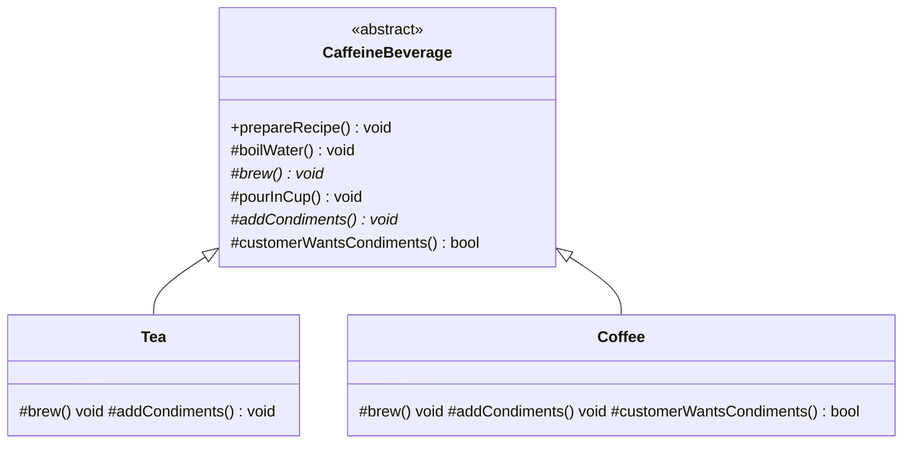
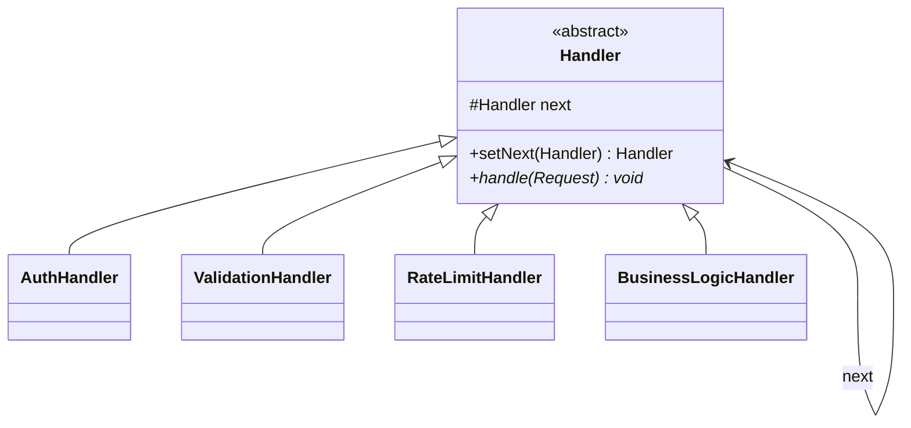
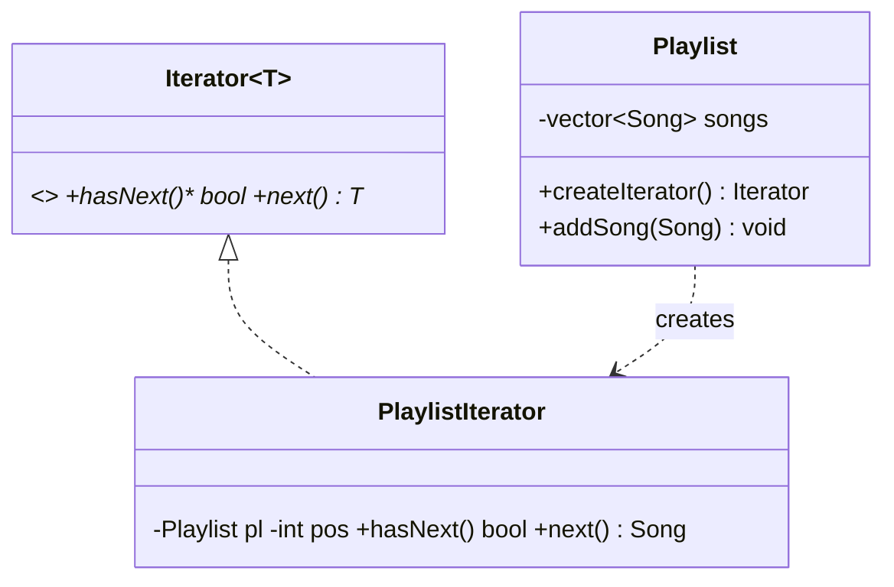
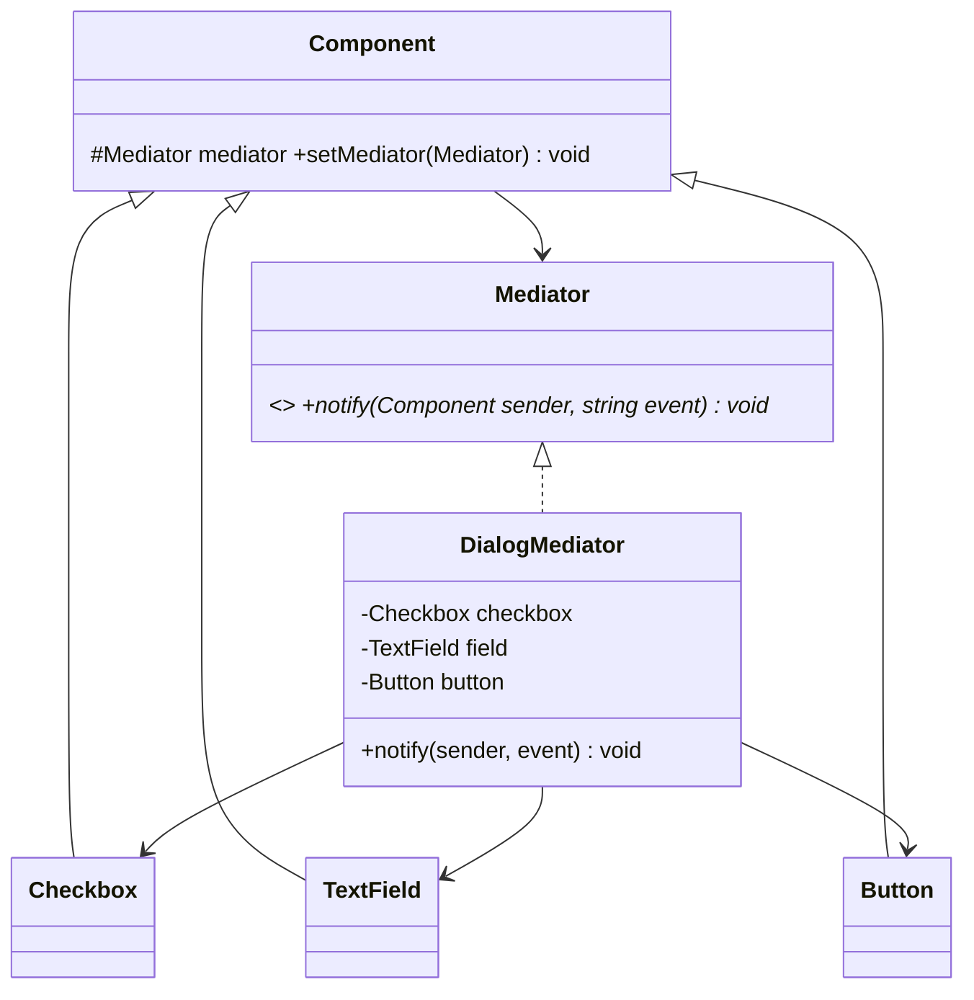
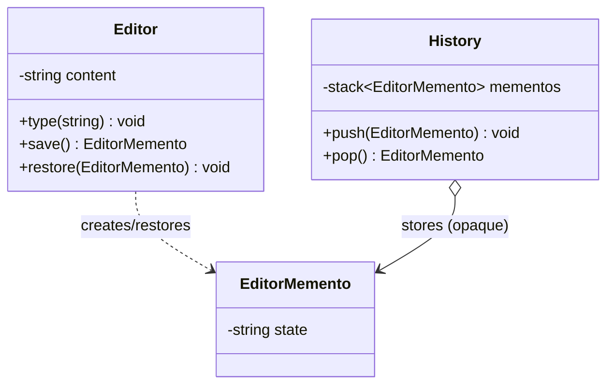
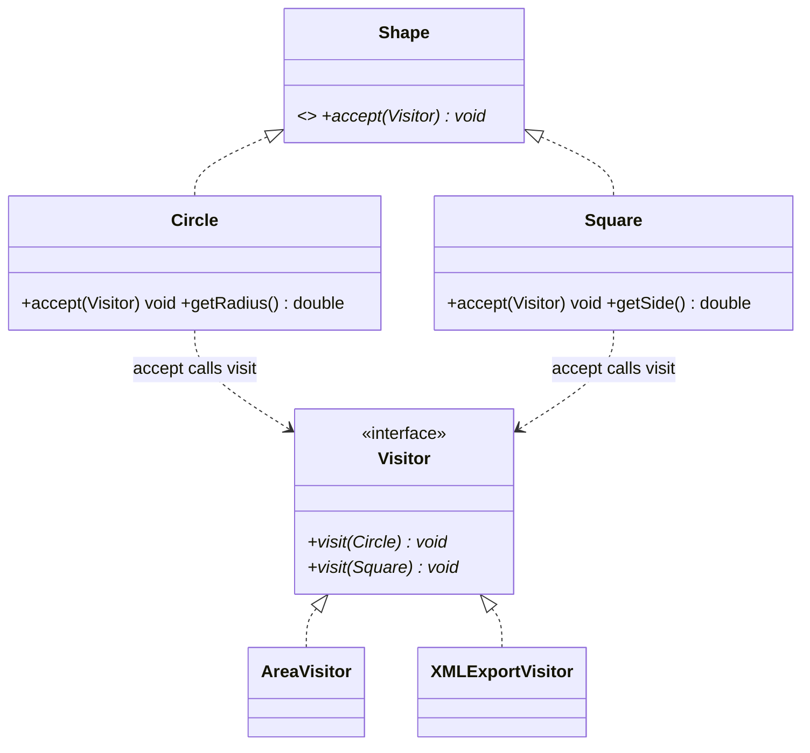

# LLD Notes: Part 6B. Behavioral Design Patterns II (C++)

---

## Table of Contents

1. Template Method
2. Chain of Responsibility
3. Iterator
4. Mediator
5. Memento
6. Visitor
7. Interpreter (brief)
8. Master comparison: all behavioral patterns
9. Interview Q&A
10. One-page cheat sheet

---

## 1. Template Method

### 1.1 Intent
> *Define the **skeleton of an algorithm** in a base class method, deferring **some steps** to subclasses. Template Method lets subclasses redefine certain steps **without changing the algorithm's structure**.*

**Real-world analogy:** A **recipe template**: "boil water → add ingredient → cook → serve". Tea and Coffee both follow these 4 steps; only "add ingredient" differs (tea bag vs coffee grounds). The **order never changes**.

### 1.2 Problem: duplicated algorithm skeleton

```cpp
// ❌ Both classes repeat the SAME overall steps and order, duplicating structure
class TeaMaker {
public:
    void prepare() { boilWater(); steepTeaBag(); pourInCup(); addLemon(); }
private: /* ... */
};
class CoffeeMaker {
public:
    void prepare() { boilWater(); brewCoffeeGrounds(); pourInCup(); addSugarAndMilk(); }
private: /* ... */
};
```
The **sequence** (`boil → brew → pour → add-ins`) is duplicated. If the sequence needs to change (e.g., add a "preheat cup" step), you must edit **every** class.

### 1.3 Solution
Put the **fixed algorithm skeleton** in a base class as a **non-virtual (or final) method**, calling a mix of **concrete** (shared) and **abstract/virtual** (varying) steps. Subclasses override only the varying steps.

### 1.4 Structure

```
 AbstractClass
 + templateMethod()  { step1(); step2(); hook(); step3(); }   <- fixed order, NOT overridden
 # step1()  (concrete, shared)
 # step2() = 0  (abstract, subclass MUST implement)
 # step3() = 0  (abstract, subclass MUST implement)
 # hook()  (concrete, optional override, empty by default)
       ^
       |
 ConcreteClassA / B   (override step2, step3, maybe hook)
```



### 1.5 C++ code: Caffeine Beverage (the canonical example)

```cpp
class CaffeineBeverage {
public:
    // TEMPLATE METHOD — the fixed skeleton. Mark final so subclasses can't change the order.
    void prepareRecipe() final {
        boilWater();
        brew();                              // varying step
        pourInCup();
        if (customerWantsCondiments())       // HOOK: optional override, has a default
            addCondiments();                 // varying step
    }
    virtual ~CaffeineBeverage() = default;

protected:
    void boilWater()  { cout << "Boiling water\n"; }      // shared, concrete
    void pourInCup()  { cout << "Pouring into cup\n"; }   // shared, concrete

    virtual void brew() = 0;                              // MUST override (pure virtual)
    virtual void addCondiments() = 0;                     // MUST override

    virtual bool customerWantsCondiments() { return true; }   // HOOK: optional override, has default
};

class Tea : public CaffeineBeverage {
protected:
    void brew() override          { cout << "Steeping the tea\n"; }
    void addCondiments() override { cout << "Adding lemon\n"; }
};

class Coffee : public CaffeineBeverage {
protected:
    void brew() override          { cout << "Dripping coffee through filter\n"; }
    void addCondiments() override { cout << "Adding sugar and milk\n"; }
    bool customerWantsCondiments() override {              // override the hook
        char answer;
        cout << "Add milk/sugar? (y/n): ";
        cin >> answer;
        return answer == 'y';
    }
};

int main() {
    unique_ptr<CaffeineBeverage> tea = make_unique<Tea>();
    tea->prepareRecipe();           // Boiling water / Steeping / Pouring / Adding lemon

    unique_ptr<CaffeineBeverage> coffee = make_unique<Coffee>();
    coffee->prepareRecipe();        // same 4 steps, customer decides on condiments via the hook
}
```

### 1.6 Key ideas: three kinds of steps
| Step type | Declared as | Subclass obligation |
|---|---|---|
| **Concrete step** | normal method | Cannot override (or simply doesn't need to) |
| **Abstract step** | `= 0` pure virtual | **Must** override |
| **Hook** | `virtual` with a default (often empty or simple) | **May** override, optional |

- The **template method itself should be `final`** (or non-virtual) so subclasses can't change the **order** of steps, only their content. This directly applies **LSP** (Part 2): subclasses extend behavior without breaking the algorithm's contract.
- This is the main **inheritance-based** behavioral pattern (unlike Strategy, which is composition-based).

### 1.7 Pros / Cons
| Pros | Cons |
|---|---|
| Removes **duplicated structure**; algorithm defined once | Uses **inheritance**, so tighter coupling than Strategy |
| Enforces a **consistent sequence** across subclasses | Can lead to a deep hierarchy if many variants |
| Hooks give **optional** customization points | Hard to change the skeleton later without touching all subclasses |
| Classic application of the **Hollywood Principle**: "Don't call us, we'll call you" — subclasses don't call the base, the base calls them | Violates "favor composition over inheritance" (Part 1) by design — a deliberate trade-off here |

### 1.8 Use cases
- Data processing pipelines (`load → validate → transform → save`, with `validate`/`transform` overridden per format).
- Framework lifecycle methods (`onCreate → onStart → onResume` style hooks — Android/UI frameworks).
- Report/document generation (`buildHeader → buildBody → buildFooter`, body varies).
- Sorting algorithms with a fixed scaffold (compare step varies) — though Strategy is more common here.
- Game AI turn sequences (`startTurn → takeAction → endTurn`).

### 1.9 Interview traps
- *"Template Method vs Strategy — which is 'better'?"* → Neither is better; different trade-offs. **Template Method** uses **inheritance** to vary **parts of one fixed algorithm**. **Strategy** uses **composition** to swap the **entire algorithm**. If you need to swap the whole thing at runtime, use Strategy. If the **overall sequence must stay fixed** and only a few steps vary, use Template Method.
- *"What is the Hollywood Principle and how does Template Method use it?"* → "Don't call us, we'll call you": low-level code (subclass steps) doesn't call high-level code; instead, high-level code (the template method) calls into low-level code at the right points.
- *"Why mark the template method `final`?"* → To preserve LSP: subclasses must not be able to reorder or skip steps, only fill them in.
- *"What's a hook, concretely?"* → A virtual method with a **default (often no-op) implementation** that subclasses *may* override — contrast with pure virtual methods, which subclasses *must* override.

> ⚡ **Quick Recall**
> Template Method = **fixed algorithm skeleton in the base class (`final`)**, calling abstract steps (must override) and hooks (may override). Inheritance-based, unlike Strategy's composition.

---

## 2. Chain of Responsibility (CoR)

### 2.1 Intent
> *Avoid coupling the sender of a request to its receiver by giving **more than one object a chance to handle** the request. Chain the receiving objects and pass the request along the chain until **someone handles it**.*

**Real-world analogy:** **Tech support escalation.** Level 1 support tries to solve your issue; if they can't, they pass it to Level 2; then Level 3. You don't call each level yourself — the request moves along the chain until someone handles it (or it reaches the end unresolved).

### 2.2 Problem
A request may need to be handled by **one of several possible handlers**, but the sender shouldn't need to know **which one** in advance, and the set of handlers (and their order) should be **easy to change**.

```cpp
// ❌ Caller hard-codes the escalation logic
void handleRequest(int severity) {
    if (severity == LOW) { level1Support(); }
    else if (severity == MEDIUM) { level2Support(); }
    else { level3Support(); }
}
```

### 2.3 Solution
Each handler implements a common interface with a **reference to the next handler**. Each handler decides: **handle it** or **pass it along**.

### 2.4 Structure

```
 <<interface>> Handler
 + setNext(Handler*)
 + handle(request)
        ^
   _____|_____________________
  |            |               |
 Level1Handler Level2Handler  Level3Handler
 - next : Handler*
 + handle(r) { if (canHandle(r)) solve(); else if (next) next->handle(r); }
```



### 2.5 C++ code: HTTP request middleware chain

```cpp
struct Request {
    string token;
    string body;
    int requestCountThisMinute;
};

// ---------- Abstract Handler ----------
class Handler {
protected:
    unique_ptr<Handler> next;
public:
    Handler* setNext(unique_ptr<Handler> h) {
        next = std::move(h);
        return next.get();                               // returns raw ptr for chaining .setNext().setNext()
    }
    virtual void handle(Request& req) {
        if (next) next->handle(req);                      // default: pass along (base class provides this!)
    }
    virtual ~Handler() = default;
};

// ---------- Concrete Handlers ----------
class AuthHandler : public Handler {
public:
    void handle(Request& req) override {
        if (req.token.empty()) { cout << "Rejected: no auth token\n"; return; }   // STOP the chain
        cout << "Auth passed\n";
        Handler::handle(req);                              // pass to next
    }
};
class RateLimitHandler : public Handler {
public:
    void handle(Request& req) override {
        if (req.requestCountThisMinute > 100) { cout << "Rejected: rate limit exceeded\n"; return; }
        cout << "Rate limit OK\n";
        Handler::handle(req);
    }
};
class ValidationHandler : public Handler {
public:
    void handle(Request& req) override {
        if (req.body.empty()) { cout << "Rejected: empty body\n"; return; }
        cout << "Validation passed\n";
        Handler::handle(req);
    }
};
class BusinessLogicHandler : public Handler {
public:
    void handle(Request& req) override {
        cout << "Processing request: " << req.body << "\n";   // end of chain: actually do the work
    }
};

int main() {
    auto chain = make_unique<AuthHandler>();
    Handler* tail = chain->setNext(make_unique<RateLimitHandler>());
    tail = tail->setNext(make_unique<ValidationHandler>());
    tail->setNext(make_unique<BusinessLogicHandler>());

    Request req{"token123", "order data", 5};
    chain->handle(req);
    // Auth passed / Rate limit OK / Validation passed / Processing request: order data
}
```

### 2.6 Two chain behaviors: stop-on-handle vs always-pass-through

| Style | Behavior | Example |
|---|---|---|
| **Stop on first match** | First handler that **can** handle it, does, and the chain stops | Support escalation, event handling (first listener consumes it) |
| **Pass through all** | Every handler in the chain runs (e.g., for logging/validation), request continues regardless | Middleware stacks (auth, logging, compression all run) |

The HTTP example above is a hybrid: it stops **only on rejection**, but **passes through on success** — a common real-world variant.

### 2.7 Pros / Cons
| Pros | Cons |
|---|---|
| **Decouples sender from receiver(s)** | Request might go **unhandled** if the chain is misconfigured (no catch-all at the end) |
| **OCP**: add/remove/reorder handlers without touching client or other handlers | Can be **hard to debug** (which handler actually processed it?) |
| Each handler has **one responsibility** (SRP) | Slight runtime cost for long chains |
| Chain order is configurable at runtime | |

### 2.8 Use cases
- **Middleware pipelines** (auth → logging → rate-limit → compression — Express.js/ASP.NET style).
- **Support ticket escalation**, **approval workflows** (manager → director → VP, with spending limits).
- **Event bubbling in UI** (click on button → bubbles to panel → bubbles to window).
- **Exception handling chains** (catch blocks trying progressively broader exception types).
- **Logging frameworks** (DEBUG/INFO/WARN/ERROR handlers chained by severity).

### 2.9 Interview traps
- *"CoR vs Decorator (Part 5)?"* → Structurally similar (both chain wrapped objects), but **CoR's intent is "one handler deals with it, then usually stop"** (conditional, may short-circuit); **Decorator's intent is "every layer adds behavior and all layers run"** (unconditional, always passes through after adding its bit).
- *"CoR vs Strategy?"* → Strategy picks **one** algorithm directly. CoR tries a **sequence** of handlers until one succeeds (or all run, depending on style).
- *"What if no handler handles the request?"* → Decide and design explicitly: either the default base `handle()` silently does nothing (shown above via `if (next) next->handle(req);`), or you add an explicit terminal/fallback handler that always handles it (e.g., a default "unsupported request" handler at the chain's end).
- *"How is the chain built?"* → Usually assembled once at **startup/configuration time** (composition root), not scattered through business logic.

> ⚡ **Quick Recall**
> Chain of Responsibility = **linked handlers**, each decides **handle or pass along**. Decouples sender from the (possibly multiple) receivers. Always design for the "nobody handled it" case.

---

## 3. Iterator

### 3.1 Intent
> *Provide a way to **access elements of a collection sequentially** without exposing its **underlying representation**.*

**Real-world analogy:** A **TV remote's channel-up button**. You don't need to know how channels are stored internally (array, linked list, tree); you just press "next" and get the next one.

### 3.2 Problem
Client code that needs to traverse a custom collection either:
1. Needs to know the **internal structure** (breaks encapsulation), or
2. Each collection exposes **different traversal APIs**, so client code can't treat collections **uniformly**.

### 3.3 Solution
Define a common `Iterator` interface (`hasNext()`, `next()`) separate from the collection. The collection provides a `createIterator()` method. Client code uses only the iterator interface, never touching internals.

### 3.4 Structure

```
 <<interface>> Iterator              <<interface>> Aggregate (Collection)
 + hasNext() : bool                  + createIterator() : Iterator
 + next() : T
        ^                                       ^
        |                                       |
 ConcreteIterator               ConcreteAggregate
 - collection ref, position     - items
                                + createIterator() { return ConcreteIterator(this); }
```



### 3.5 C++ code: Custom Playlist Iterator

```cpp
struct Song { string title; };

// ---------- Iterator interface ----------
class Iterator {
public:
    virtual bool hasNext() const = 0;
    virtual Song next() = 0;
    virtual ~Iterator() = default;
};

// ---------- Collection (Aggregate) ----------
class Playlist {
    vector<Song> songs;
public:
    void addSong(const Song& s) { songs.push_back(s); }
    unique_ptr<Iterator> createIterator() const;         // defined after PlaylistIterator exists
    const vector<Song>& getSongs() const { return songs; }   // internal access, used only by iterator
};

// ---------- Concrete Iterator ----------
class PlaylistIterator : public Iterator {
    const Playlist& playlist;
    size_t position = 0;
public:
    explicit PlaylistIterator(const Playlist& p) : playlist(p) {}
    bool hasNext() const override { return position < playlist.getSongs().size(); }
    Song next() override { return playlist.getSongs()[position++]; }
};

unique_ptr<Iterator> Playlist::createIterator() const { return make_unique<PlaylistIterator>(*this); }

int main() {
    Playlist pl;
    pl.addSong({"Song A"}); pl.addSong({"Song B"}); pl.addSong({"Song C"});

    auto it = pl.createIterator();
    while (it->hasNext()) {
        cout << it->next().title << "\n";                 // client never touches the internal vector directly
    }
}
```

### 3.6 Why C++ rarely needs to hand-roll this: STL iterators
C++'s **Standard Template Library already implements the Iterator pattern pervasively**. Every container (`vector`, `list`, `map`, `set`) exposes `begin()`/`end()` returning iterator objects supporting `operator++`, `operator*`, `operator!=` — this **is** the Iterator pattern, just with operator-overloading syntax instead of `hasNext()`/`next()`.

```cpp
vector<int> v{1, 2, 3};
for (auto it = v.begin(); it != v.end(); ++it) cout << *it << " ";   // classic iterator usage
for (int x : v) cout << x << " ";                                     // range-based for — sugar over the same thing
```

**Writing a custom STL-compatible iterator** (for your own container class) means implementing `operator*`, `operator++`, `operator!=`/`operator==`, and the nested typedefs/tags the STL expects (`iterator_category`, `value_type`, etc.), so your type works with range-based `for` and `<algorithm>` functions.

```cpp
class IntRange {              // minimal custom container with STL-style iterator
    int start, end_;
public:
    IntRange(int s, int e) : start(s), end_(e) {}
    class iterator {
        int val;
    public:
        explicit iterator(int v) : val(v) {}
        int operator*() const { return val; }
        iterator& operator++() { ++val; return *this; }
        bool operator!=(const iterator& o) const { return val != o.val; }
    };
    iterator begin() const { return iterator(start); }
    iterator end()   const { return iterator(end_); }
};

for (int x : IntRange(1, 5)) cout << x << " ";   // 1 2 3 4   — works because of the custom iterator above
```

### 3.7 Multiple simultaneous iterators & fail-fast
- **Multiple independent iterators** over the same collection should be possible (each with its own position) — this is naturally true in both the GoF form (each `createIterator()` call returns a fresh object) and STL form.
- **Fail-fast iterators**: STL iterators become **invalidated** if the underlying container is modified during iteration (e.g., `vector` reallocation after `push_back`). This is a classic C++ bug source — always check container-specific invalidation rules.

### 3.8 Pros / Cons
| Pros | Cons |
|---|---|
| **Encapsulation**: internal structure stays hidden | Extra class(es) for simple collections (often unnecessary in C++ thanks to STL) |
| **Uniform traversal interface** across different collection types | Iterator state must stay in sync with a mutating collection (invalidation risk) |
| Supports **multiple simultaneous traversals** | |
| Can support different traversal orders (forward, reverse, in-order for trees) without changing the collection class | |

### 3.9 Use cases
- Any **custom data structure** (tree, graph, linked list) needing traversal without exposing internals.
- **Multiple traversal strategies** over the same structure (e.g., in-order/pre-order/post-order tree iterators).
- **Pagination** (an iterator that fetches the next page from a database/API on demand — lazy iteration).
- Composite pattern traversal (Part 5): iterating a file-system tree.

### 3.10 Interview traps
- *"Why not just expose the internal `vector` directly?"* → Breaks encapsulation (Part 1/2): clients become coupled to the exact storage type, and you can't later switch to a `list` or `deque` without breaking client code.
- *"Does C++ need the GoF Iterator pattern given the STL?"* → For **your own custom containers**, yes — you implement the **same pattern** using C++'s iterator **conventions** (`operator++`, `begin()/end()`) rather than inventing `hasNext()/next()` from scratch.
- *"What's iterator invalidation?"* → Certain container operations (e.g., `vector::push_back` causing reallocation, `erase`) invalidate existing iterators pointing into it — a common C++ interview/bug question.

> ⚡ **Quick Recall**
> Iterator = **separate traversal object** (`hasNext()/next()` or STL's `begin()/end()` + `operator++`) so clients traverse without touching internals. In C++, lean on STL conventions for custom containers.

---

## 4. Mediator

### 4.1 Intent
> *Define an object that encapsulates **how a set of objects interact**. Mediator promotes loose coupling by keeping objects from referring to each other explicitly, and lets you vary their interaction independently.*

**Real-world analogy:** An **air traffic control tower**. Planes don't communicate directly with each other to avoid collisions — they all talk to the **control tower**, which coordinates everyone. N planes talking directly = N² communication links; with a tower, it's N links.

### 4.2 Problem: many-to-many coupling

```cpp
// ❌ Every UI component directly references every other — N² tangled dependencies
class Checkbox { TextField* field; Button* button; /* on change, manually update field AND button */ };
class TextField { Checkbox* checkbox; Button* button; /* ... */ };
class Button { Checkbox* checkbox; TextField* field; /* ... */ };
```
As components grow, the web of direct references becomes unmanageable — classic **tight coupling** and poor **cohesion** (Part 1).

### 4.3 Solution
Introduce a **Mediator** object. Each component (**Colleague**) talks **only to the mediator**, not to each other. The mediator contains the **coordination logic**.

### 4.4 Structure

```
 <<interface>> Mediator                   Colleague (abstract)
 + notify(sender, event)                  - mediator : Mediator*
        ^                                 + (colleague calls mediator->notify(this, event) on changes)
        |
 ConcreteMediator               ____________|____________
 - colleagues (refs)           |            |             |
 + notify() {...routes...}  ColleagueA   ColleagueB   ColleagueC
```



### 4.5 C++ code: Dialog box coordination

```cpp
class Mediator {
public:
    virtual void notify(class Component* sender, const string& event) = 0;
    virtual ~Mediator() = default;
};

class Component {
protected:
    Mediator* mediator = nullptr;
public:
    void setMediator(Mediator* m) { mediator = m; }
    virtual ~Component() = default;
};

class Checkbox : public Component {
    bool checked = false;
public:
    void toggle() {
        checked = !checked;
        cout << "Checkbox toggled: " << checked << "\n";
        if (mediator) mediator->notify(this, "checkboxToggled");   // tell the mediator, not other components
    }
    bool isChecked() const { return checked; }
};
class TextField : public Component {
public:
    void enable()  { cout << "TextField enabled\n"; }
    void disable() { cout << "TextField disabled\n"; }
};
class Button : public Component {
public:
    void enable()  { cout << "Button enabled\n"; }
    void disable() { cout << "Button disabled\n"; }
};

class DialogMediator : public Mediator {
    Checkbox& checkbox; TextField& field; Button& button;
public:
    DialogMediator(Checkbox& c, TextField& f, Button& b) : checkbox(c), field(f), button(b) {}
    void notify(Component* sender, const string& event) override {
        if (sender == &checkbox && event == "checkboxToggled") {
            // ALL the coordination logic lives HERE, not scattered across components
            if (checkbox.isChecked()) { field.enable(); button.enable(); }
            else                      { field.disable(); button.disable(); }
        }
    }
};

int main() {
    Checkbox cb; TextField tf; Button btn;
    DialogMediator mediator(cb, tf, btn);
    cb.setMediator(&mediator);

    cb.toggle();    // Checkbox toggled: 1 / TextField enabled / Button enabled
    cb.toggle();    // Checkbox toggled: 0 / TextField disabled / Button disabled
}
```

### 4.6 Pros / Cons
| Pros | Cons |
|---|---|
| **Reduces coupling** from many-to-many to many-to-one | Mediator can become a **God object** if it absorbs too much logic |
| Coordination logic **centralized** in one place (easier to understand/change) | Single point of failure/bottleneck |
| Colleagues become simpler, more reusable (don't know about each other) | Can be harder to test the mediator in isolation if it grows large |
| Adding a new colleague touches the mediator but not other colleagues | |

### 4.7 Use cases
- **UI dialogs/forms** (coordinating related widgets), **chat room** (users send to the room, room broadcasts — not direct user-to-user), **air traffic control**, **workflow orchestration** between microservices (orchestrator pattern), **game engines** (coordinating entity interactions, e.g., collision resolution systems).

### 4.8 Interview traps
- *"Mediator vs Observer?"* → Related but different: Observer is **one-to-many broadcast** from a single subject; Mediator is **many-to-many coordination** through a central hub, and typically involves **request-response style logic**, not just notification. (Often Mediator is implemented *using* Observer internally — colleagues "observe" the mediator.)
- *"Mediator vs Facade (Part 5)?"* → **Facade** simplifies access **to a subsystem** (one-directional: client → subsystem, subsystem unaware of facade). **Mediator** coordinates **peers that are aware they go through it** (colleagues explicitly call the mediator; it's bidirectional/multi-directional).
- *"How do you prevent the Mediator from becoming a God object?"* → Split into multiple mediators by concern/domain if it grows too large; keep the mediator focused on **coordination**, delegating actual work back to colleagues.

> ⚡ **Quick Recall**
> Mediator = **central hub**; colleagues talk **only to the hub**, never directly to each other. Turns N² links into N. Watch for the hub becoming a God object.

---

## 5. Memento

### 5.1 Intent
> *Without violating encapsulation, capture and externalize an object's **internal state** so the object can be **restored to this state later**.*

**Real-world analogy:** A **video game save file**. The game (Originator) writes its state to a save file (Memento); you can load an old save later. The save file itself is opaque — other parts of the game don't poke around inside it.

### 5.2 Problem
You want **undo/checkpoint/snapshot** functionality, but:
1. Directly exposing an object's internal state (public fields or getters for everything) to whatever stores the history **breaks encapsulation**.
2. The object storing the history (**Caretaker**) shouldn't need to understand or manipulate the snapshot's internals.

### 5.3 Solution
Three roles:
- **Originator**: the object whose state we snapshot; creates and restores from Mementos.
- **Memento**: an **opaque snapshot** object. Only the Originator can read/write its full contents (often via `friend` or a private nested class in C++).
- **Caretaker**: stores Mementos (e.g., in a stack/list) but **never looks inside them**.

### 5.4 Structure

```
 Originator                     Memento (opaque to everyone except Originator)
 + save() : Memento             - state   (private; only Originator can access)
 + restore(Memento)
      |
      | creates / consumes
      v
 Caretaker
 - history : stack<Memento>     (stores mementos, never reads their internals)
```



### 5.5 C++ code: Text Editor Undo (using a nested class for true encapsulation)

```cpp
class Editor {
    string content;
public:
    void type(const string& text) { content += text; }
    string getContent() const { return content; }

    // ---------- Memento: NESTED class, so only Editor can construct/read it ----------
    class Memento {
        friend class Editor;                              // ONLY Editor may access the private state
        string state;
        explicit Memento(string s) : state(std::move(s)) {}   // private constructor too
    };

    Memento save() const { return Memento(content); }       // Editor creates a Memento from itself
    void restore(const Memento& m) { content = m.state; }   // Editor consumes a Memento to restore itself
};

// ---------- Caretaker: stores history, NEVER looks inside a Memento ----------
class History {
    stack<Editor::Memento> mementos;
public:
    void push(const Editor::Memento& m) { mementos.push(m); }
    Editor::Memento pop() {
        auto m = mementos.top();
        mementos.pop();
        return m;
    }
    bool empty() const { return mementos.empty(); }
};

int main() {
    Editor editor;
    History history;

    editor.type("Hello");
    history.push(editor.save());                    // checkpoint 1: "Hello"

    editor.type(", World");
    history.push(editor.save());                    // checkpoint 2: "Hello, World"

    editor.type("!!!");
    cout << editor.getContent() << "\n";             // Hello, World!!!

    editor.restore(history.pop());                   // undo to checkpoint 2
    cout << editor.getContent() << "\n";             // Hello, World

    editor.restore(history.pop());                   // undo to checkpoint 1
    cout << editor.getContent() << "\n";             // Hello
}
```

**Why the nested `Memento` class with `friend class Editor`?** This is the C++ idiom for true GoF-style encapsulation: the `Memento`'s constructor and `state` member are **private**, but `Editor` is declared a `friend`, so **only `Editor`** can create or read a Memento's contents. `History` can store `Editor::Memento` objects (pass them around, push/pop) but **cannot peek inside them** — it only sees an opaque blob. This is stricter than a typical "just make a copy of the object" approach and is the detail interviewers probe for.

### 5.6 Memento vs just keeping a full copy
A simpler alternative — `vector<Editor> history;` storing full copies — works for small objects but:
- **Exposes more surface area** (anyone with an `Editor` copy can call any of its public methods, not just restore).
- Doesn't scale if `Editor` is large/expensive (Memento can store a **diff** or **compressed** state instead of a full copy — an internal implementation detail hidden from the Caretaker).

### 5.7 Pros / Cons
| Pros | Cons |
|---|---|
| Preserves **encapsulation**: internal state never exposed to the Caretaker | Can be **memory-expensive** if snapshots are large/frequent (mitigate with diffs/compression inside the Memento) |
| Simplifies the Originator (doesn't need to manage its own history) | Caretaker must manage memento lifecycle (when to discard old ones) |
| Clean separation: Originator creates/restores, Caretaker only stores | In garbage-collected languages, easy; in C++, must be deliberate about copy cost |

### 5.8 Use cases
- **Undo/redo** in editors, IDEs, drawing apps.
- **Game save states / checkpoints.**
- **Transaction rollback** (database-like semantics, conceptually).
- **Wizard/multi-step forms** with a "back" button restoring previous step's data.
- Often paired with **Command** (Part 6A): each Command stores a Memento of the state before `execute()`, to implement `undo()`.

### 5.9 Interview traps
- *"Memento vs Command's undo?"* → They **complement** each other: Command encapsulates the **action**, Memento encapsulates the **state snapshot** needed to reverse it. A Command's `undo()` often **uses** a Memento internally when the reverse operation isn't simply "the opposite action" (e.g., undoing a complex text replace needs the prior full state, not just "retype the old text").
- *"How do you keep the Memento truly encapsulated in C++?"* → Nested class + `friend`, or make the Memento's interface **narrow** (Caretaker only sees `push/pop`, never `getState()`).
- *"What about memory with many large snapshots?"* → Store **deltas/diffs** instead of full state, or cap history size (e.g., keep last N).

> ⚡ **Quick Recall**
> Memento = **Originator creates an opaque snapshot**; **Caretaker stores it blindly** (never reads inside); **Originator restores from it**. C++: nested class + `friend` for true encapsulation.

---

## 6. Visitor

### 6.1 Intent
> *Represent an **operation to be performed on the elements of an object structure**. Visitor lets you define a **new operation without changing the classes** of the elements on which it operates.*

**Real-world analogy:** A **tax auditor visiting different business types.** The auditor (Visitor) knows how to audit a Restaurant, a Retail Store, a Factory, etc. (different `visit()` methods). The businesses don't need to know how auditing works — they just "accept" the auditor and let them do their job.

### 6.2 Problem: adding new operations to a stable class hierarchy

```cpp
// A fixed hierarchy of shapes; you keep needing NEW operations (area, export to XML, render, validate...)
class Shape { public: virtual void draw() = 0; };
class Circle : public Shape { public: void draw() override {} };
class Square : public Shape { public: void draw() override {} };

// ❌ Adding "exportToXML()" means editing EVERY shape class, and again for "calculateArea()", etc.
// This violates OCP on the SHAPE side — every new operation touches every class.
```
This is the **reverse problem** from Strategy/normal polymorphism: here, the **set of classes is stable** (rarely changes) but the **set of operations grows often**.

### 6.3 Solution: Double Dispatch
Each element implements `accept(Visitor&)`, which calls `visitor.visit(*this)`. Because `*this` has a **concrete type** at that point, the compiler resolves the correct **overload** of `visit()` on the Visitor — this is called **double dispatch** (the operation depends on **both** the element's type **and** the visitor's type).

### 6.4 Structure

```
 <<interface>> Shape                      <<interface>> Visitor
 + accept(Visitor&)                       + visit(Circle&)
        ^                                 + visit(Square&)
   _____|_____                                   ^
  |           |                           ________|________
 Circle    Square                        |                 |
 + accept(v) { v.visit(*this); }    AreaVisitor      XMLExportVisitor
 + accept(v) { v.visit(*this); }
```



### 6.5 C++ code

```cpp
class Circle; class Square;                              // forward declarations

// ---------- Visitor interface: one visit() per concrete element type ----------
class Visitor {
public:
    virtual void visit(Circle& c) = 0;
    virtual void visit(Square& s) = 0;
    virtual ~Visitor() = default;
};

// ---------- Element interface ----------
class Shape {
public:
    virtual void accept(Visitor& v) = 0;                  // DOUBLE DISPATCH entry point
    virtual ~Shape() = default;
};

class Circle : public Shape {
    double radius;
public:
    explicit Circle(double r) : radius(r) {}
    double getRadius() const { return radius; }
    void accept(Visitor& v) override { v.visit(*this); }  // calls visit(Circle&) — resolved at compile time HERE,
};                                                          // because *this has the concrete type Circle

class Square : public Shape {
    double side;
public:
    explicit Square(double s) : side(s) {}
    double getSide() const { return side; }
    void accept(Visitor& v) override { v.visit(*this); }  // calls visit(Square&)
};

// ---------- Concrete Visitors: NEW operations, without touching Circle/Square ----------
class AreaVisitor : public Visitor {
public:
    void visit(Circle& c) override { cout << "Circle area: " << 3.14159 * c.getRadius() * c.getRadius() << "\n"; }
    void visit(Square& s) override { cout << "Square area: " << s.getSide() * s.getSide() << "\n"; }
};
class XMLExportVisitor : public Visitor {
public:
    void visit(Circle& c) override { cout << "<circle radius=\"" << c.getRadius() << "\"/>\n"; }
    void visit(Square& s) override { cout << "<square side=\"" << s.getSide() << "\"/>\n"; }
};

int main() {
    vector<unique_ptr<Shape>> shapes;
    shapes.push_back(make_unique<Circle>(5));
    shapes.push_back(make_unique<Square>(4));

    AreaVisitor areaVisitor;
    for (auto& s : shapes) s->accept(areaVisitor);         // Circle area: 78.5 / Square area: 16

    XMLExportVisitor xmlVisitor;
    for (auto& s : shapes) s->accept(xmlVisitor);           // <circle .../> / <square .../>

    // Adding a NEW operation (e.g., PerimeterVisitor) = ONE new class. Circle/Square untouched.
}
```

### 6.6 Why "double dispatch"? (the detail interviewers probe)
- **Single dispatch** (normal virtual call): `shape->draw()` — the method chosen depends on **one** thing: the runtime type of `shape`.
- **Double dispatch**: `shape->accept(visitor)` calls `visitor.visit(*this)`. The method chosen depends on **two** things: the runtime type of `shape` (which `accept()` override runs) **and** the compile-time-resolved-but-dynamically-reached type inside that override (which overload of `visit()` gets called, because `*this` is statically typed as `Circle&` or `Square&` *inside that specific override*).
- C++ (like most OOP languages) only has **single dispatch built in** (virtual functions dispatch on one object's type). Visitor **simulates double dispatch** using **two virtual calls** in sequence.

### 6.7 Pros / Cons
| Pros | Cons |
|---|---|
| **Add new operations** without modifying element classes (OCP **on the operation side**) | **Adding a new element type** means editing the `Visitor` interface and **every** concrete visitor (OCP **violated on the element side**) |
| Related operations **grouped together** in one Visitor class (better cohesion for the operation) instead of scattered across element classes | Breaks encapsulation somewhat: Visitor often needs public getters on elements to do its work |
| Useful for operations that don't naturally belong inside the element classes (e.g., export/serialization logic) | Adds real complexity (double dispatch) — one of the harder patterns to explain cleanly |

**This is the key trade-off to state in an interview:** *"Visitor is a direct trade-off: it's easy to add new **operations**, but hard to add new **element types**. Use it only when your class hierarchy is stable but you keep needing new operations."* (This is essentially the **Expression Problem** in programming language theory.)

### 6.8 Use cases
- **Compilers/interpreters**: AST (Abstract Syntax Tree) node visitors for type-checking, code generation, optimization passes (the hierarchy of expression/statement nodes is stable; new compiler passes are the "new operations").
- **Document object models**: export to different formats (PDF, HTML, XML) without changing the document element classes.
- **Shape/geometry libraries**: area, perimeter, rendering, collision-detection operations over a fixed set of shape types.
- **File system traversal** with varying operations (size calculation, virus scan, search) — often combined with Composite (Part 5).

### 6.9 Interview traps
- *"Why not just add a virtual method to the base class for each new operation?"* → That works too (regular polymorphism), but it means **editing the stable class hierarchy for every new feature**, bloating it over time and violating OCP on the class side. Visitor **moves that growth to a separate hierarchy** of visitors instead.
- *"What's the Expression Problem?"* → The fundamental tension between adding new **types** easily (favors regular OOP/polymorphism) vs. adding new **operations** easily (favors Visitor). You generally can't get both for free in a statically typed OOP language — Visitor explicitly picks "operations are easy, types are hard."
- *"Does Visitor violate encapsulation?"* → Often yes, in practice — elements need to expose enough public state (getters) for visitors to do meaningful work, which is a real design cost to acknowledge.
- *"When would you NOT use Visitor?"* → When element types are added frequently and operations are stable — then regular polymorphism (one virtual method per operation, implemented per class) is simpler.

> ⚡ **Quick Recall**
> Visitor = **`accept(visitor)` on elements → `visitor.visit(*this)`** = double dispatch. Easy to add **operations**, hard to add **element types** (opposite trade-off from normal polymorphism). Used in compilers/ASTs, document export.

---

## 7. Interpreter (Brief)

> *Not usually asked in depth in LLD interviews, but worth recognizing.*

### 7.1 Intent
> *Given a language, define a representation for its grammar along with an interpreter that uses the representation to **interpret sentences** in the language.*

### 7.2 Idea
Model each **grammar rule** as a class with an `interpret(context)` method. Build an expression tree; interpreting means recursively calling `interpret()` down the tree.

```cpp
class Expression { public: virtual int interpret() = 0; virtual ~Expression() = default; };
class Number : public Expression {
    int value;
public:
    explicit Number(int v) : value(v) {}
    int interpret() override { return value; }
};
class Add : public Expression {
    unique_ptr<Expression> left, right;
public:
    Add(unique_ptr<Expression> l, unique_ptr<Expression> r) : left(std::move(l)), right(std::move(r)) {}
    int interpret() override { return left->interpret() + right->interpret(); }
};

// Represents: (3 + 4)
auto expr = make_unique<Add>(make_unique<Number>(3), make_unique<Number>(4));
cout << expr->interpret();   // 7
```
This is structurally similar to **Composite** (Part 5) with an `interpret()` instead of a generic operation.

**Use cases:** simple expression evaluators, SQL-like query parsers, rule engines, regular expression engines (conceptually). **Rarely implemented from scratch** in production (people use parser generators/libraries instead), so interviewers mostly want you to **recognize** it, not deep-dive it.

---

## 8. Master Comparison: All Behavioral Patterns

| Pattern | Core mechanism | Key question it answers |
|---|---|---|
| **Strategy** | Context composed with swappable algorithm | "Which algorithm should run?" |
| **Observer** | Subject broadcasts to a list of observers | "Who needs to know when this changes?" |
| **State** | Context delegates to current-state object; states self-transition | "What should happen given the object's current mode?" |
| **Command** | Request wrapped as an object with execute/undo | "How do I decouple triggering an action from performing it (with undo/queue/log)?" |
| **Template Method** | Fixed algorithm skeleton (base), varying steps (subclass) | "What's the same every time, and what varies?" |
| **Chain of Responsibility** | Linked handlers, each handles-or-passes | "Who among several candidates should handle this?" |
| **Iterator** | Separate traversal object over a collection | "How do I walk through this without exposing internals?" |
| **Mediator** | Central hub coordinates colleagues | "How do many objects talk to each other without direct coupling?" |
| **Memento** | Opaque snapshot, created/restored by the Originator | "How do I save/restore state without breaking encapsulation?" |
| **Visitor** | Double dispatch: accept() then visit() | "How do I add new operations to a stable hierarchy?" |

### 8.1 Grouped by underlying mechanism

| Mechanism | Patterns |
|---|---|
| **Context + swappable interface (composition)** | Strategy, State, (Bridge from Part 5) |
| **One-to-many / many-to-many communication** | Observer, Mediator |
| **Wrapping a request/action as an object** | Command, (Decorator/Proxy from Part 5 for wrapping objects) |
| **Fixed structure, varying pieces** | Template Method (inheritance), Visitor (double dispatch) |
| **Sequential processing** | Chain of Responsibility |
| **Traversal** | Iterator |
| **State capture/restore** | Memento |

### 8.2 Which patterns pair naturally together
- **Command + Memento**: undo stores a snapshot.
- **Command + Composite**: Macro Command.
- **Observer + Mediator**: colleagues often "observe" the mediator internally.
- **Visitor + Composite**: visiting a tree structure (e.g., file system, AST).
- **Strategy + Factory** (Part 4): a factory selects which strategy object to create.
- **State + Flyweight** (Part 5): sharing stateless state objects.
- **Iterator + Composite**: iterating over a tree uniformly.

---

## 9. Interview Q&A

**Q1. What does Template Method fix that plain inheritance doesn't already solve?**
Plain inheritance alone doesn't enforce a **fixed call order**. Template Method puts the sequencing in one `final` method, so subclasses can vary **content** of steps but never their **order** — applying LSP.

**Q2. What's a "hook" in Template Method?**
A virtual method with a sensible default implementation that subclasses *may* override, as opposed to a pure virtual step they *must* implement.

**Q3. Explain the Hollywood Principle.**
"Don't call us, we'll call you" — low-level/subclass code doesn't call into high-level/base code; instead the high-level code (template method) calls down into the low-level hooks/steps at the right moments.

**Q4. What problem does Chain of Responsibility solve?**
It lets a request be handled by one of several possible handlers without the sender knowing which one in advance, and makes the set/order of handlers easy to change.

**Q5. CoR vs Decorator — what's the intent difference?**
CoR: a handler may **stop** the chain once it handles the request (conditional). Decorator: every wrapper **always** adds its behavior and passes through (unconditional, cumulative).

**Q6. What happens if no handler in a CoR chain handles the request?**
It depends on the design — either silently ends (default base behavior does nothing further) or you add an explicit terminal/fallback handler. This must be a deliberate design decision.

**Q7. Does C++ need the GoF Iterator pattern given the STL?**
For built-in containers, no — STL already provides it via `begin()/end()`. For a custom container type, yes — you implement the same pattern, typically following STL conventions (`operator++`, `operator*`) so it works with range-based for loops and `<algorithm>`.

**Q8. What is iterator invalidation?**
Certain container mutations (e.g., `vector::push_back` triggering reallocation, or `erase`) invalidate existing iterators pointing into that container — a common C++ bug source.

**Q9. Mediator vs Observer — how do you tell them apart?**
Observer is one-way broadcast from a subject to its observers. Mediator is many-to-many coordination where colleagues actively communicate *through* a central hub, often involving logic in both directions.

**Q10. Mediator vs Facade — what's the key structural difference?**
Facade: subsystem is unaware of the facade; it's a one-directional convenience layer. Mediator: colleagues are aware of and explicitly talk to the mediator; it's genuinely bidirectional coordination.

**Q11. How do you keep a Memento truly encapsulated in C++?**
Make it a nested class inside the Originator with a private constructor and private state, and declare the Originator a `friend` — so only the Originator can create or read it; the Caretaker only stores opaque objects.

**Q12. How does Memento relate to Command's undo functionality?**
Command encapsulates *what action to perform*; Memento encapsulates *the state snapshot* needed to reverse that action. A Command's `undo()` often uses a Memento internally when simply "doing the opposite" isn't possible.

**Q13. Explain double dispatch and why Visitor needs it.**
Double dispatch means the method invoked depends on the runtime types of **two** objects, not one. C++ virtual functions only give single dispatch, so Visitor simulates double dispatch using two chained virtual calls: `element.accept(visitor)` → `visitor.visit(element)`.

**Q14. What's the core trade-off of the Visitor pattern?**
Adding new **operations** is easy (new Visitor subclass); adding new **element types** is hard (must update the Visitor interface and every concrete visitor). This is the opposite trade-off from normal polymorphism.

**Q15. Give a real scenario where you'd choose Visitor over just adding virtual methods to the element classes.**
A compiler's AST: node types (Number, BinaryOp, Variable...) are relatively stable, but you keep adding new passes (type-checking, optimization, code generation, pretty-printing). Visitor keeps each pass as one cohesive class instead of smearing bits of each pass across every node class.

**Q16. How would you design an undo feature for a drawing app (shapes can be added, moved, deleted)?**
Command for each action (AddShapeCommand, MoveShapeCommand, DeleteShapeCommand) with `execute()`/`undo()`; for complex state changes, each Command captures a Memento of affected state before executing, to guarantee a clean undo.

---

## 10. One-Page Cheat Sheet

```
TEMPLATE METHOD : base class has a FINAL method calling abstract steps (must override) + hooks (may override).
                  Fixed algorithm ORDER, varying CONTENT. Inheritance-based (unlike Strategy's composition).
                  Hollywood Principle: "don't call us, we'll call you."

CHAIN OF RESP.  : linked Handlers, each decides handle-or-pass-along. Decouples sender from receiver(s).
                  Design for "nobody handled it" explicitly. CoR vs Decorator: CoR may STOP; Decorator always PASSES.

ITERATOR        : separate traversal object (hasNext/next, or STL begin()/end() + operator++).
                  Hides internal structure. C++: implement STL conventions for custom containers.
                  Watch: iterator invalidation on container mutation.

MEDIATOR        : colleagues talk ONLY to a central hub, never to each other. N² links -> N.
                  Risk: hub becomes a God object. Mediator vs Facade: Facade is one-way/subsystem unaware;
                  Mediator is bidirectional/colleagues aware.

MEMENTO         : Originator creates/restores an OPAQUE snapshot; Caretaker stores it blindly (never reads inside).
                  C++: nested class + friend for true encapsulation. Often paired with Command's undo().

VISITOR         : accept(visitor) -> visitor.visit(*this)  = DOUBLE DISPATCH (2 virtual calls).
                  Easy: add new OPERATIONS (new Visitor). Hard: add new ELEMENT TYPES (edit every visitor).
                  Opposite trade-off from normal polymorphism = "the Expression Problem."

INTERPRETER     : each grammar rule = a class with interpret(); tree of expressions, recursive evaluation.
                  Structurally = Composite + interpret(). Rarely hand-built in production.

PAIRINGS        : Command+Memento (undo) | Command+Composite (macro) | Observer+Mediator (internal)
                  Visitor+Composite (tree ops) | Strategy+Factory (pick a strategy) | State+Flyweight (shared states)

TRIGGER WORDS
  "fixed steps, some customizable"         -> Template Method
  "pass through multiple handlers/levels"  -> Chain of Responsibility
  "traverse without exposing internals"    -> Iterator
  "many objects coordinate with each other"-> Mediator
  "save/restore state, undo"               -> Memento (often + Command)
  "new operations on a fixed set of types" -> Visitor
```

---
