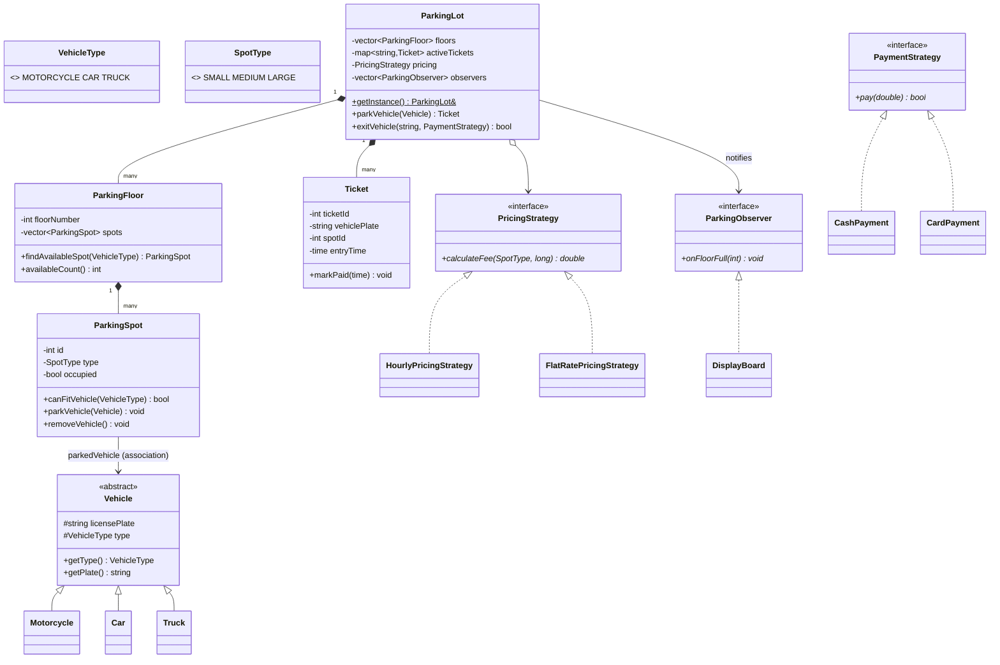
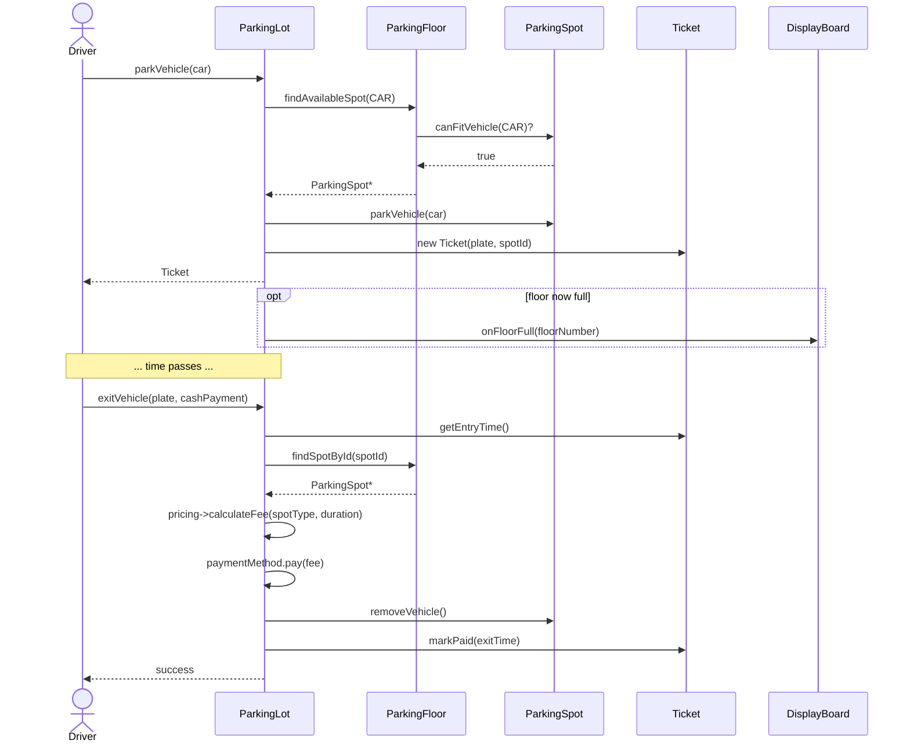

# LLD Notes: Part 7. Building a Full Application — Parking Lot (C++)

---

## Table of Contents

1. The interview workflow (recap from Part 3)
2. Step 1: Requirements gathering
3. Step 2: Identify entities (nouns → classes)
4. Step 3: Identify relationships
5. Step 4: Identify variation points → map to patterns
6. Step 5: Class diagram
7. Step 6: Full compilable C++ code (tested)
8. Step 7: Sequence diagram (park + exit flow)
9. Step 8: Trace through SOLID
10. Extending the design (how interviewers probe further)
11. Common mistakes in this problem
12. Interview Q&A
13. One-page cheat sheet

---

## 1. The Interview Workflow (Recap from Part 3 §19)

```
1. Clarify requirements (5 min)
2. Identify entities (nouns) and actions (verbs)
3. Assign responsibilities (SRP)
4. Decide relationships (association / aggregation / composition / inheritance)
5. Find variation points -> introduce interfaces + name the pattern (OCP, DIP)
6. Add multiplicity, draw the class diagram
7. Walk one flow through a sequence diagram
8. Write the code
9. Discuss trade-offs and extensions
```
This file follows exactly that order for **Parking Lot**, the most commonly asked LLD problem.

---

## 2. Step 1: Requirements Gathering

**What to ask the interviewer (say these out loud — it's part of the evaluation):**
- How many **floors**? How many **spot types** (motorcycle/compact/large)?
- Which **vehicle types** are supported, and what's the **fit rule** (can a motorcycle park in a large spot)?
- Is this **multi-entry/multi-exit** (multiple gates)?
- How is **pricing** calculated — flat, hourly, per-vehicle-type?
- What **payment methods**?
- Do we need a **display board** showing available spots per floor?
- Scale: how many spots total? (affects whether we need indexing/concurrency)

**Functional requirements (typical, assume these if interviewer doesn't specify)**
1. Support multiple floors, each with spots of different sizes (SMALL, MEDIUM, LARGE).
2. Support multiple vehicle types (MOTORCYCLE, CAR, TRUCK) with fit rules:
   - Motorcycle → any spot
   - Car → MEDIUM or LARGE
   - Truck → LARGE only
3. On entry: assign the **nearest/first available** suitable spot, issue a **ticket**.
4. On exit: calculate fee based on **duration and spot type**, accept payment, free the spot.
5. Show **real-time availability**; notify a display board when a floor becomes full.
6. Support different **pricing strategies** (hourly, flat-rate) — this should be easy to swap/extend.

**Non-functional requirements**
- Extensible: adding a new vehicle type or pricing scheme shouldn't require rewriting core logic (**OCP**).
- Thread-safety for concurrent entry (mentioned as an extension in section 10; kept simple in the base design).

> ⚡ **Quick Recall**
> Always restate requirements before designing. It shows structured thinking and avoids solving the wrong problem.

---

## 3. Step 2: Identify Entities (Nouns → Classes)

| Noun from requirements | Class | Responsibility (SRP) |
|---|---|---|
| Vehicle, Motorcycle, Car, Truck | `Vehicle` hierarchy | Represents a vehicle and its type |
| Parking Spot | `ParkingSpot` | Tracks occupancy, fits-check for a vehicle type |
| Floor | `ParkingFloor` | Owns a set of spots, finds an available one |
| Ticket | `Ticket` | Records entry/exit time, spot, status |
| Pricing rule | `PricingStrategy` (+ implementations) | Calculates fee — **varies**, so it's an interface |
| Payment method | `PaymentStrategy` (+ implementations) | Processes payment — **varies**, so it's an interface |
| Display board | `ParkingObserver` (+ `DisplayBoard`) | Reacts to floor-full events |
| The parking lot itself | `ParkingLot` | Orchestrates floors, tickets, parking/exit flow — **exactly one** of these exists |

**Verbs → candidate methods:** park, exit/unpark, findAvailableSpot, calculateFee, pay, notify.

---

## 4. Step 3: Identify Relationships

| Pair | Relationship | Why (using the Part 3 test: *delete the container — does the part still make sense?*) |
|---|---|---|
| `ParkingLot` *— `ParkingFloor`* | **Composition** ◆ | Floors don't exist independently of the lot that defines them |
| `ParkingFloor` *— `ParkingSpot`* | **Composition** ◆ | A spot is meaningless without its floor in this model |
| `ParkingSpot` *— `Vehicle`* | **Association** → | Spot holds a **non-owning** reference while parked; vehicle exists independently (owned by its driver/the caller) |
| `ParkingLot` *— `Ticket`* | **Composition** ◆ | The lot owns active tickets; a ticket has no life outside the lot's records |
| `ParkingLot` *— `PricingStrategy`* | **Dependency/Association** (via DIP) | The lot holds one strategy at a time, swappable |
| `ParkingLot` *— `ParkingObserver`* | **Association** → | Observers are attached from outside, lot doesn't own their lifetime |
| `Motorcycle`/`Car`/`Truck` *— `Vehicle`* | **Inheritance** ▷ | Is-a relationship, each vehicle type IS a `Vehicle` |
| `CashPayment`/`CardPayment` *— `PaymentStrategy`* | **Realization** ┄▷ | Implements the payment contract |

---

## 5. Step 4: Identify Variation Points → Map to Patterns

This is the step interviewers weight most heavily — recognizing **where requirements say "varies" or "multiple kinds of"** and reaching for the right pattern (Part 2 OCP/DIP, Parts 4-6 patterns).

| Requirement signal | Variation point | Pattern | Why |
|---|---|---|---|
| "different pricing strategies, hourly or flat-rate" | How fee is calculated | **Strategy** | Swappable algorithm, same interface, no `if/switch` in `ParkingLot` |
| "different payment methods" | How payment is processed | **Strategy** | Same reasoning |
| "notify display board when floor is full" | Reacting to state changes | **Observer** | Lot shouldn't know concrete display types; broadcast to any listener |
| "exactly one parking lot system running" | Single shared instance | **Singleton** | One `ParkingLot` instance coordinates everything (Meyers' Singleton, Part 4) |
| "different vehicle types with different fit rules" | Vehicle hierarchy | **Inheritance** (not a GoF pattern here — plain OOP is enough; no behavior varies **polymorphically** beyond the `type` field, so Factory is optional, not required) | Avoid overusing patterns — YAGNI (Part 2 §8) |

**What I'd explicitly say in the interview:**
> *"Pricing and payment are the two places the requirements say 'different kinds of X', so I'll use Strategy for both — that satisfies OCP, since adding a new pricing model later means adding a class, not editing `ParkingLot`. The display board reacting to lot state is a textbook Observer. I'm keeping vehicle types as a simple inheritance hierarchy rather than reaching for a Factory, since there's no complex creation logic to hide yet — I'd introduce one if vehicle creation grew more involved."*

This is exactly the judgment call from **Part 2 §8 (when NOT to apply SOLID/patterns)** — naming patterns only where the requirements justify them.

---

## 6. Step 5: Class Diagram



**ASCII summary (for quick copy into notes)**
```
Vehicle <|-- Motorcycle, Car, Truck

ParkingLot (Singleton)
   *-- ParkingFloor (1 .. many)         composition
         *-- ParkingSpot (1 .. many)    composition
               --> Vehicle              association (non-owning)
   *-- Ticket (1 .. many, active)       composition
   o--> PricingStrategy                 Strategy pattern
   --> ParkingObserver                  Observer pattern

PricingStrategy <|.. HourlyPricingStrategy, FlatRatePricingStrategy
PaymentStrategy <|.. CashPayment, CardPayment
ParkingObserver <|.. DisplayBoard
```

---

## 7. Step 6: Full Compilable C++ Code (Tested)

> **This code was compiled with `g++ -std=c++17 -Wall -Wextra` and run successfully** — the output below is real, not hypothetical.

```cpp
#include <bits/stdc++.h>
using namespace std;

// ===================== Enums =====================
enum class VehicleType { MOTORCYCLE, CAR, TRUCK };
enum class SpotType    { SMALL, MEDIUM, LARGE };
enum class TicketStatus { ACTIVE, PAID };

// ===================== Vehicle hierarchy =====================
class Vehicle {
protected:
    string licensePlate;
    VehicleType type;
public:
    Vehicle(string plate, VehicleType t) : licensePlate(move(plate)), type(t) {}
    virtual ~Vehicle() = default;
    VehicleType getType() const { return type; }
    const string& getPlate() const { return licensePlate; }
};
class Motorcycle : public Vehicle { public: explicit Motorcycle(string p) : Vehicle(move(p), VehicleType::MOTORCYCLE) {} };
class Car        : public Vehicle { public: explicit Car(string p)        : Vehicle(move(p), VehicleType::CAR) {} };
class Truck      : public Vehicle { public: explicit Truck(string p)      : Vehicle(move(p), VehicleType::TRUCK) {} };

// ===================== ParkingSpot =====================
class ParkingSpot {
    int id;
    SpotType type;
    bool occupied = false;
    Vehicle* parkedVehicle = nullptr;        // association: spot doesn't own the vehicle
public:
    ParkingSpot(int id, SpotType t) : id(id), type(t) {}

    bool isOccupied() const { return occupied; }
    SpotType getType() const { return type; }
    int getId() const { return id; }

    bool canFitVehicle(VehicleType vt) const {
        if (occupied) return false;
        switch (vt) {
            case VehicleType::MOTORCYCLE: return true;                                   // fits anywhere
            case VehicleType::CAR:        return type == SpotType::MEDIUM || type == SpotType::LARGE;
            case VehicleType::TRUCK:      return type == SpotType::LARGE;
        }
        return false;
    }

    void parkVehicle(Vehicle* v) { parkedVehicle = v; occupied = true; }
    void removeVehicle()         { parkedVehicle = nullptr; occupied = false; }
    Vehicle* getParkedVehicle() const { return parkedVehicle; }
};

// ===================== Ticket =====================
class Ticket {
    static inline int counter = 0;
    int ticketId;
    string vehiclePlate;
    int spotId;
    time_t entryTime;
    time_t exitTime = 0;
    TicketStatus status = TicketStatus::ACTIVE;
public:
    Ticket(string plate, int spot) : ticketId(++counter), vehiclePlate(move(plate)), spotId(spot) {
        entryTime = time(nullptr);
    }
    int getId() const { return ticketId; }
    int getSpotId() const { return spotId; }
    time_t getEntryTime() const { return entryTime; }
    void markPaid(time_t exit) { exitTime = exit; status = TicketStatus::PAID; }
    TicketStatus getStatus() const { return status; }
};

// ===================== Pricing: STRATEGY pattern =====================
class PricingStrategy {
public:
    virtual double calculateFee(SpotType type, long durationHours) const = 0;
    virtual ~PricingStrategy() = default;
};
class HourlyPricingStrategy : public PricingStrategy {
public:
    double calculateFee(SpotType type, long durationHours) const override {
        double rate = (type == SpotType::SMALL) ? 10.0 : (type == SpotType::MEDIUM) ? 20.0 : 30.0;
        return max<long>(1, durationHours) * rate;    // minimum 1 hour charged
    }
};
class FlatRatePricingStrategy : public PricingStrategy {
public:
    double calculateFee(SpotType, long) const override { return 50.0; }
};

// ===================== Payment: STRATEGY pattern =====================
class PaymentStrategy {
public:
    virtual bool pay(double amount) = 0;
    virtual ~PaymentStrategy() = default;
};
class CashPayment : public PaymentStrategy {
public:
    bool pay(double amount) override { cout << "Paid Rs " << amount << " by cash\n"; return true; }
};
class CardPayment : public PaymentStrategy {
public:
    bool pay(double amount) override { cout << "Paid Rs " << amount << " by card\n"; return true; }
};

// ===================== ParkingFloor =====================
class ParkingFloor {
    int floorNumber;
    vector<unique_ptr<ParkingSpot>> spots;
public:
    // globalSpotId is passed by reference so spot ids stay UNIQUE ACROSS FLOORS (needed for exit lookup)
    ParkingFloor(int num, int small, int medium, int large, int& globalSpotId) : floorNumber(num) {
        for (int i = 0; i < small;  i++) spots.push_back(make_unique<ParkingSpot>(globalSpotId++, SpotType::SMALL));
        for (int i = 0; i < medium; i++) spots.push_back(make_unique<ParkingSpot>(globalSpotId++, SpotType::MEDIUM));
        for (int i = 0; i < large;  i++) spots.push_back(make_unique<ParkingSpot>(globalSpotId++, SpotType::LARGE));
    }

    ParkingSpot* findAvailableSpot(VehicleType vt) {
        for (auto& s : spots) if (s->canFitVehicle(vt)) return s.get();
        return nullptr;
    }
    ParkingSpot* findSpotById(int id) {
        for (auto& s : spots) if (s->getId() == id) return s.get();
        return nullptr;
    }
    int getFloorNumber() const { return floorNumber; }
    int availableCount() const {
        return count_if(spots.begin(), spots.end(), [](auto& s){ return !s->isOccupied(); });
    }
};

// ===================== Observer pattern: notify displays when full =====================
class ParkingObserver {
public:
    virtual void onFloorFull(int floorNumber) = 0;
    virtual ~ParkingObserver() = default;
};
class DisplayBoard : public ParkingObserver {
public:
    void onFloorFull(int floorNumber) override {
        cout << "[DisplayBoard] Floor " << floorNumber << " is FULL\n";
    }
};

// ===================== ParkingLot: Singleton (Meyers') =====================
class ParkingLot {
    vector<unique_ptr<ParkingFloor>> floors;
    unordered_map<string, unique_ptr<Ticket>> activeTickets;   // plate -> ticket
    unique_ptr<PricingStrategy> pricing;
    vector<ParkingObserver*> observers;
    int nextSpotId = 0;                              // keeps spot ids unique ACROSS floors

    ParkingLot() : pricing(make_unique<HourlyPricingStrategy>()) {}   // private ctor (Part 4 Singleton)

public:
    ParkingLot(const ParkingLot&) = delete;
    ParkingLot& operator=(const ParkingLot&) = delete;

    static ParkingLot& getInstance() {
        static ParkingLot instance;                 // Meyers' Singleton, thread-safe since C++11
        return instance;
    }

    void addFloor(int floorNum, int small, int medium, int large) {
        floors.push_back(make_unique<ParkingFloor>(floorNum, small, medium, large, nextSpotId));
    }
    void setPricingStrategy(unique_ptr<PricingStrategy> p) { pricing = move(p); }   // swap strategy at runtime
    void attach(ParkingObserver* o) { observers.push_back(o); }

    Ticket* parkVehicle(Vehicle* v) {
        for (auto& floor : floors) {
            ParkingSpot* spot = floor->findAvailableSpot(v->getType());
            if (spot) {
                spot->parkVehicle(v);
                auto ticket = make_unique<Ticket>(v->getPlate(), spot->getId());
                Ticket* raw = ticket.get();
                activeTickets[v->getPlate()] = move(ticket);
                cout << "Parked " << v->getPlate() << " at floor " << floor->getFloorNumber()
                     << ", spot " << spot->getId() << "\n";
                if (floor->availableCount() == 0)                               // OBSERVER notification
                    for (auto* obs : observers) obs->onFloorFull(floor->getFloorNumber());
                return raw;
            }
        }
        cout << "No available spot for " << v->getPlate() << "\n";
        return nullptr;
    }

    bool exitVehicle(const string& plate, PaymentStrategy& paymentMethod) {
        auto it = activeTickets.find(plate);
        if (it == activeTickets.end()) { cout << "No active ticket for " << plate << "\n"; return false; }

        Ticket* ticket = it->second.get();
        time_t exitTime = time(nullptr);
        long durationSeconds = static_cast<long>(difftime(exitTime, ticket->getEntryTime()));
        long durationHours = max<long>(1, durationSeconds / 3600);

        ParkingSpot* spot = nullptr;                      // find the occupied spot across floors
        for (auto& floor : floors) {
            spot = floor->findSpotById(ticket->getSpotId());
            if (spot && spot->isOccupied()) break;
            spot = nullptr;
        }
        if (!spot) { cout << "Internal error: spot not found\n"; return false; }

        double fee = pricing->calculateFee(spot->getType(), durationHours);     // STRATEGY: pricing
        bool success = paymentMethod.pay(fee);                                  // STRATEGY: payment
        if (success) {
            ticket->markPaid(exitTime);
            spot->removeVehicle();
            activeTickets.erase(it);
            cout << "Vehicle " << plate << " exited. Fee: Rs " << fee << "\n";
        }
        return success;
    }
};

// ===================== main: demo =====================
int main() {
    ParkingLot& lot = ParkingLot::getInstance();
    lot.addFloor(1, /*small*/2, /*medium*/2, /*large*/1);

    DisplayBoard board;
    lot.attach(&board);

    Motorcycle m1("MH-01-AA-1111");
    Car c1("MH-01-BB-2222");
    Truck t1("MH-01-CC-3333");

    lot.parkVehicle(&m1);
    lot.parkVehicle(&c1);
    lot.parkVehicle(&t1);

    CashPayment cash;
    lot.exitVehicle("MH-01-BB-2222", cash);

    return 0;
}
```

**Actual program output (verified by compiling and running):**
```
Parked MH-01-AA-1111 at floor 1, spot 0
Parked MH-01-BB-2222 at floor 1, spot 2
Parked MH-01-CC-3333 at floor 1, spot 4
Paid Rs 20 by cash
Vehicle MH-01-BB-2222 exited. Fee: Rs 20
```

**Why those spot numbers:** floor 1 was built with 2 SMALL (ids 0-1), 2 MEDIUM (ids 2-3), 1 LARGE (id 4). The motorcycle takes the first available spot overall (id 0, a SMALL spot — motorcycles fit anywhere, and `findAvailableSpot` returns the **first** match). The car needs MEDIUM/LARGE, so it skips the SMALL spots and takes id 2. The truck needs LARGE, so it takes id 4. The car's fee is `max(1, hours) * 20` (MEDIUM rate) = **Rs 20** for ≤1 hour, which matches the output.

---

## 8. Step 7: Sequence Diagram (Park + Exit Flow)



This diagram **validates** the class diagram: every message corresponds to a real method in the code above. If a message had no matching method, that would be a sign the class diagram was incomplete (Part 3 §16.3).

---

## 9. Step 8: Trace Through SOLID

Say this explicitly in an interview — it shows you're applying Part 2 deliberately, not by accident.

| Principle | Where it shows up |
|---|---|
| **SRP** | `ParkingSpot` only tracks occupancy/fit. `Ticket` only records timing/status. `ParkingLot` only orchestrates — it delegates fee calculation and payment to strategies, and spot-finding to floors |
| **OCP** | Adding `ValetPricingStrategy` or `UPIPayment` = new class implementing the interface; `ParkingLot` is untouched. Adding `Bus` as a vehicle type = new subclass of `Vehicle` |
| **LSP** | Every `Vehicle` subtype can be passed to `parkVehicle(Vehicle*)` without special-casing (no subtype throws "unsupported" or breaks the fit-check contract) |
| **ISP** | `PricingStrategy` and `PaymentStrategy` are separate, narrow interfaces — a pricing implementation never needs to know about payment methods |
| **DIP** | `ParkingLot` depends on `PricingStrategy&`/`PaymentStrategy&` abstractions, not concrete classes; `CashPayment` is passed in from `main` (the composition root), not `new`'d inside `ParkingLot` |

**Patterns used and why (recap):**
- **Singleton** (Part 4): exactly one `ParkingLot` coordinates the whole system.
- **Strategy** (Part 6A): pricing and payment both vary independently of the core flow.
- **Observer** (Part 6A): the display board reacts to floor-full events without `ParkingLot` knowing its concrete type.

---

## 10. Extending the Design (How Interviewers Probe Further)

Interviewers almost always ask **one or two follow-ups**. Here's how each maps back to earlier parts of these notes:

| Follow-up question | How to answer |
|---|---|
| "What if two gates try to park in the same spot simultaneously?" | Add a `mutex` guarding `findAvailableSpot` + `parkVehicle` as one atomic critical section (a classic **thread-safety** extension — same concern as the Singleton/Object Pool thread-safety discussion in Part 4) |
| "How would you support reserved/VIP spots?" | Add a `SpotType::RESERVED` or a separate `ReservationStrategy`, or give `ParkingSpot` an `isReservedFor(Vehicle*)` check — another **Strategy** |
| "How would you find the nearest available spot to the entrance, not just the first one?" | Change `findAvailableSpot`'s search policy — itself a candidate for a **Strategy** (`SpotAssignmentStrategy`: nearest-first, random, floor-balanced) |
| "How do you support multiple entry gates printing tickets simultaneously?" | Each gate is a separate object calling the shared `ParkingLot::getInstance()`; ticket ID generation must be thread-safe (`atomic<int>` instead of a plain counter) |
| "What if a floor should notify when it becomes *available* again, not just full?" | Extend `ParkingObserver` with `onSpotAvailable(int floorNumber)` — adding a method to an existing interface, which is a **minor ISP/OCP trade-off** worth naming out loud |
| "How would you persist tickets/payments to a database?" | Introduce a `TicketRepository` interface (DIP) that `ParkingLot` depends on; a `SQLTicketRepository` implementation plugs in without changing `ParkingLot`'s core logic — this is the same idea as the `Database` abstraction in Part 2's DIP example |

**General interview tip:** when asked "how would you extend this for X", the strong answer is almost always *"I'd introduce an interface for the varying part and inject an implementation"* — i.e., reach for **Strategy + DIP** again. Naming this pattern explicitly is what separates a strong answer from a vague one.

---

## 11. Common Mistakes in This Problem

| Mistake | Why it's wrong | Fix |
|---|---|---|
| Giant `if/else` on vehicle type inside `ParkingLot` for fee calculation | Violates OCP; scattered logic | Push the fit-check into `ParkingSpot::canFitVehicle`, fee logic into `PricingStrategy` |
| Making `ParkingSpot` know about `ParkingLot` | Backwards dependency, unnecessary coupling | Spot only needs to know about itself and the vehicle it holds |
| Using raw `new`/`delete` for floors/spots | Memory leaks, unclear ownership | `unique_ptr` for owned composition relationships (Part 1 §15) |
| Making `ParkingLot` a plain static-method class instead of a real Singleton object | Can't implement interfaces, can't be mocked/injected for testing, can't be lazily configured | Use Meyers' Singleton (Part 4 §2.5) so it's a genuine object |
| Forgetting a **virtual destructor** on `Vehicle`, `PricingStrategy`, `PaymentStrategy`, `ParkingObserver` | Deleting through a base pointer without it is undefined behavior (Part 1 §5) | Every polymorphic base class needs `virtual ~Base() = default;` |
| Reusing spot IDs per floor (0, 1, 2... on every floor) | ID collisions make `findSpotById` ambiguous across floors | Use a single global counter across all floors (as fixed in this file's tested code) |
| Hardcoding `CashPayment` inside `ParkingLot::exitVehicle` | DIP violation, can't swap payment method | Pass `PaymentStrategy&` in as a parameter (dependency injection, Part 2 §5) |

---

## 12. Interview Q&A

**Q1. Why is `ParkingLot` a Singleton here?**
Exactly one parking lot system should coordinate all floors, spots, and active tickets — multiple instances would cause inconsistent state (double-booking a spot, for example).

**Q2. Why Strategy for pricing instead of a method with an enum/switch?**
The requirements explicitly say "different pricing strategies" — a direct OCP signal. A switch-based approach means editing `ParkingLot` for every new pricing scheme; Strategy means adding a class.

**Q3. Why is `ParkingSpot`'s reference to `Vehicle` an association and not composition?**
The vehicle exists independently of the spot (it existed before parking and continues to exist after leaving) — composition would be wrong since the vehicle's lifetime isn't tied to the spot's.

**Q4. How would you handle a motorcycle parking in a large spot when no small spot is available — is that wasteful?**
Yes, and it's a legitimate design discussion: either accept the inefficiency for simplicity, or implement an **assignment Strategy** that tries smallest-fitting-spot-first rather than just "first available" — worth mentioning as a trade-off even if you don't fully implement it.

**Q5. Why does `ParkingFloor` use `unique_ptr<ParkingSpot>` but `ParkingSpot` uses a raw `Vehicle*`?**
`ParkingFloor` **owns** its spots (composition — spots don't make sense outside their floor), so `unique_ptr` is correct. `ParkingSpot` does **not** own the vehicle (association — the vehicle exists independently), so a non-owning raw pointer is correct. This is a direct application of the ownership decision tree from Part 3 §14.

**Q6. How would you add support for EV charging spots?**
Add `SpotType::EV_CHARGING` (or a separate `bool hasCharger` flag on `ParkingSpot`), extend `canFitVehicle`'s logic or add a parallel `canCharge(VehicleType)` check — shows the fit-rule logic was already isolated in one method, so it's a contained change (**OCP** in action).

**Q7. What would you change to make this thread-safe for concurrent `parkVehicle` calls?**
Wrap the spot-search-and-assign sequence in `parkVehicle` in a `mutex` (or use a lock-free structure), since "find an available spot" and "mark it occupied" must be atomic together, otherwise two threads could both find and claim the same spot.

**Q8. Where's the Observer pattern and what problem does it solve here?**
`ParkingLot` holds a list of `ParkingObserver*` and calls `onFloorFull()` when a floor fills up, without knowing the display board's concrete type — new kinds of observers (an SMS alert, a mobile push notification) can be added without touching `ParkingLot`.

**Q9. Why aren't `Motorcycle`/`Car`/`Truck` using a Factory pattern?**
There's no complex creation logic to hide — construction is a one-line call with a license plate. A Factory would be premature abstraction (**YAGNI**, Part 2 §8); it would make sense if, say, vehicle creation needed to read from a registration database or apply business rules.

**Q10. How does this design demonstrate DIP specifically?**
`ParkingLot::exitVehicle` takes a `PaymentStrategy&` parameter rather than constructing a `CashPayment` internally — the caller (composition root, i.e. `main`) decides the concrete payment method, and `ParkingLot` only depends on the abstraction.

---

## 13. One-Page Cheat Sheet

```
WORKFLOW : requirements -> entities (nouns) -> relationships -> variation points -> patterns ->
           class diagram -> sequence diagram -> code -> SOLID trace -> extensions

ENTITIES : Vehicle(+Motorcycle/Car/Truck) | ParkingSpot | ParkingFloor | Ticket |
           PricingStrategy | PaymentStrategy | ParkingObserver | ParkingLot

RELATIONSHIPS
  ParkingLot   *-- ParkingFloor *-- ParkingSpot     (composition: owned, dies with parent)
  ParkingSpot  --> Vehicle                          (association: non-owning, independent lifetime)
  Vehicle hierarchy                                 (inheritance: is-a)
  PricingStrategy/PaymentStrategy implementations   (realization: implements contract)

PATTERNS USED
  Singleton (Part 4)  : exactly ONE ParkingLot        -> Meyers' static-local instance
  Strategy  (Part 6A)  : pricing AND payment vary      -> interface + injected implementation
  Observer  (Part 6A)  : display board reacts to state -> list<Observer*> + notify loop

SOLID TRACE
  SRP: each class does ONE job (spot tracks occupancy, ticket tracks time, lot orchestrates)
  OCP: new pricing/payment/vehicle type = new class, ParkingLot untouched
  LSP: every Vehicle subtype substitutable in parkVehicle(Vehicle*)
  ISP: PricingStrategy and PaymentStrategy kept separate, narrow
  DIP: ParkingLot depends on Strategy& abstractions, injected from main (composition root)

COMMON BUGS TO AVOID
  - spot IDs must be unique ACROSS floors (global counter), not per-floor
  - every polymorphic base needs a virtual destructor
  - own with unique_ptr (composition), reference with raw ptr (association)
  - don't new a concrete Strategy inside ParkingLot -- inject it

TYPICAL FOLLOW-UPS -> answer with "introduce an interface + inject it" (Strategy + DIP) almost always:
  thread safety -> mutex around find+assign | nearest-spot assignment -> SpotAssignmentStrategy
  persistence -> TicketRepository interface | new observer event -> extend ParkingObserver
```

---
