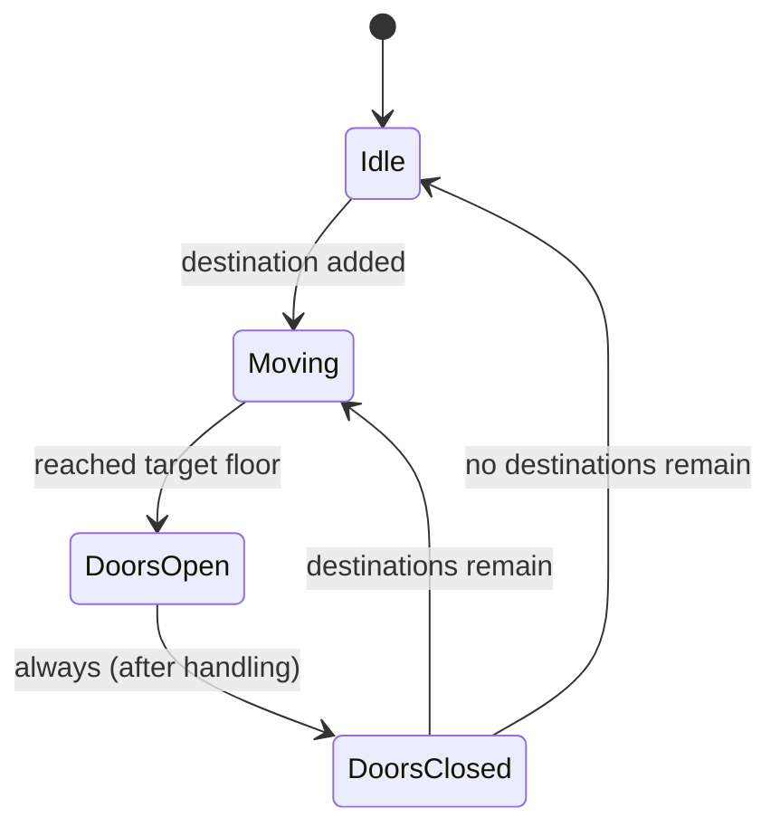
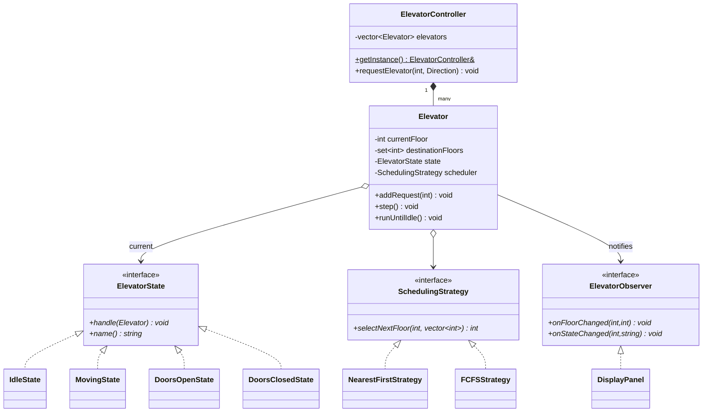
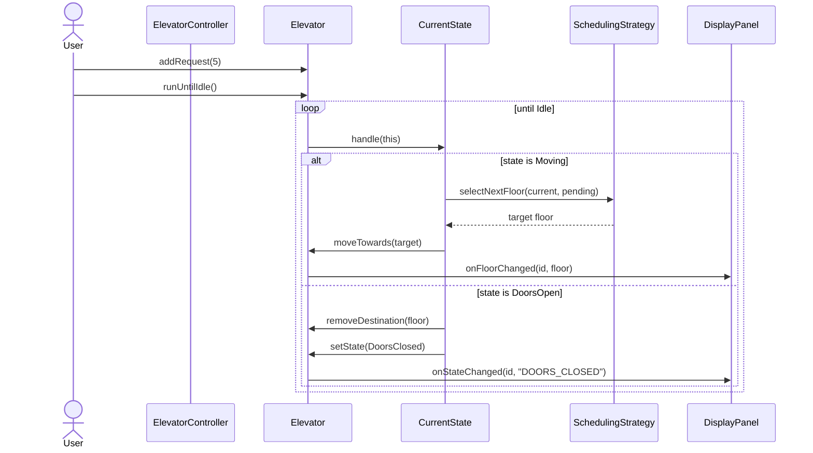
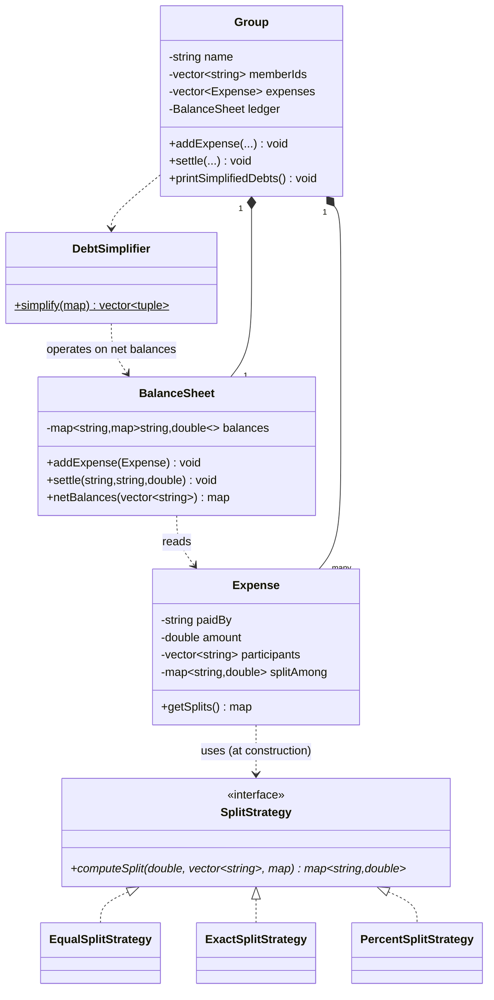
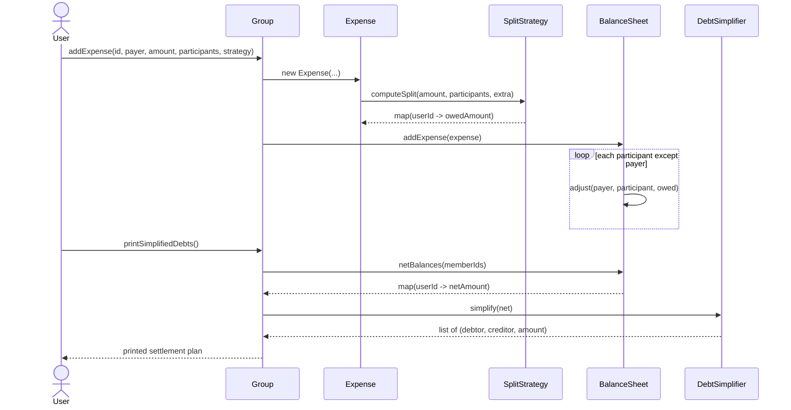

# LLD Notes: Part 8. Building Full Applications — Elevator System & Splitwise (C++)

---

## Table of Contents

**A. Elevator System**
1. Requirements
2. Entities and relationships
3. Variation points → patterns
4. Class diagram
5. Full compilable C++ code (tested)
6. A bug I hit while building this (and why it matters for your interview)
7. Sequence diagram
8. SOLID trace
9. Extensions interviewers probe
10. Interview Q&A

**B. Splitwise (Expense Sharing)**
11. Requirements
12. Entities and relationships
13. Variation points → patterns
14. Class diagram
15. Full compilable C++ code (tested)
16. The debt-simplification algorithm, explained
17. Sequence diagram
18. SOLID trace
19. Extensions interviewers probe
20. Interview Q&A

21. One-page cheat sheet (both problems)

---

# A. Elevator System

## 1. Requirements

**Clarifying questions to ask:**
- How many elevators, how many floors?
- Internal requests (button inside car) vs external/hall requests (button on each floor, with direction)?
- Scheduling policy: nearest-first? Direction-aware (SCAN/LOOK algorithm, like a disk scheduler)? First-come-first-served?
- Does the elevator serve requests **in the direction it's already moving** before reversing (real elevator behavior), or stop-and-go per request?
- Multiple elevators — how is a hall call **dispatched** to the best elevator?
- Door behavior: auto-close after a delay? Obstruction sensor?

**Functional requirements (assumed for this design)**
1. Multiple elevators, each independently moves between floors.
2. Each elevator has a **state**: Idle, Moving, Doors Open, Doors Closed — behavior depends on current state.
3. Requests (internal button press or external hall call) are queued as **destination floors**.
4. A **scheduling strategy** decides which pending floor to serve next — this should be swappable (nearest-first now, SCAN algorithm later).
5. A **display panel** shows each elevator's current floor and state — notified automatically on change.
6. A central **controller** dispatches hall calls to the best-positioned elevator among several.

**Non-functional:** extensible scheduling policy (OCP), observable state for displays/monitoring, thread-safety is a noted extension (section 9).

---

## 2. Entities and Relationships

| Noun | Class | Responsibility |
|---|---|---|
| Elevator | `Elevator` | Tracks floor, direction, door state, destinations; delegates behavior to current state |
| Elevator's behavior per mode | `ElevatorState` (+ 4 concrete states) | Encapsulates what happens in Idle / Moving / Doors Open / Doors Closed |
| How to pick the next floor | `SchedulingStrategy` (+ implementations) | Varies — nearest-first, FCFS, (SCAN as an extension) |
| Floor/direction display | `ElevatorObserver` (+ `DisplayPanel`) | Reacts to floor and state changes |
| Coordinator for multiple elevators | `ElevatorController` | Exactly one; dispatches hall calls to the best elevator |

**Relationships**
| Pair | Relationship | Why |
|---|---|---|
| `Elevator` *— `ElevatorState`* | **Composition** ◆ (current state) | The current state object has no meaning outside its elevator; swapped via `unique_ptr` |
| `Elevator` *— `SchedulingStrategy`* | **Dependency/Association** (injected) | Strategy is swappable, doesn't belong to one elevator conceptually |
| `Elevator` *— `ElevatorObserver`* | **Association** → | Observers attached externally, elevator doesn't own their lifetime |
| `ElevatorController` *— `Elevator`* | **Composition** ◆ | The controller owns and creates the elevators it coordinates |
| `IdleState`/`MovingState`/etc. *— `ElevatorState`* | **Realization** ┄▷ | Implements the state contract |

---

## 3. Variation Points → Patterns

| Requirement signal | Pattern | Why |
|---|---|---|
| "behavior depends on current state: idle/moving/doors open/closed" | **State** (Part 6A) | Textbook state machine — matches a UML state diagram directly |
| "scheduling policy should be swappable" | **Strategy** (Part 6A) | Nearest-first vs FCFS vs SCAN, same interface |
| "display panel reacts to floor/state changes" | **Observer** (Part 6A) | Panel shouldn't be hardcoded into the elevator |
| "exactly one controller coordinates all elevators" | **Singleton** (Part 4) | One coordination point |

**What to say in the interview:**
> *"The core of this problem is a state machine — an elevator's behavior is entirely determined by whether it's idle, moving, or with doors open, and each state knows what comes next. That's the State pattern. Scheduling (which floor to serve next) is the one part of the logic likely to change — real elevators use SCAN/LOOK algorithms, interview versions often start simpler — so I'm isolating it behind a Strategy interface from the start."*

---

## 4. Class Diagram





---

## 5. Full Compilable C++ Code (Tested)

> **Compiled and run with `g++ -std=c++17 -Wall -Wextra -Wpedantic`** — zero warnings, verified output below.

```cpp
#include <bits/stdc++.h>
using namespace std;

// ===================== Enums =====================
enum class Direction { UP, DOWN, IDLE };
enum class DoorState { OPEN, CLOSED };

// ===================== Forward decls (file scope — see section 6 for why this matters) =====================
class Elevator;
class IdleState;
class MovingState;
class DoorsOpenState;
class DoorsClosedState;

// ===================== Request =====================
struct Request {
    int floor;
    Direction direction;   // direction the requester wants to go (for external hall calls)
};

// ===================== STATE pattern: ElevatorState =====================
class ElevatorState {
public:
    virtual void handle(Elevator& e) = 0;
    virtual string name() const = 0;
    virtual ~ElevatorState() = default;
};

// ===================== STRATEGY pattern: SchedulingStrategy =====================
class SchedulingStrategy {
public:
    // picks the next destination floor given current floor and pending requests
    virtual int selectNextFloor(int currentFloor, const vector<int>& pendingFloors) const = 0;
    virtual ~SchedulingStrategy() = default;
};
class NearestFirstStrategy : public SchedulingStrategy {
public:
    int selectNextFloor(int currentFloor, const vector<int>& pendingFloors) const override {
        int best = pendingFloors.front();
        int bestDist = abs(best - currentFloor);
        for (int f : pendingFloors) {
            int d = abs(f - currentFloor);
            if (d < bestDist) { bestDist = d; best = f; }
        }
        return best;
    }
};
class FCFSStrategy : public SchedulingStrategy {               // first-come-first-served
public:
    int selectNextFloor(int, const vector<int>& pendingFloors) const override {
        return pendingFloors.front();
    }
};

// ===================== OBSERVER pattern: ElevatorObserver =====================
class ElevatorObserver {
public:
    virtual void onFloorChanged(int elevatorId, int floor) = 0;
    virtual void onStateChanged(int elevatorId, const string& stateName) = 0;
    virtual ~ElevatorObserver() = default;
};
class DisplayPanel : public ElevatorObserver {
public:
    void onFloorChanged(int elevatorId, int floor) override {
        cout << "[Display] Elevator " << elevatorId << " at floor " << floor << "\n";
    }
    void onStateChanged(int elevatorId, const string& stateName) override {
        cout << "[Display] Elevator " << elevatorId << " is now " << stateName << "\n";
    }
};

// ===================== Elevator (Context for State) =====================
class Elevator {
    int id;
    int currentFloor;
    Direction direction = Direction::IDLE;
    DoorState doorState = DoorState::CLOSED;
    set<int> destinationFloors;                    // pending stops (internal + accepted external)
    unique_ptr<ElevatorState> state;
    unique_ptr<SchedulingStrategy> scheduler;
    vector<ElevatorObserver*> observers;

public:
    Elevator(int id, int startFloor, unique_ptr<SchedulingStrategy> s);

    int getId() const { return id; }
    int getCurrentFloor() const { return currentFloor; }
    Direction getDirection() const { return direction; }
    DoorState getDoorState() const { return doorState; }
    const set<int>& getDestinations() const { return destinationFloors; }
    SchedulingStrategy& getScheduler() { return *scheduler; }

    void setState(unique_ptr<ElevatorState> s);
    void setDirection(Direction d) { direction = d; }
    void setDoorState(DoorState d) { doorState = d; }
    void moveTowards(int floor) {
        currentFloor += (floor > currentFloor) ? 1 : (floor < currentFloor ? -1 : 0);
        notifyFloorChanged();
    }
    void removeDestination(int floor) { destinationFloors.erase(floor); }

    void addRequest(int floor) {
        destinationFloors.insert(floor);
        cout << "Elevator " << id << " received request for floor " << floor << "\n";
    }
    void step() { state->handle(*this); }            // delegate to current state (STATE pattern)
    bool isIdle() const { return state->name() == "IDLE"; }
    void runUntilIdle() {                             // simulation driver: ticks the state machine to completion
        step();                                        // kick off from IDLE if there's a pending destination
        while (!isIdle()) step();
    }

    void attach(ElevatorObserver* o) { observers.push_back(o); }
    void notifyFloorChanged() { for (auto* o : observers) o->onFloorChanged(id, currentFloor); }
    void notifyStateChanged(const string& name) { for (auto* o : observers) o->onStateChanged(id, name); }
};

// ===================== Concrete States: declared, defined out-of-line below =====================
class IdleState : public ElevatorState {
public:
    string name() const override { return "IDLE"; }
    void handle(Elevator& e) override;
};
class MovingState : public ElevatorState {
public:
    string name() const override { return "MOVING"; }
    void handle(Elevator& e) override;
};
class DoorsOpenState : public ElevatorState {
public:
    string name() const override { return "DOORS_OPEN"; }
    void handle(Elevator& e) override;
};
class DoorsClosedState : public ElevatorState {
public:
    string name() const override { return "DOORS_CLOSED"; }
    void handle(Elevator& e) override;
};

// ---- Out-of-line definitions: each state transitions to the NEXT state (State pattern, Part 6A) ----
void IdleState::handle(Elevator& e) {
    if (!e.getDestinations().empty()) e.setState(make_unique<MovingState>());
}

void MovingState::handle(Elevator& e) {
    if (e.getDestinations().empty()) { e.setState(make_unique<IdleState>()); return; }

    vector<int> pending(e.getDestinations().begin(), e.getDestinations().end());
    int target = e.getScheduler().selectNextFloor(e.getCurrentFloor(), pending);   // STRATEGY: scheduling

    if (e.getCurrentFloor() == target) { e.setState(make_unique<DoorsOpenState>()); return; }

    e.setDirection(target > e.getCurrentFloor() ? Direction::UP : Direction::DOWN);
    e.moveTowards(target);

    if (e.getCurrentFloor() == target) e.setState(make_unique<DoorsOpenState>());
}

void DoorsOpenState::handle(Elevator& e) {
    e.setDoorState(DoorState::OPEN);
    cout << "Elevator " << e.getId() << " doors OPEN at floor " << e.getCurrentFloor() << "\n";
    e.removeDestination(e.getCurrentFloor());
    e.setState(make_unique<DoorsClosedState>());
}

void DoorsClosedState::handle(Elevator& e) {
    e.setDoorState(DoorState::CLOSED);
    if (e.getDestinations().empty()) { e.setDirection(Direction::IDLE); e.setState(make_unique<IdleState>()); }
    else                              e.setState(make_unique<MovingState>());
}

// ===================== Elevator ctor + setState (defined after states exist) =====================
Elevator::Elevator(int id, int startFloor, unique_ptr<SchedulingStrategy> s)
    : id(id), currentFloor(startFloor), state(make_unique<IdleState>()), scheduler(move(s)) {}

void Elevator::setState(unique_ptr<ElevatorState> s) {
    state = move(s);
    notifyStateChanged(state->name());              // OBSERVER: tell displays the state changed
    // Note: setState only TRANSITIONS; it does not auto-run the new state.
    // The caller (runUntilIdle's loop, or the next explicit step()) drives execution.
    // Keeping transition and execution separate avoids unbounded recursion between states.
}

// ===================== ElevatorController: Singleton, coordinates multiple elevators =====================
class ElevatorController {
    vector<unique_ptr<Elevator>> elevators;
    ElevatorController() = default;
public:
    ElevatorController(const ElevatorController&) = delete;
    ElevatorController& operator=(const ElevatorController&) = delete;

    static ElevatorController& getInstance() {
        static ElevatorController instance;
        return instance;
    }

    Elevator& addElevator(int startFloor, unique_ptr<SchedulingStrategy> strategy) {
        int id = static_cast<int>(elevators.size()) + 1;
        elevators.push_back(make_unique<Elevator>(id, startFloor, move(strategy)));
        return *elevators.back();
    }

    // external hall call: pick the "best" idle/nearest elevator (simplified dispatch)
    void requestElevator(int floor, Direction) {
        Elevator* best = nullptr;
        int bestDist = INT_MAX;
        for (auto& e : elevators) {
            int d = abs(e->getCurrentFloor() - floor);
            if (d < bestDist) { bestDist = d; best = e.get(); }
        }
        if (best) best->addRequest(floor);
    }
};

// ===================== main: demo =====================
int main() {
    ElevatorController& controller = ElevatorController::getInstance();
    Elevator& e1 = controller.addElevator(0, make_unique<NearestFirstStrategy>());

    DisplayPanel panel;
    e1.attach(&panel);

    e1.addRequest(5);     // internal button press inside elevator, or routed external call
    e1.runUntilIdle();    // simulate ticks until the elevator finishes this trip and goes idle

    e1.addRequest(2);
    e1.runUntilIdle();

    controller.requestElevator(8, Direction::UP);   // hall call, dispatched to e1 (only elevator)
    e1.runUntilIdle();

    return 0;
}
```

**Actual program output (verified):**
```
Elevator 1 received request for floor 5
[Display] Elevator 1 is now MOVING
[Display] Elevator 1 at floor 1
[Display] Elevator 1 at floor 2
[Display] Elevator 1 at floor 3
[Display] Elevator 1 at floor 4
[Display] Elevator 1 at floor 5
[Display] Elevator 1 is now DOORS_OPEN
Elevator 1 doors OPEN at floor 5
[Display] Elevator 1 is now DOORS_CLOSED
[Display] Elevator 1 is now IDLE
Elevator 1 received request for floor 2
[Display] Elevator 1 is now MOVING
[Display] Elevator 1 at floor 4
[Display] Elevator 1 at floor 3
[Display] Elevator 1 at floor 2
[Display] Elevator 1 is now DOORS_OPEN
Elevator 1 doors OPEN at floor 2
[Display] Elevator 1 is now DOORS_CLOSED
[Display] Elevator 1 is now IDLE
Elevator 1 received request for floor 8
[Display] Elevator 1 is now MOVING
[Display] Elevator 1 at floor 4
...
[Display] Elevator 1 at floor 8
[Display] Elevator 1 is now DOORS_OPEN
Elevator 1 doors OPEN at floor 8
[Display] Elevator 1 is now DOORS_CLOSED
[Display] Elevator 1 is now IDLE
```
The elevator correctly travels 0→5, then 5→2, then 2→8, cycling through `MOVING → DOORS_OPEN → DOORS_CLOSED → IDLE` each trip.

---

## 6. A Bug I Hit While Building This (and Why It Matters for Your Interview)

I'm keeping this in because both mistakes are realistic interview-whiteboard mistakes, not contrived teaching examples.

### Bug 1: `make_unique<class MovingState>()` inside another class's method
My first draft wrote `IdleState::handle` like this:
```cpp
void handle(Elevator& e) override {
    if (!e.getDestinations().empty())
        e.setState(make_unique<class MovingState>());   // BROKEN
}
```
**What went wrong:** writing `class MovingState` *inside a function body* where `MovingState` hasn't been declared yet doesn't refer to the real class — it creates a **new, local, incomplete forward declaration scoped to that function**, unrelated to the real `MovingState` defined later in the file. The compiler error was `invalid use of incomplete type` — a confusing message if you don't know this C++ quirk.

**The fix:** forward-declare all the state classes **at file scope** before any of them are defined (as shown at the top of the code above: `class IdleState; class MovingState; ...`), then declare each state's `handle()` **in the class body** but **define it out-of-line afterward**, once every class it references is fully visible. This is the same "declare now, define later" pattern used for the Visitor pattern in Part 6B and for mutually-referencing classes generally.

**Interview lesson:** when writing a State or Visitor pattern on a whiteboard/IDE with mutually-referencing concrete classes, declare **all** of them first, then fill in bodies after. Don't try to define each state's logic inline as you go.

### Bug 2: `setState` auto-chaining into `handle()` caused incomplete trips
My first working draft had `setState` immediately call the new state's `handle()`:
```cpp
void Elevator::setState(unique_ptr<ElevatorState> s) {
    state = move(s);
    state->handle(*this);     // auto-chain
}
```
Combined with `addRequest()` calling `step()` once per call, the elevator only advanced **one floor per `addRequest` call** — a second request arriving mid-trip would interrupt the first, and the demo ended before any trip completed. Running it produced an elevator that never finished a journey.

**The fix:** separate **transitioning state** from **executing state**. `setState()` now *only* changes `state` and notifies observers — it does not execute the new state. A separate `runUntilIdle()` loop explicitly ticks `step()` until the elevator returns to Idle. This is a cleaner State pattern: the context's "drive the simulation" concern is kept apart from "what does each state do."

**Interview lesson:** when a State pattern's states can trigger immediate, automatic transitions into *each other*, be explicit about **who drives the loop** — the context via an explicit tick/step method (what I used here), versus genuinely event-driven transitions (e.g., a timer firing `doorsOpen → doorsClosed` after N seconds, in a real system). Conflating "transition" with "run" is an easy source of subtle, hard-to-explain bugs — exactly the kind of thing an interviewer will probe if your design has automatic state chaining.

---

## 7. Sequence Diagram



---

## 8. SOLID Trace

| Principle | Where |
|---|---|
| **SRP** | Each state class handles exactly one mode's logic; `SchedulingStrategy` only picks a floor; `Elevator` only orchestrates |
| **OCP** | New scheduling policy (SCAN) = new `SchedulingStrategy` subclass; new state (e.g., `MaintenanceState`) = new `ElevatorState` subclass |
| **LSP** | Every concrete state is substitutable wherever `ElevatorState` is expected — `handle()` never throws "unsupported" |
| **ISP** | `ElevatorObserver` only has the two methods a display genuinely needs |
| **DIP** | `Elevator` depends on `SchedulingStrategy&`/`ElevatorState` abstractions, injected rather than hardcoded |

---

## 9. Extensions Interviewers Probe

| Follow-up | How to answer |
|---|---|
| "Implement the SCAN/LOOK algorithm (serve all requests in current direction before reversing)" | New `ScanStrategy : SchedulingStrategy` that filters `pendingFloors` to those in the current direction first, falling back to the nearest otherwise — no change to `Elevator` |
| "Multiple elevators — how do you pick the best one for a hall call?" | Extend `ElevatorController::requestElevator`'s dispatch logic — itself a candidate for an **Strategy** (`DispatchStrategy`) if it grows complex (e.g., factoring in direction, current load) |
| "Thread safety for concurrent requests?" | Guard `destinationFloors` mutations with a `mutex`, since `addRequest` and `step()` both touch it |
| "Capacity limits (max weight/people)?" | Add a check in `MovingState`/boarding logic; reject requests or hold doors open with an alert — a `CapacityPolicy` Strategy is a clean way to isolate it |
| "Emergency stop / maintenance mode?" | A new `ElevatorState` (`OutOfServiceState`) that ignores `addRequest` — the State pattern already supports this without touching other states |

---

## 10. Interview Q&A (Elevator)

**Q1. Why State instead of a `switch` on an enum?**
Each mode's logic (what happens on `handle()`, what the next state is) stays isolated in its own class; adding a new mode means adding a class, not editing every method that has a switch on the mode.

**Q2. Who decides the next state — the Elevator or the State object?**
The **State object itself**, by calling `e.setState(...)` — this is the defining trait of the GoF State pattern (Part 6A §3.6).

**Q3. Why does `Elevator` hold a `SchedulingStrategy` separately from its `ElevatorState`?**
They vary independently: the mode (idle/moving/doors) is about *what the elevator is currently doing*; the scheduling policy is about *which floor to go to next while moving*. Conflating them would mean every new scheduling policy requires a new `MovingState` subclass — wrong axis of variation.

**Q4. Why is `setState` separated from actually running the new state?**
To avoid unbounded/implicit recursion and to make the control flow explicit — see section 6, Bug 2, for the real failure this caused during development.

**Q5. How would you avoid starvation (a floor request waiting forever under NearestFirst)?**
Worth naming as a real trade-off: pure NearestFirst can starve a far-away floor if closer requests keep arriving. A SCAN-based or aging-aware strategy addresses this — another point in favor of keeping scheduling behind a Strategy interface from the start.

---

# B. Splitwise (Expense Sharing)

## 11. Requirements

**Clarifying questions to ask:**
- Can an expense be split **equally**, by **exact amounts**, or by **percentage**? (Real Splitwise supports all three.)
- Groups of people, or just pairwise expenses?
- Should the system show **simplified** settlements (minimum transactions) or just raw pairwise balances?
- Multi-currency? (Assume single currency for the core design, mention as an extension.)
- Can users **settle up** (record a payment that reduces a debt)?

**Functional requirements (assumed)**
1. Users can be added to a **group**.
2. An expense has a **payer**, a **total amount**, a set of **participants**, and a **split method**.
3. Split methods: **Equal**, **Exact** (explicit amounts per person), **Percentage** — must be easy to add more (OCP signal).
4. The system tracks **pairwise balances** ("who owes whom how much").
5. The system can produce a **simplified settlement plan** — the fewest transactions that settle all debts.
6. Users can **settle up** (record an actual payment), updating balances.

**Non-functional:** split logic must be extensible without touching the expense/ledger core (OCP); balance calculations must stay numerically correct as expenses accumulate.

---

## 12. Entities and Relationships

| Noun | Class | Responsibility |
|---|---|---|
| Person | `User` | Identity (id, name) |
| A shared expense | `Expense` | Who paid, how much, who owes what (computed via a strategy) |
| How to split the bill | `SplitStrategy` (+ Equal/Exact/Percent) | Varies — the central extensibility point |
| Who owes whom | `BalanceSheet` | Pairwise ledger; records expenses and settlements |
| Reducing debts to fewer transactions | `DebtSimplifier` | Pure algorithm, no state of its own |
| A trip/household/event | `Group` | Owns members, expenses, and its own ledger |

**Relationships**
| Pair | Relationship | Why |
|---|---|---|
| `Group` *— `User` (ids)* | **Association** → | Users exist independently of any one group (a person can be in multiple groups) |
| `Group` *— `Expense`* | **Composition** ◆ | An expense recorded in this group has no life outside it |
| `Group` *— `BalanceSheet`* | **Composition** ◆ | The ledger is this group's own derived state |
| `Expense` *— `SplitStrategy`* | **Dependency** (passed into the constructor, not stored) | Used once at creation time to compute the split, then discarded |
| `DebtSimplifier` *— `BalanceSheet`* | **Dependency** | Pure function over the net balances; stateless, no stored reference |

---

## 13. Variation Points → Patterns

| Requirement signal | Pattern | Why |
|---|---|---|
| "split equally, by exact amount, or by percentage" | **Strategy** (Part 6A) | Textbook signal — same interface (`computeSplit`), different algorithms, must stay extensible for new split types (e.g., "by shares") |
| "simplify debts to fewest transactions" | Plain algorithm (not a GoF pattern) | This is a **graph/greedy algorithm** concern, not a structural variation point — correctly *not* forced into a pattern (YAGNI judgment call, Part 2 §8) |

**What to say in the interview:**
> *"The split calculation is the one place the requirements explicitly list multiple interchangeable algorithms, so that's Strategy. Debt simplification is a one-off algorithm, not something that varies by caller — I'm keeping it as a plain static method rather than wrapping it in an unnecessary pattern."*

This is a good moment to show restraint — not every part of a design needs a named pattern.

---

## 14. Class Diagram



---

## 15. Full Compilable C++ Code (Tested)

> **Compiled and run with `g++ -std=c++17 -Wall -Wextra`** — zero warnings, verified output below (and independently cross-checked by hand, section 16).

```cpp
#include <bits/stdc++.h>
using namespace std;

// ===================== User =====================
class User {
    string id, name;
public:
    User(string id, string name) : id(move(id)), name(move(name)) {}
    const string& getId() const { return id; }
    const string& getName() const { return name; }
};

// ===================== STRATEGY pattern: SplitStrategy =====================
// Computes how much EACH participant owes, given the total amount.
class SplitStrategy {
public:
    // returns map<userId, amountOwedByThatUser>
    virtual map<string, double> computeSplit(double totalAmount, const vector<string>& participantIds,
                                               const map<string, double>& extra) const = 0;
    virtual ~SplitStrategy() = default;
};

class EqualSplitStrategy : public SplitStrategy {
public:
    map<string, double> computeSplit(double totalAmount, const vector<string>& participantIds,
                                      const map<string, double>&) const override {
        map<string, double> result;
        double share = totalAmount / static_cast<double>(participantIds.size());
        for (auto& id : participantIds) result[id] = share;
        return result;
    }
};

class ExactSplitStrategy : public SplitStrategy {
public:
    // 'extra' holds the EXACT amount each participant owes; must sum to totalAmount (validated by caller)
    map<string, double> computeSplit(double, const vector<string>& participantIds,
                                      const map<string, double>& extra) const override {
        map<string, double> result;
        for (auto& id : participantIds) result[id] = extra.at(id);
        return result;
    }
};

class PercentSplitStrategy : public SplitStrategy {
public:
    // 'extra' holds the PERCENTAGE each participant owes; must sum to 100 (validated by caller)
    map<string, double> computeSplit(double totalAmount, const vector<string>& participantIds,
                                      const map<string, double>& extra) const override {
        map<string, double> result;
        for (auto& id : participantIds) result[id] = totalAmount * extra.at(id) / 100.0;
        return result;
    }
};

// ===================== Expense =====================
class Expense {
    string id;
    string paidBy;
    double amount;
    vector<string> participants;
    map<string, double> splitAmong;             // userId -> amount owed by that user
public:
    Expense(string id, string paidBy, double amount, vector<string> participants,
            const SplitStrategy& strategy, const map<string, double>& extra = {})
        : id(move(id)), paidBy(move(paidBy)), amount(amount), participants(move(participants)) {
        splitAmong = strategy.computeSplit(amount, this->participants, extra);
    }
    const string& getPaidBy() const { return paidBy; }
    double getAmount() const { return amount; }
    const map<string, double>& getSplits() const { return splitAmong; }
};

// ===================== Balance Sheet: pairwise ledger =====================
// balances[A][B] = amount B owes A  (positive = B owes A; if negative, A owes B)
class BalanceSheet {
    map<string, map<string, double>> balances;
    static constexpr double EPS = 1e-6;
public:
    void addExpense(const Expense& expense) {
        const string& payer = expense.getPaidBy();
        for (auto& [userId, owed] : expense.getSplits()) {
            if (userId == payer) continue;              // payer doesn't owe themself
            adjust(payer, userId, owed);                 // userId owes payer `owed`
        }
    }

    // record that `debtor` owes `creditor` `amount` (net against any existing opposite debt)
    void adjust(const string& creditor, const string& debtor, double amount) {
        balances[creditor][debtor] += amount;
        balances[debtor][creditor] -= amount;
    }

    void settle(const string& payer, const string& receiver, double amount) {
        // payer is paying off what they owe to receiver
        adjust(receiver, payer, -amount);
        cout << payer << " paid " << receiver << " Rs " << amount << " (settled)\n";
    }

    double getBalance(const string& A, const string& B) const {
        // positive => B owes A
        auto itA = balances.find(A);
        if (itA == balances.end()) return 0.0;
        auto itB = itA->second.find(B);
        if (itB == itA->second.end()) return 0.0;
        return itB->second;
    }

    void printAllBalances(const vector<string>& userIds) const {
        for (auto& a : userIds) {
            for (auto& b : userIds) {
                if (a >= b) continue;                      // print each pair once
                double bal = getBalance(a, b);
                if (abs(bal) < EPS) continue;
                if (bal > 0) cout << b << " owes " << a << " Rs " << bal << "\n";
                else         cout << a << " owes " << b << " Rs " << -bal << "\n";
            }
        }
    }

    // net amount this user is owed overall (positive) or owes overall (negative), across everyone
    map<string, double> netBalances(const vector<string>& userIds) const {
        map<string, double> net;
        for (auto& a : userIds) {
            double total = 0;
            for (auto& b : userIds) total += getBalance(a, b);   // sum of what everyone owes 'a'
            net[a] = total;
        }
        return net;
    }
};

// ===================== Debt Simplification =====================
// Reduces a tangle of pairwise debts to a SMALL number of transactions using net balances
// (greedy largest-creditor-vs-largest-debtor matching; see note below on optimality).
class DebtSimplifier {
public:
    static vector<tuple<string, string, double>> simplify(map<string, double> net) {
        vector<tuple<string, string, double>> transactions;
        // Greedy: repeatedly match the largest creditor with the largest debtor.
        // This does NOT always produce the mathematically minimum number of transactions
        // (that's an NP-hard variant related to subset-sum), but it is the standard,
        // simple, interview-acceptable greedy approximation.
        vector<pair<string,double>> creds, debts;
        for (auto& [id, amt] : net) {
            if (amt > 1e-6) creds.push_back({id, amt});
            else if (amt < -1e-6) debts.push_back({id, -amt});   // store as positive "owes this much"
        }
        sort(creds.begin(), creds.end(), [](auto&a, auto&b){ return a.second > b.second; });
        sort(debts.begin(), debts.end(), [](auto&a, auto&b){ return a.second > b.second; });

        size_t i = 0, j = 0;
        while (i < creds.size() && j < debts.size()) {
            double settleAmt = min(creds[i].second, debts[j].second);
            transactions.push_back({debts[j].first, creds[i].first, settleAmt});   // debtor pays creditor
            creds[i].second -= settleAmt;
            debts[j].second -= settleAmt;
            if (creds[i].second < 1e-6) i++;
            if (debts[j].second < 1e-6) j++;
        }
        return transactions;
    }
};

// ===================== Group =====================
class Group {
    string name;
    vector<string> memberIds;
    vector<Expense> expenses;
    BalanceSheet ledger;
public:
    explicit Group(string n) : name(move(n)) {}
    void addMember(const string& id) { memberIds.push_back(id); }

    void addExpense(const string& expenseId, const string& paidBy, double amount,
                     const vector<string>& participants, const SplitStrategy& strategy,
                     const map<string, double>& extra = {}) {
        Expense e(expenseId, paidBy, amount, participants, strategy, extra);
        ledger.addExpense(e);
        expenses.push_back(move(e));
    }

    void settle(const string& payer, const string& receiver, double amount) { ledger.settle(payer, receiver, amount); }

    void printBalances() const {
        cout << "--- Balances in " << name << " ---\n";
        ledger.printAllBalances(memberIds);
    }

    void printSimplifiedDebts() const {
        cout << "--- Simplified settlements in " << name << " ---\n";
        auto net = ledger.netBalances(memberIds);
        auto txns = DebtSimplifier::simplify(net);
        for (auto& [debtor, creditor, amt] : txns)
            cout << debtor << " should pay " << creditor << " Rs " << amt << "\n";
    }
};

// ===================== main: demo =====================
int main() {
    Group trip("Goa Trip");
    trip.addMember("alice"); trip.addMember("bob"); trip.addMember("carol");

    EqualSplitStrategy equalSplit;
    ExactSplitStrategy exactSplit;
    PercentSplitStrategy percentSplit;

    // Alice paid 300 for dinner, split equally among all 3
    trip.addExpense("e1", "alice", 300.0, {"alice", "bob", "carol"}, equalSplit);

    // Bob paid 150 for a cab, split EXACTLY: alice owes 50, carol owes 100
    trip.addExpense("e2", "bob", 150.0, {"alice", "carol"}, exactSplit, {{"alice", 50.0}, {"carol", 100.0}});

    // Carol paid 200 for groceries, split by PERCENT: alice 50%, bob 50%
    trip.addExpense("e3", "carol", 200.0, {"alice", "bob"}, percentSplit, {{"alice", 50.0}, {"bob", 50.0}});

    trip.printBalances();
    trip.printSimplifiedDebts();

    return 0;
}
```

**Actual program output (verified):**
```
--- Balances in Goa Trip ---
bob owes alice Rs 50
--- Simplified settlements in Goa Trip ---
bob should pay alice Rs 50
```

---

## 16. The Debt-Simplification Algorithm, Explained

**Why the output collapses to one line:** three expenses create a tangle of six potential pairwise debts, but once netted out, most of it cancels. Here's the hand-verified trace (also cross-checked independently in Python while building this):

| Expense | Effect on net balance |
|---|---|
| e1: Alice paid 300, equal 3-way split (100 each) | Alice +200 (owed by bob and carol), bob −100, carol −100 |
| e2: Bob paid 150, exact split (alice 50, carol 100) | Bob +150, alice −50, carol −100 |
| e3: Carol paid 200, percent split (alice 50%, bob 50%) | Carol +200, alice −100, bob −100 |
| **Net total** | **Alice: +200−50−100 = +50. Bob: −100+150−100 = −50. Carol: −100−100+200 = 0.** |

Carol's net is exactly **zero** — she neither owes nor is owed anything overall, even though she was involved in all three expenses. The simplifier correctly reduces this to the **single** necessary transaction: **bob pays alice Rs 50**.

**Why "greedy largest-vs-largest" and not a more complex algorithm?**
- Finding the **true minimum** number of transactions to settle a set of net balances is a harder problem (related to subset-sum partitioning, NP-hard in general).
- The greedy approach (always match the biggest creditor against the biggest debtor) is **not always optimal** in transaction count, but it's simple, fast (`O(n log n)`), and is what real-world Splitwise-style systems and most interview solutions use.
- **Say this trade-off out loud in an interview** — naming the NP-hard connection and explaining why you chose the practical greedy approach over an optimal-but-expensive algorithm is a strong signal.

---

## 17. Sequence Diagram



---

## 18. SOLID Trace

| Principle | Where |
|---|---|
| **SRP** | `Expense` only computes/stores a split; `BalanceSheet` only tracks pairwise debt; `DebtSimplifier` only reduces transactions; `Group` only orchestrates |
| **OCP** | A new split type (e.g., "by shares"/weighted) = new `SplitStrategy` subclass; `Expense`/`BalanceSheet`/`Group` all untouched |
| **LSP** | Every `SplitStrategy` returns a valid `map<userId, amount>` summing to the total — none throws "unsupported" or returns a different contract |
| **ISP** | `SplitStrategy` has exactly one method; no implementation is forced to implement something irrelevant |
| **DIP** | `Expense`'s constructor takes `const SplitStrategy&` — it depends on the abstraction, and the concrete strategy is chosen by the caller (`Group::addExpense`'s caller, i.e. `main`) |

---

## 19. Extensions Interviewers Probe

| Follow-up | How to answer |
|---|---|
| "Add a 'split by shares' type (e.g., 2 shares vs 1 share)" | New `ShareSplitStrategy : SplitStrategy` — compute each person's fraction of total shares, multiply by amount. No other class changes |
| "Support multiple currencies" | `Expense` gains a `Currency` field; `BalanceSheet` would need per-currency ledgers (a `map<Currency, BalanceSheet>`), or a `CurrencyConverter` Strategy applied before recording — worth naming as a real complexity jump |
| "What if `extra` amounts don't sum to the total (ExactSplitStrategy)?" | Validate in `Expense`'s constructor or in the strategy itself, throwing/rejecting if the sum doesn't match within an epsilon — a good moment to mention input validation explicitly |
| "How would you persist this to a database?" | Introduce an `ExpenseRepository`/`BalanceRepository` interface (DIP, same idea as Part 7's extension) that `Group` depends on, rather than keeping everything in-memory |
| "How do you handle a user leaving a group with outstanding balances?" | Discuss as a policy decision: block removal until settled, or snapshot their final balance — no single correct answer, but naming the trade-off matters |

---

## 20. Interview Q&A (Splitwise)

**Q1. Why is split calculation a Strategy and not just a method parameter (enum + switch)?**
The requirements explicitly list multiple split types as a defining feature, and new types (shares, custom weights) are a realistic future ask — the textbook OCP signal from Part 2.

**Q2. Why does `Expense` take `const SplitStrategy&` instead of owning a `unique_ptr<SplitStrategy>`?**
The strategy is only needed **once**, at construction time, to compute the split — `Expense` doesn't need to keep a reference afterward, so a plain reference is both correct and avoids unnecessary ownership (Part 1 §15 ownership decision tree: use what the actual lifetime needs, nothing more).

**Q3. Walk through why `BalanceSheet::adjust` updates both directions.**
`balances[creditor][debtor] += amount` records that debtor owes creditor that much; `balances[debtor][creditor] -= amount` keeps the mirror entry consistent, so `getBalance(A, B)` and `getBalance(B, A)` are always exact negatives of each other — this symmetry is what makes `printAllBalances`'s "only print each pair once" logic correct.

**Q4. Is the debt simplifier guaranteed to produce the minimum number of transactions?**
No — true minimization is a harder (NP-hard-adjacent) problem. The greedy largest-vs-largest approach used here is a standard, practical approximation, and naming that trade-off explicitly is the strong answer.

**Q5. How would `settle()` interact with the simplifier?**
`settle` directly adjusts the pairwise ledger (recording an actual payment), which changes the net balances; a subsequent call to `printSimplifiedDebts()` would naturally reflect the reduced debt, since the simplifier always recomputes from the current `netBalances`.

---

## 21. One-Page Cheat Sheet (Both Problems)

```
ELEVATOR
  Patterns : State (idle/moving/doors) + Strategy (scheduling) + Observer (display) + Singleton (controller)
  Core: Elevator delegates to ElevatorState; states self-transition via e.setState(...)
  Bug to avoid #1: make_unique<class X>() inside a method body creates a LOCAL incomplete type if X
                   isn't forward-declared at FILE SCOPE first. Forward-declare all mutually-referencing
                   classes up top, define handle() bodies out-of-line after all classes exist.
  Bug to avoid #2: don't let setState() auto-run the new state's handle() AND have an external loop
                   also call step() -- separate "transition" from "execute" to avoid partial/garbled runs.
                   Use an explicit runUntilIdle()-style driver loop.

SPLITWISE
  Patterns : Strategy (Equal/Exact/Percent split) -- debt simplification is a PLAIN ALGORITHM, not a pattern
  Core: Expense computes its split via SplitStrategy at construction; BalanceSheet stores SYMMETRIC
        pairwise ledger (balances[A][B] == -balances[B][A]); DebtSimplifier nets everyone's balance
        then greedily matches biggest creditor <-> biggest debtor.
  Know: minimum-transaction settlement is NP-hard-adjacent; greedy is the standard practical approach --
        say so explicitly, don't claim optimality you haven't proven.

BOTH: requirements -> entities -> relationships -> variation points -> patterns -> UML -> code -> SOLID trace -> extensions
      Only name a pattern where the requirements actually signal variation (OCP). Don't force one on a
      one-off algorithm (debt simplification) just to use a "named pattern" -- that's the YAGNI judgment
      call from Part 2 in action.
```

---
